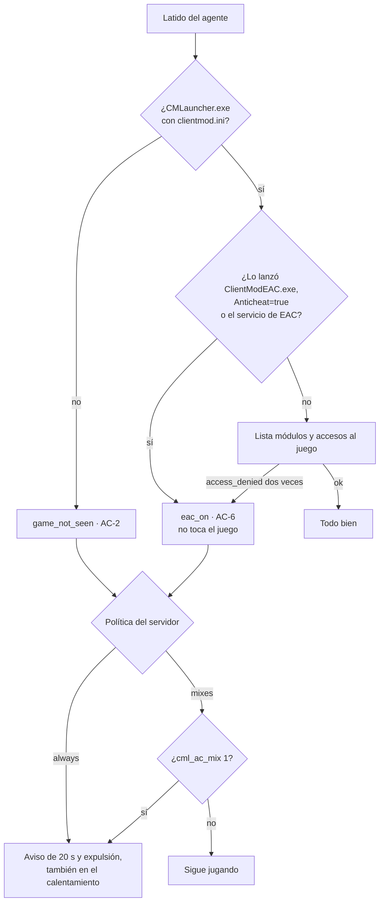

# Plan: anticheat sin el EAC de ClientMod y expulsión obligatoria que funcione

> Planeación original. Estado: **propuesta**, pendiente de aprobación. Pedida por Daniel (2026-11-27) después de revisar `kyan/ac`. Rama `kyan/ac`, sin commit. Sigue a [`2026-11-27-anticheat-deteccion`](../2026-11-27-anticheat-deteccion/PLAN.md) (replanteos `155` a `158`, agente 0.5.0, Bridge 1.2.0).

ClientMod trae **Easy Anti-Cheat de Epic (EOS)**: `ClientModEAC.exe` arranca el servicio de EAC y lanza `CMLauncher.exe`, que queda protegido a nivel del kernel. CM Launcher deja apagarlo (`clientmod.ini` → `Anticheat=false`), y entonces arranca `CMLauncher.exe` directo. Con el EAC prendido, dos funciones del agente 0.5.0 chocan con él: la lista de módulos del juego (pide leer su memoria cada 5 s) y la búsqueda de programas con acceso al juego (copia accesos de otros procesos, que es lo que hacen los cheats para saltarse a EAC). EAC lo puede tomar como un cheat y sancionar al jugador, y además esas dos funciones no ven nada, porque EAC no las deja.

Daniel eligió (2026-11-27) que **el EAC quede prohibido** en nuestros servidores: el jugador juega con el EAC apagado y la protección es nuestro agente, más liviano. En la misma revisión salieron cuatro problemas que hacen que hoy la expulsión obligatoria no funcione; este plan los arregla.

## Decisiones tomadas

| Tema | Decisión | Por qué |
|---|---|---|
| EAC | **Prohibido** (Daniel, 2026-11-27: "desactivarlo para que no intervenga con nuestro anticheat, ya que la idea es que nuestro ac sea mucho más liviano que el EAC") | Sin el EAC, el agente puede ver el juego por dentro sin que nadie lo bloquee ni lo sancione |
| Cómo se ve el EAC | Prendido si se cumple cualquiera de estas: (1) el proceso que lanzó `CMLauncher.exe` es `ClientModEAC.exe`; (2) `Anticheat=true` en el `clientmod.ini` de la carpeta del juego; (3) el servicio `EasyAntiCheat_EOS` está corriendo mientras está el juego; (4) la lista de módulos del juego da `access_denied` dos veces seguidas | (1) a (3) se miran **sin tocar el juego**. Recién si las tres dicen "apagado" se lista lo que hay dentro del juego: así el agente no le pide la memoria a un juego protegido por EAC. No hace falta que sea imposible de engañar: a quien hace trampa le conviene tener el EAC apagado, que es lo que pedimos |
| Qué se manda | El latido suma `game.eac` (`true`, `false` o sin el dato) y `game.eac_why` (`parent`, `ini`, `service` o `denied`) | `eac_why` es para el staff y para medir cuál señal anda |
| Código | `AC-6` (motivo `eac_on`). Expulsa con las mismas reglas que `AC-1` y `AC-2` | Es un error del jugador, no una trampa |
| Qué ve el jugador | **Esta vez sí se le dice qué hacer**: en el chat y en la expulsión, "Desactiva el anticheat de ClientMod (EAC) en CM Launcher y vuelve a abrir el juego (AC-6)". En la ventana del agente, la tarjeta naranja con lo mismo | Decirle que apague el EAC no revela nada de lo que detecta el agente (la regla de Kyan del 2026-11-27 sigue valiendo para todo lo demás). Sin el mensaje, nadie sabría cómo arreglarlo |
| Módulos y accesos al juego | Siempre prendidos con el EAC apagado, con los intervalos de `agent_config` (5 s y 10 s). Se mide cuánto procesador usan antes de dejarlos así | Sin el EAC son la única forma de ver un cheat. La búsqueda de accesos lee la lista de todos los accesos abiertos de Windows: puede pesar |
| Firmas buenas de ClientMod | Un script lee la carpeta de ClientMod (1.5.14) y genera las firmas `good` por **hash** de cada `.dll` y `.exe` (incluido el `steamclient.dll` de RevEmu, empacado y sin firma). Se cargan desde el panel o con SQL, y se repite con cada versión de ClientMod | Las DLL del v34 y de ClientMod no tienen firma digital: sin esto, cada sesión llena el panel con marcas `module_unsigned`. Por hash y no por nombre: un cheat puede llamarse `client.dll` |
| Cuándo es obligatorio | `ac_server_policy.enforce_mixes` pasa a `enforce text`: `off`, `mixes` o `always`. Con `always`, se expulsa a quien no cumple **desde que entra**, también en el calentamiento. **#1, #2 y #3 quedan en `always`** | Hoy el aviso sale recién en el LO3 y la expulsión, 20 s después: en el matchmaking, eso rompe la partida en la primera ronda. Los tres servidores son de partidas, no de juego libre |
| `cml_ac_mix` | Se agrega `cml_ac_mix 1` al final de `cfg/csstv/live.cfg`, como decía el Bridge. Sigue haciendo falta para `mixes` y para `cml_aimstats` | Hoy ningún cfg lo pone en 1: con `mixes`, nadie es expulsado nunca, y `cml_aimstats` no cuenta nada |
| IPv4 contra IPv6 | La base compara la IP del agente con la del juego. El agente llega a la API por Cloudflare, que acepta IPv6; el juego va por IPv4 a `190.104.34.3`. **Se apaga la compatibilidad con IPv6 de Cloudflare** para `cmleague.lat` (opción `ipv6` de la zona, por la API) si el plan gratuito lo deja. Si no se puede: el latido manda también la IPv4 pública del agente, que saca de un pedido aparte a un host que solo tenga IPv4, y la base acepta cualquiera de las dos | Un jugador con IPv6 en su conexión hoy queda afuera con `AC-1`, aunque tenga todo bien. Hay que confirmar con Daniel el cambio en Cloudflare: afecta a toda la web, aunque no cambia nada para quien entra por IPv4 |
| `AC-5` | `ac_bridge_player` busca el último equipo de la cuenta **aunque esté revocado**: si se revocó por máquina baneada, responde `machine_banned`. Y lo revisa antes que `agent_stale` e `ip_mismatch` | Hoy el latido revoca el equipo y desde ahí la base responde `no_agent`: `AC-5` no sale nunca y, fuera de un mix, ni siquiera se expulsa |
| `hl2.exe` | Sigue igual (`AC-3`, expulsa siempre). ClientMod no tiene un `hl2.exe` (lo confirman sus `docs/`) | Ya decidido por Kyan el 2026-11-26 |
| Juego reconocido solo por el nombre | El agente también compara la ruta de `CMLauncher.exe` con la de un `clientmod.ini` al lado. Sin eso, `game_not_seen` | Hoy cualquier programa renombrado a `CMLauncher.exe` cuenta como el juego |

## 1. El flujo completo

## 2. Agente (`agent/`, 0.6.0)

- `main.cpp`, `GameScan()`: además de `clientmod` y `hl2`, devuelve `eac` y `eac_why`. El padre de `CMLauncher.exe` sale de `ParentOf` (ya existe en `detect.cpp`), comparado con su nombre y con que haya arrancado antes que el juego (un `pid` se reutiliza). `clientmod.ini` se lee de la carpeta de `ProcessPath(pid)`. El servicio, con `OpenSCManager(SC_MANAGER_CONNECT)` y `QueryServiceStatus`, que no pide administrador.
- Con `eac` en `true`, no se llama a `Modules()` ni a `DetectHandles()`. Si `Modules()` da `denied` dos veces seguidas, `eac` pasa a `true` con `eac_why = denied`.
- La ventana: con `eac`, la tarjeta naranja "Desactiva el anticheat de ClientMod (EAC) en CM Launcher y vuelve a abrir el juego".
- `--detect` imprime también `eac` y `eac_why`, y cuánto tardó cada chequeo.

## 3. Base (replanteo `159_anticheat_sin_eac.sql`, con su inversa)

- `ac_devices`: `game_eac boolean` y `game_eac_why text`.
- `ac_heartbeat`: lee `p_game->'eac'` y `p_game->'eac_why'`.
- `ac_server_policy`: `enforce text not null default 'off' check (enforce in ('off', 'mixes', 'always'))`, con `enforce = case when enforce_mixes then 'mixes' else 'off' end` para lo que ya hay, y se borra `enforce_mixes`.
- `ac_bridge_player`:
  - El último equipo de la cuenta, revocado o no. Revocado por máquina baneada → `machine_banned`; revocado por otra cosa → `no_agent`.
  - `machine_banned` antes que `agent_stale` e `ip_mismatch`.
  - `eac_on` después de `hl2_detected` y antes de `game_not_seen`.
  - `v_force` con `always` no depende de `p_in_mix`.
  - Si se hace lo de la IPv4 aparte: `ip_mismatch` solo si `p_ip` no es `last_ip` ni `last_ip_v4`.
- Las filas de `ac_server_policy` de #1, #2 y #3 (`protected = true`, `enforce = 'always'`) **no van en la migración**: van en la guía, con SQL por el túnel, cuando se despliegue.

## 4. API (`web/backend`)

- `HeartbeatBody.game` suma `eac` y `eac_why` (opcionales).
- Si se hace lo de la IPv4 aparte: `ipv4` opcional en el latido, validado como IPv4.
- Pruebas: los casos `eac_on`, `machine_banned` con el equipo revocado y `always` en el calentamiento.

## 5. Bridge (`cml_anticheat_bridge.sp`, 1.3.0) y cfg

- `eac_on` → `AC-6`, con el mensaje que dice qué hacer (en el chat y en la expulsión).
- `OnMapStart` vuelve `g_bWarned` a `false`: hoy, si cambia el mapa durante los 20 s de aviso, el temporizador se pierde y al minuto lo expulsa sin volver a avisarle.
- Sin SteamID válido: "No pudimos leer tu SteamID. Vuelve a entrar", no el mensaje de abrir el anticheat.
- `cfg/csstv/live.cfg`: `cml_ac_mix 1` al final.

## 6. Panel (Administración › Anticheat)

- La política de cada servidor (`off`, `mixes` o `always`) se cambia desde la pestaña Agente, en vez de por SQL.
- En la sesión, el estado del EAC y por qué.

## 7. Herramienta de firmas de ClientMod

- `agent/firmas-clientmod.ps1 <carpeta de ClientMod>`: calcula el `sha256` de cada `.dll` y `.exe` y escribe un `.sql` con un `insert … on conflict do nothing` en `ac_signatures` (`verdict = 'good'`, `kinds = {module, game_file}`, `label = 'ClientMod <versión>'`).

## 8. Términos, privacidad y manual

- `/privacidad`: el agente registra si el juego se abrió con el EAC de ClientMod. Es un dato del mismo tipo que los que ya dice (el estado del juego), y lo del anticheat sigue "En preparación" hasta la mezcla en `main`.
- `/terminos`: para jugar en nuestros servidores hay que abrir ClientMod **sin** su EAC. Va con lo demás del anticheat.
- Manual del jugador: página nueva `jugador/anticheat.md` con los códigos que el jugador puede arreglar solo: `AC-1` (abrir y vincular el agente), `AC-2` (abrir el juego en esta PC), `AC-3` (cerrar `hl2.exe`) y `AC-6` (cómo se apaga el EAC en CM Launcher, con captura). Va con la mezcla del anticheat en `main`.
- Manual del admin (`admin/anticheat.md`): `AC-6`, la política `always` y las firmas de ClientMod.
- Comandos: `sm_ac_open` y `sm_ac_status` no cambian.

## 9. Requisitos antes de empezar

- **Probar el agente 0.5.0 con ClientMod abierto, con el EAC prendido y apagado** (lo que la guía de Kyan llama "el 0"). Hay que confirmar qué señales de la sección 2 funcionan, que con el EAC apagado los módulos y los accesos se listan, y cuánto procesador usan.
- Confirmar con Daniel el cambio de IPv6 en Cloudflare, y si el plan de la zona lo deja.
- Docker para probar `155` a `159` en una base local (instalado en la PC de Kyan).
- `spcomp` 1.8 para el Bridge.

## 10. Orden de implementación

1. Prueba con ClientMod, con el EAC prendido y apagado, y medición de lo que pesa el agente.
2. Agente 0.6.0: detección del EAC y la ruta del juego.
3. Replanteo `159` y su inversa; probar `155` a `159` en una base local.
4. API y sus pruebas.
5. Bridge 1.3.0 y `live.cfg`; compilar.
6. Panel: la política y el estado del EAC.
7. Script de firmas y firmas de ClientMod 1.5.14.
8. IPv6: apagarlo en Cloudflare, o la IPv4 aparte.
9. Documentación, guía, manual y legales.
