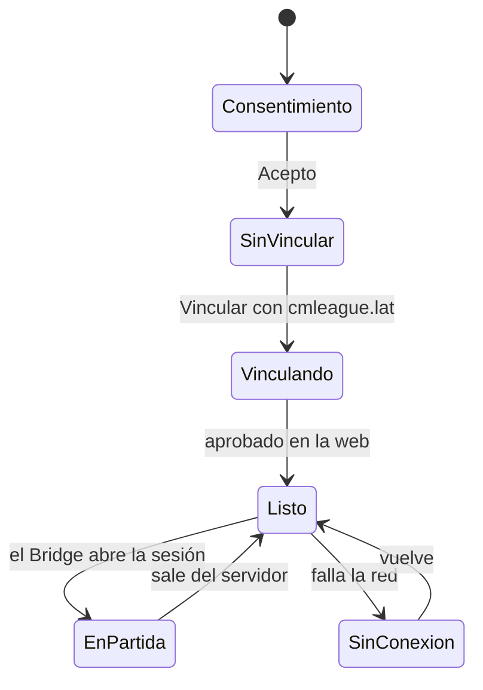

# Ventana nueva del anticheat: documentación

## Qué hace

La ventana de CMLeague Anticheat pasó de una columna alta (420×600) a una **horizontal y compacta de 460×320**, sin bordes y arrastrable por la barra de título. La estructura es la de la referencia de Kyan; los colores (`#ff6900` sobre `#0a0a0a`), el logo y los textos son de CMLeague.

- **Arriba:** la foto, el nick y "Miembro desde el …" de la cuenta vinculada. A la derecha, **CERRAR SESIÓN**, que desvincula el equipo después de una confirmación.
- **En el medio:** una tarjeta con el ícono y el color del estado, un título y una línea.
- **Abajo:** un punto de color con "Conectado" o "Sin conexión", y "Esperando una partida…" o "En partida en <servidor>".

**La ventana no dice nada de lo que hace, recopila o detecta el agente** (Kyan, 2026-11-27). Tampoco el pie: no dice si ve el juego.

## Pantallas

| Pantalla | Color | Qué dice |
|---|---|---|
| Consentimiento | — | "Al aceptar, aceptas los términos y la política de privacidad de CMLeague", con el enlace a `/privacidad`. Sin ninguna lista |
| Sin vincular | Naranja | Botón para vincular con `cmleague.lat` |
| Vinculando | Naranja | El código para comparar en la web |
| Listo para jugar | Verde | Esperando una partida |
| En partida | Verde | El nombre del servidor de la sesión |
| Sin conexión | Rojo | Que no hay conexión con CMLeague |
| Equipo bloqueado | Rojo | "No se puede usar CMLeague Anticheat en este equipo (AC-5)", de la [detección](../2026-11-27-anticheat-deteccion/DOCUMENTACION.md) |

La imagen de cada una está en [`capturas/00-ventana-del-agente.png`](../2026-11-27-anticheat-deteccion/capturas/00-ventana-del-agente.png).

## De dónde salen los datos del perfil

El agente no tiene sesión de la web, solo su token. El latido le devuelve `profile: { nick, avatar_url, member_since }` y `session.server_name` (replanteo `156`). La foto se baja una vez por `https` (hasta 2 MB) con `HttpGet` y se dibuja en un círculo con GDI+. Si no hay foto, se dibuja la inicial del nick.

## Qué cambia para cada rol

| Rol | Qué cambia | Página del manual |
|---|---|---|
| Jugador | La ventana nueva, con su cuenta arriba y un solo estado | Se escribe al pasar el anticheat a `main`: hoy el manual no tiene páginas del anticheat |

## Términos y privacidad

Sin cambios. El consentimiento remite a `/terminos` y `/privacidad` en lugar de listar los datos. Por eso, esas páginas tienen que estar al día antes de distribuir el agente (el "5" de Kyan).

## Dónde está cada cosa

| Qué | Archivo |
|---|---|
| Dibujo de las pantallas | `agent/src/ui.cpp` |
| Estado de la ventana y tamaño | `agent/src/core.h` (`UiState`, `kWidth`, `kHeight`) |
| Perfil, foto, confirmación al desvincular y enlace | `agent/src/main.cpp` |
| Bajar la foto | `agent/src/net.cpp` (`HttpGet`) |
| Perfil en el latido | `supabase/replanteo/156_anticheat_juego.sql`, `web/backend/src/schemas/anticheat.ts` |
