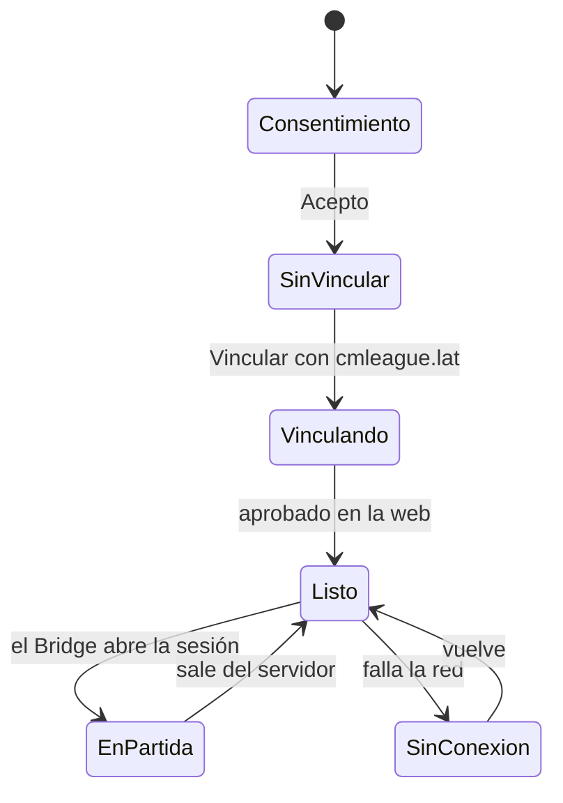

# Plan: ventana nueva del anticheat

> Planeación original. Estado: **en curso**, pedida por Kyan (2026-11-27) con una captura de la ventana de otro anticheat como referencia de diseño. Rama `kyan/pruebas`, sin commit.

La ventana actual (420×600) es una columna alta con un escudo grande y una lista de comprobaciones. Kyan la quiere como la de su referencia: horizontal, compacta, con el perfil arriba, una tarjeta de estado en el medio y una línea de conexión abajo. Se toma solo la estructura: los colores, el logo y los textos son de CMLeague.

## Decisiones tomadas

| Tema | Decisión | Por qué |
|---|---|---|
| Tamaño | 460×320, sin bordes, arrastrable por la barra de título | Compacta, como la referencia |
| Arriba | Foto, nick y "Miembro desde el …" de la cuenta vinculada. A la derecha, "CERRAR SESIÓN" (desvincula el equipo) | El jugador ve con qué cuenta está jugando |
| Medio | Una tarjeta con un ícono y el color del estado (verde listo o en partida, naranja falta algo, rojo sin conexión), un título y una línea | Un solo mensaje claro, como la referencia |
| Abajo | Punto de color + "Conectado" o "Sin conexión" │ "Esperando una partida…" o "En partida en <servidor>" | El estado del servicio y del juego de un vistazo |
| Qué no dice | Nada de lo que detecta (Kyan, 2026-11-27) | Ver [`2026-11-27-anticheat-ver-el-juego`](../2026-11-27-anticheat-ver-el-juego/PLAN.md) |
| Datos del perfil | El latido devuelve `profile: { nick, avatar_url, member_since }` y `session.server_name` (replanteo `155`) | El agente no tiene sesión de la web: solo su token |
| Foto | El agente la baja una vez por `https` (hasta 2 MB) y la dibuja en un círculo. Sin foto, la inicial del nick | Sin dependencias nuevas: WinHTTP y GDI+ |
| Consentimiento | Sin decir qué hace ni qué recopila: "Al aceptar, aceptas los términos y la política de privacidad de CMLeague" y el enlace a `/privacidad` (Kyan, 2026-11-27) | Un cheater no puede sacar nada de la ventana |
| Pie | "Esperando una partida…" o "En partida en <servidor>": no dice si ve el juego | Lo mismo |

## 1. Pantallas

## 2. Archivos

- `agent/src/ui.cpp`: el dibujo nuevo.
- `agent/src/core.h`: `UiState` suma nick, fecha de alta, foto y nombre del servidor. `kWidth` y `kHeight` pasan a 460 y 320.
- `agent/src/main.cpp`: lee el perfil del latido y baja la foto.
- `agent/src/net.cpp`: `HttpGet` para la foto.
- `supabase/replanteo/155_anticheat_juego.sql` y `web/backend/src/schemas/anticheat.ts`: el perfil y el servidor en el latido.

## 3. Requisitos

- Las Build Tools de C++ (instaladas el 2026-11-27).

## 4. Orden

1. Perfil en el latido (base y API).
2. Dibujo nuevo y `--render` de cada pantalla para revisarlas en imagen.
3. Probarlo vinculado contra una API local.
