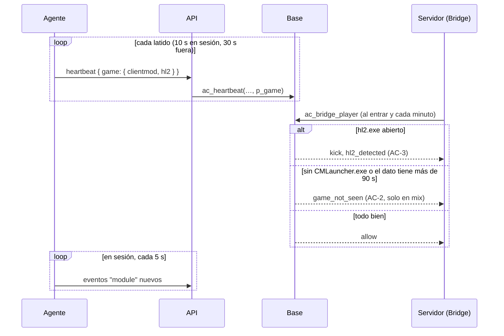

# El anticheat ve el juego de verdad: documentación

## Qué hace

El agente ya no da el juego por abierto solo porque existe un proceso. En cada latido le dice a la base si está **`CMLauncher.exe`** (ClientMod) y si hay algún **`hl2.exe`**. Con eso, el Bridge del servidor decide:

- Si hay un `hl2.exe` abierto, expulsa siempre.
- Si no ve el juego en esa PC, expulsa con las mismas reglas que cuando falta el agente.

En sesión, el agente lista cada 5 s los **módulos** (DLL) cargados en `CMLauncher.exe`, que llegan al panel del staff como eventos de tipo `module`. La captura de pantalla ya no busca la ventana por su título: toma **todo el monitor donde está el juego**, así que también salen los overlays externos. Las capturas que pide un admin **no avisan al jugador**.

Ningún texto que vea el jugador dice qué mira el agente (Kyan, 2026-11-27). Al jugador solo le llega un código. El motivo queda en el log del servidor y en la sesión del panel.

## Reglas del Bridge

| Motivo | Código al jugador | Cuándo expulsa |
|---|---|---|
| Sin perfil, sin agente, sin latido reciente u otra IP | `AC-1` | Servidor protegido, `enforce_mixes` y en mix |
| `game_not_seen`: el agente no ve `CMLauncher.exe`, o el dato tiene más de 90 s | `AC-2` | Igual que `AC-1` |
| `hl2_detected`: hay un `hl2.exe` abierto, aunque también esté `CMLauncher.exe` | `AC-3` | **Siempre** en un servidor protegido, aunque un admin haya abierto los mixes con `sm_ac_open` |

Un agente viejo, que no manda `game`, deja el estado en `null` y cuenta como `game_not_seen`.

## Datos

| Tabla | Columna o valor | Qué es |
|---|---|---|
| `ac_devices` | `game_clientmod`, `game_hl2` | Lo último que informó el agente |
| `ac_devices` | `game_reported_at` | Cuándo lo informó |
| `ac_process_events` | `kind = 'module'` | Un módulo cargado en el juego: nombre, ruta, hash y firma |

El latido también devuelve el **perfil** (`nick`, `avatar_url` y `member_since`) y el nombre del servidor de la sesión (`session.server_name`), para la ventana nueva ([`2026-11-27-anticheat-ventana-nueva`](../2026-11-27-anticheat-ventana-nueva/DOCUMENTACION.md)).

## Cómo lee el juego el agente

- Procesos: `CreateToolhelp32Snapshot`, con los nombres cifrados en el `.exe` (`OBF`, de la [detección](../2026-11-27-anticheat-deteccion/DOCUMENTACION.md)).
- Módulos: `TH32CS_SNAPMODULE` y `TH32CS_SNAPMODULE32`, sin inyectar nada. Si Windows no deja (el EAC de ClientMod o el juego elevado), el evento lleva `note = access_denied`. Eso no es indicio de nada.
- Captura: Desktop Duplication si el juego está en el monitor principal, BitBlt de la pantalla si está en otro. Hace falta que el juego esté al frente.

## Límite conocido

La **segunda PC con ClientMod abierto en las dos** no se resuelve acá: el agente ve el juego en la PC limpia. La [detección](../2026-11-27-anticheat-deteccion/DOCUMENTACION.md) suma el cruce de puertos (`port_mismatch`), que es solo un indicio.

## Qué cambia para cada rol

| Rol | Qué cambia | Página del manual |
|---|---|---|
| Jugador | Con un `hl2.exe` abierto (por ejemplo, el CS:S de Steam) no puede jugar en un servidor protegido. Sin el juego en la PC del agente, no puede jugar un mix. Ve los códigos `AC-2` y `AC-3` | Se escribe al pasar el anticheat a `main`: hoy el manual no tiene páginas del anticheat, y la del jugador no puede decir qué detecta |
| Admin | En la evidencia de una sesión, el bloque **Módulos del juego**. Los códigos `AC-2` y `AC-3` | [`admin/anticheat.md`](../../manual/admin/anticheat.md) |

## Términos y privacidad

Sin cambios en este commit. Al pasar a `main` (el "5" de Kyan), `/privacidad` tiene que decir dos cosas, en categorías generales y sin detallar qué busca el anticheat: que las capturas son de **toda la pantalla** y que el staff puede pedirlas **sin aviso**. Lo del anticheat ya figura "En preparación" y sigue así hasta entonces.

## Dónde está cada cosa

| Qué | Archivo |
|---|---|
| Ver el juego y `hl2.exe` | `agent/src/evidence.cpp` (`GameScan`) |
| Latido con `game` | `agent/src/main.cpp` |
| Módulos y captura de todo el monitor | `agent/src/evidence.cpp` |
| Base | `supabase/replanteo/156_anticheat_juego.sql` y su inversa en `docs/bitacora/2026-10-14-replanteo-modelo-datos/reversas/` |
| API | `web/backend/src/schemas/anticheat.ts`, `web/backend/src/routes/anticheat.ts` y `anticheat-evidence.ts` |
| Bridge | `server/addons/sourcemod/scripting/cml_anticheat_bridge.sp` |
| Panel | `web/frontend/src/features/admin/anticheat/AdminAnticheatPage.tsx` |
