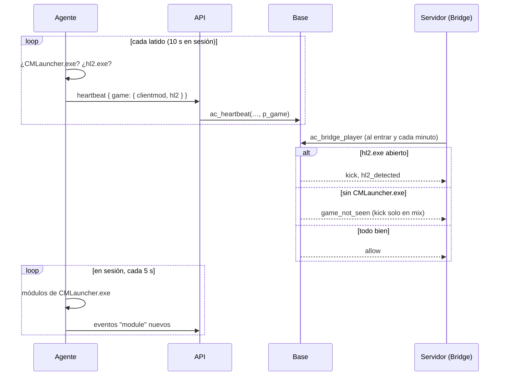

# Plan: el anticheat ve el juego de verdad

> Planeación original. Estado: **propuesta**, pedida por Kyan (2026-11-27). Rama `kyan/pruebas`, sin commit.

Hoy el agente (`CMLeagueAC.exe` 0.3.0) da el juego por abierto si hay un proceso `CMLauncher.exe`, pero no manda ese dato: el Bridge no sabe si el juego está en esa PC. Captura la ventana que se llame `CS:S v34 ClientMod`, que cualquier otro programa puede imitar, y no ve un `hl2.exe` abierto. Además, lista los procesos de la PC pero no lo que está **dentro** del juego, que es donde se inyectan casi todas las trampas de CS:S. Este plan es el primer paso de "mejorar el anticheat" ([`2026-11-26-ban-por-maquina`](../2026-11-26-ban-por-maquina/PLAN.md), en `main`, es otro).

## Decisiones tomadas

| Tema | Decisión | Por qué |
|---|---|---|
| Qué es el juego | El proceso **`CMLauncher.exe`** (Kyan, 2026-11-27; en `C:\CSSv34_ClientMod` no hay un `ClientMod.exe`) | Es el ejecutable de ClientMod. Por la ruta y el hash se ve si es el original |
| `hl2.exe` | **Si hay un `hl2.exe` abierto, se expulsa sin más** (Kyan, 2026-11-26: "que lo expulse, sin rechistar"), aunque también haya un `CMLauncher.exe`, y en cualquier momento, no solo en los mixes | Existiría un emulador de ClientMod que corre como `hl2.exe`. Solo vale jugar con `CMLauncher.exe` |
| Sin juego | Con el agente abierto pero sin `CMLauncher.exe`, el Bridge responde `game_not_seen`. Se expulsa con las mismas reglas que sin agente (servidor protegido, `enforce_mixes` y en mix) | Entrar al servidor sin el juego en esa PC es jugar desde otra |
| Ventana para las capturas | La del proceso `CMLauncher.exe`, la más grande y visible, en vez de buscarla por título | Una ventana con el mismo título en otro programa ya no sirve |
| DLL del juego | En sesión, el agente lista los módulos cargados en `CMLauncher.exe` (nombre, ruta, hash y firma) como eventos nuevos de tipo `module`, al empezar y cada vez que aparece uno | Las trampas internas se cargan como DLL |
| Cómo se leen | Con `CreateToolhelp32Snapshot` (`TH32CS_SNAPMODULE` y `TH32CS_SNAPMODULE32`), una API de consulta de Windows. Sin inyectar ni hooks | Es lo mismo que hace el Administrador de tareas. Si Windows no deja (EAC de ClientMod, juego elevado), se manda `note = access_denied`, que no es indicio de nada |
| Cada cuánto | Los módulos, cada 5 s en sesión. El juego y `hl2.exe`, en cada latido (10 s en sesión, 30 s fuera) | Barato y suficiente: el Bridge revisa cada minuto |
| Qué manda el latido | `game: { clientmod: bool, hl2: bool }`. La base guarda en `ac_devices` el último estado y cuándo | El Bridge decide con eso |
| Capturas pedidas por un admin | **Sin aviso al jugador** (Kyan, 2026-11-27) | Si se entera, cierra la trampa antes de la captura |
| Qué se captura | **Todo el monitor donde está el juego**, no solo su ventana (Kyan, 2026-11-27). Sigue haciendo falta el juego al frente | Los overlays externos se dibujan en otra ventana, encima: con solo la ventana del juego no salían |
| Qué se le dice al jugador | **Nada de lo que detecta** (Kyan, 2026-11-27: "si le das la información a los chiteros pueden encontrar alguna forma de bypassearlo"). **Tampoco el consentimiento ni la página de vinculación** (Kyan, 2026-11-27, la segunda vez): solo "al aceptar, aceptas los términos y la política de privacidad", con el enlace. El servidor expulsa con un código: `AC-1` sin agente, `AC-2` no ve el juego, `AC-3` `hl2.exe`. El motivo va al log del servidor y a la sesión | Lo que necesita quien quiere esquivarlo es la lista de qué busca y cómo. Las categorías se dicen igual: la Ley 25.326 obliga a informar qué datos se juntan, no cómo se detecta |
| Qué no resuelve | La segunda PC **con ClientMod abierto en las dos**: el agente ve el juego en la limpia. Para cerrarlo hay que saber a qué servidor está conectado ese `CMLauncher.exe` y con qué SteamID | Queda para un plan siguiente (sección 7) |

## 1. El flujo completo

## 2. Agente (`agent/`, versión 0.4.0)

- `main.cpp`: `GameOpen()` pasa a `GameScan()`, que devuelve si hay `CMLauncher.exe` y si hay `hl2.exe`. El latido los manda en `game`. La pantalla sigue con "juego abierto" según `CMLauncher.exe`.
- **Sin avisos al jugador:** la ventana del agente no dice qué ve (ni `hl2.exe` ni los módulos), y las capturas pedidas por un admin tampoco avisan.
- `evidence.cpp`:
  - `Capture()` busca la ventana visible más grande del proceso `CMLauncher.exe`, no por título. `--capture-title` sigue solo en la versión de pruebas.
  - En sesión, cada 5 s, lista los módulos de `CMLauncher.exe`. Los nuevos van como eventos `module` (con el `pid` del juego), con `InspectFile` para el hash y la firma, en la misma cola firmada que los procesos.
- `Capture()` toma todo el monitor donde está el juego: Desktop Duplication si es el principal, BitBlt de la pantalla si es otro.
- Pantalla de consentimiento: sin ninguna lista de lo que hace o recopila; solo la aceptación de los términos y la privacidad, con el enlace a `/privacidad`.

## 3. Base (replanteo `155_anticheat_juego.sql`, con su inversa)

- `ac_devices`: `game_clientmod boolean`, `game_hl2 boolean` y `game_reported_at timestamptz`.
- `ac_heartbeat`: un parámetro nuevo, `p_game jsonb default null`. Guarda el estado del juego. Sin `p_game` (agente viejo), queda en `null`.
- `ac_process_events.kind` acepta `module`.
- `ac_bridge_player`, después de que el agente esté bien (`ok`):
  - `game_hl2` → `hl2_detected`, **expulsa siempre** en un servidor protegido.
  - `game_clientmod` falso o `null` → `game_not_seen`, expulsa con las reglas de hoy.
  - Si el último informe del juego es de hace más de 90 s, cuenta como `game_not_seen`.
  - Las sesiones se cierran igual que con los otros motivos.

## 4. API (`web/backend`)

- `HeartbeatBody` suma `game: { clientmod: boolean, hl2: boolean }` opcional, y la ruta lo pasa como `p_game`.
- `anticheat-evidence.ts`: `kind` acepta `module`.
- Pruebas: las de integración del anticheat suman el caso `hl2_detected` y `game_not_seen`.

## 5. Bridge (`cml_anticheat_bridge.sp`)

- Lee `reason` de la respuesta y lo traduce a un código: `AC-1` (sin agente, como hoy), `AC-2` (`game_not_seen`) y `AC-3` (`hl2_detected`). Al jugador solo le dice "CMLeague Anticheat no te deja jugar (AC-2)"; el motivo va al log.
- `AC-3` expulsa aunque un admin haya abierto los mixes con `sm_ac_open`.

## 6. Web (Administración › Anticheat)

- Los eventos `module` van en un bloque propio, "Módulos del juego", separado de los programas.

## 7. Siguiente paso (fuera de este plan)

- **Ver a qué servidor y con qué SteamID está conectado ClientMod.** Puede salir del log de la consola (`-condebug`) o de la línea de comandos que arma el launcher. Cierra la segunda PC con ClientMod abierto en las dos.
- Firmas de trampas conocidas y hashes de los archivos del juego (`client.dll`, `engine.dll`).

## 8. Términos, privacidad y manual

- **`/privacidad` tiene que decir que las capturas son de toda la pantalla**, no solo del juego, y que el staff puede pedirlas sin aviso. Para el jugador es un cambio grande: una notificación o algo en ese monitor puede salir en la captura. Va con categorías, sin detallar qué busca el anticheat.
- La tabla de códigos (`AC-1`, `AC-2` y `AC-3`) va solo en el manual del admin y del moderador.

- `/privacidad`: el agente también lista los archivos que carga el juego. Lo del anticheat ya está "En preparación" y sigue así hasta que se mezcle.
- Manual del jugador: qué pasa si tiene `hl2.exe` abierto, por ejemplo el CS:S de Steam para otro servidor. Va con la mezcla del anticheat, porque hoy el manual no tiene páginas del anticheat.

## 9. Requisitos antes de empezar

- Build Tools de Visual Studio con C++ en la PC de Kyan: instaladas el 2026-11-27.
- ClientMod en esta PC para probar.

## 10. Orden de implementación

1. Agente: `GameScan`, el latido, la captura por proceso y los módulos. Compilar con `agent/build.bat`.
2. Probar el agente con ClientMod abierto: qué ve, si Windows deja listar los módulos (EAC) y qué pasa con un `hl2.exe` abierto.
3. Replanteo `155` y su inversa.
4. API y sus pruebas.
5. Bridge, compilado con el `spcomp` del repo.
6. Web: el bloque de módulos.
7. Guía de implementación y documentación.
