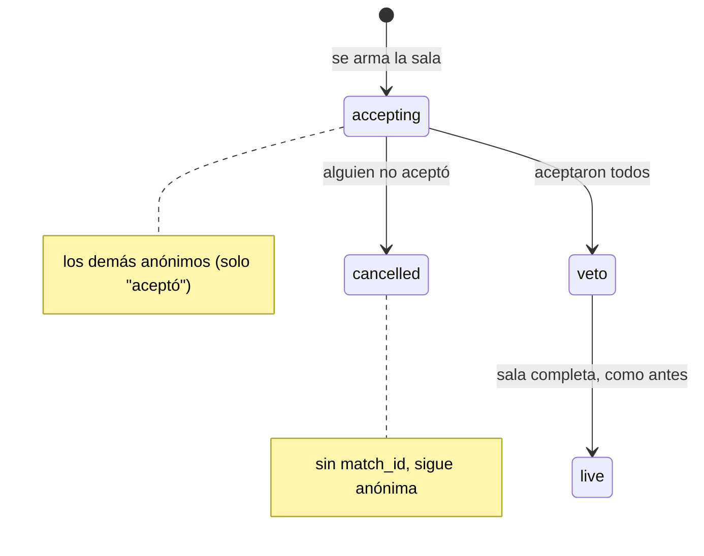

# La sala oculta mientras se acepta la partida: documentación

## Qué hace

Mientras una partida del matchmaking se está aceptando, ningún jugador de la sala puede saber con quién le tocó ni contra quién. Antes se veía de dos formas: el nick de cada jugador en el `title` de los cuadros de "quién aceptó" (al pasar el mouse) y la sala completa en la respuesta de la API (nick, foto, equipo, ELO, estadísticas y partidas jugadas juntos de los 10), visible en la pestaña de red del navegador. Con eso se podía rechazar según los compañeros.

Ahora la base manda, en ese estado, la tarjeta completa solo de quien mira. Las de los demás llegan anónimas (`oculto-1` a `oculto-9`), con `accepted` como único dato real y ordenadas por `player_id`, así que el orden tampoco muestra los equipos. Cuando aceptaron todos y la sala pasa al veto, se manda completa, como siempre.

## Reglas

| Situación | Qué ve un jugador de la sala |
|---|---|
| `accepting` | Su tarjeta completa y 9 anónimas |
| `cancelled` antes del veto (sin `match_id`) | Lo mismo: la sala no llegó a armarse |
| `veto` en adelante (y cancelada después del veto) | La sala completa |
| Alguien que no es de la sala (Administración › Matchmaking) | Siempre completa |

- La tarjeta anónima tiene las mismas claves que `mm_player_card`, con `nick` vacío, `team` nulo y el resto neutro, para que la web no cambie de forma.
- El aviso `lobby.accept` del socket ya no lleva el `user_id` de quien aceptó, solo cuántos aceptaron de cuántos. La web no lo usaba: vuelve a pedir el estado.
- Tu grupo lo sigues viendo en el panel del grupo, como antes.

## Funciones (replanteo `155`)

| Función | Qué hace |
|---|---|
| `mm_lobby_hidden(sala, quien mira)` | Verdadero en `accepting` (o cancelada sin `match_id`) si quien mira es de la sala |
| `mm_hidden_card(n, fila)` | La tarjeta anónima número `n` |
| `mm_lobby_json` | `players` según `mm_lobby_hidden` |
| `mm_trg_notify` | `lobby.accept` sin `user_id` |

Las dos nuevas no se pueden llamar desde la API (`revoke` a `anon` y `authenticated`).

## Web y app de escritorio

- `AcceptDialog.tsx`: el cuadro de los demás no lleva `title`; el tuyo dice "Tú".
- La app de escritorio abre `https://cmleague.lat/play`, así que usa esta misma web. Su parte propia (bandeja, avisos de Windows y Discord) solo muestra modo y mapa: no cambia.

## Lo que queda afuera

La lista pública de la cola (`queue_activity.players`, hasta 50 nicks) sigue igual: cuando se arma una sala, sus jugadores salen de la lista juntos. Comparándola antes y después se puede adivinar quiénes están en la sala, pero no el equipo de cada uno.

## Qué cambia para cada rol

| Rol | Qué cambia | Página del manual |
|---|---|---|
| Jugador | En "Partida encontrada" ves cuántos aceptaron, pero no quiénes; los equipos se ven en el veto | `jugador/buscar-partida.md` |

## Términos y privacidad

Sin cambios: no se guarda ni se publica nada nuevo; se muestra menos.

## Dónde está cada cosa

| Qué | Archivo / ubicación |
|---|---|
| Replanteo | `supabase/replanteo/155_mm_sala_oculta_al_aceptar.sql` |
| Inversa | `docs/bitacora/2026-10-14-replanteo-modelo-datos/reversas/155_mm_sala_oculta_al_aceptar.sql` |
| Prueba | `pruebas/prueba_155.sql` |
| Ventana de aceptar | `web/frontend/src/features/matchmaking/AcceptDialog.tsx` |
| Manual | `docs/manual/jugador/buscar-partida.md` |
