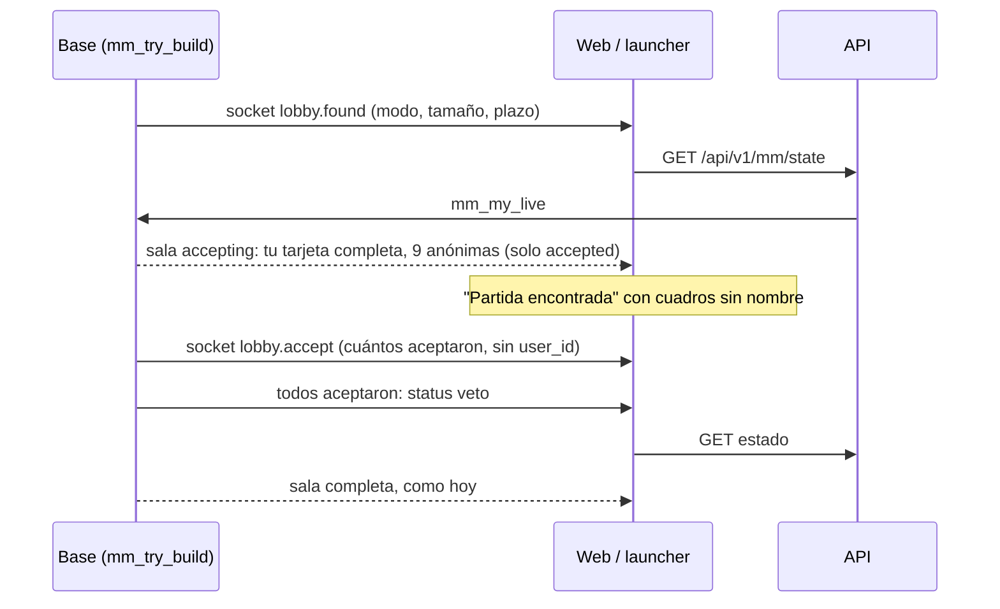

# Plan: la sala oculta mientras se acepta la partida

> Planeación original. Estado: **aprobada** por Daniel el 2026-11-27 ("arma la migración y despliega todo").

Bug reportado por Daniel el 2026-11-27: en la ventana "Partida encontrada", al pasar el mouse por los cuadros de quién aceptó, se veía el nick de cada jugador. Así se sabía con quién te tocó (y contra quién) antes de aceptar, y se podía rechazar según eso.

## Decisiones tomadas

| Tema | Decisión |
|---|---|
| Dónde se corta | En la base (`mm_lobby_json`), no solo en la web: la API mandaba la sala completa (nick, foto, equipo, ELO, estadísticas, partidas juntos) y se veía en la pestaña de red del navegador |
| Qué se oculta | Mientras la sala está en `accepting` (y si se cancela antes del veto), las tarjetas de los demás llegan anónimas: solo `accepted`. La tuya llega completa |
| Para quién | Solo para quien está en la sala. Administración › Matchmaking (que no es de la sala) sigue viendo todo |
| Orden | Por `player_id` (no por equipo y ELO), con ids `oculto-1` a `oculto-N`: el orden tampoco dice quién va en tu equipo |
| Socket | `lobby.accept` deja de mandar el `user_id` de quien aceptó; la web no lo usaba (vuelve a pedir el estado) |
| Web | El cuadro de los demás ya no lleva `title` con el nick; el tuyo dice "Tú" |
| App de escritorio | Sin cambios: abre `https://cmleague.lat/play` y en la bandeja solo muestra modo y mapa |
| Fuera de alcance | La lista pública de la cola (`queue_activity.players`, 50 nicks): cuando se arma una sala, sus 10 jugadores salen de la lista juntos. No dice el equipo; queda anotado |

## 1. El flujo completo

## 2. Base: replanteo `155_mm_sala_oculta_al_aceptar.sql`

- `mm_lobby_hidden(l mm_lobbies, viewer uuid)`: verdadero si la sala está en `accepting` (o `cancelled` sin `match_id`, que es cancelada antes del veto) y quien mira es de la sala.
- `mm_lobby_json`: con la sala oculta, `players` lleva la tarjeta completa de quien mira y, para los demás, una con las mismas claves y valores neutros (`nick` vacío, `team` nulo, `accepted` real).
- `mm_trg_notify`: `lobby.accept` sin `user_id`.
- Con `pg_temp.reemplazar` como el `146`, y su inversa en `reversas/`.

## 3. Web

`AcceptDialog.tsx`: sin el nick en el `title`.

## 4. Requisitos antes de empezar

Acceso al VPS (llave de Daniel) y a la base como `supabase_admin`.

## 5. Orden de implementación

1. Replanteo, inversa y prueba con `rollback`.
2. Pruebas de la web.
3. Comprobar que no haya una sala sin empezar la partida (en `accepting`, `veto`, `waiting_server`, `assigned` o `connecting`). Si hay, esperar a que pase a `live` o termine.
4. Aplicar el `155` en producción y desplegar la web.
5. Commit en `main`, y del replanteo también en `feat/frontend-fase-1` y `feat/mm-claim-en-sala`.
