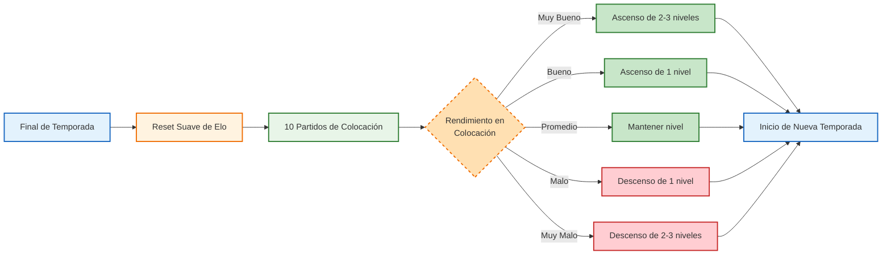

# Ladder Individual de Jugadores en Faceit

## Estructura de Niveles y Rangos

```mermaid
graph TD
    A[Nivel 1: 100-399 Elo] --> B[Nivel 2: 400-699 Elo]
    B --> C[Nivel 3: 700-999 Elo]
    C --> D[Nivel 4: 1000-1199 Elo]
    D --> E[Nivel 5: 1200-1399 Elo]
    E --> F[Nivel 6: 1400-1599 Elo]
    F --> G[Nivel 7: 1600-1799 Elo]
    G --> H[Nivel 8: 1800-1999 Elo]
    H --> I[Nivel 9: 2000-2000 Elo]
    I --> J[Nivel 10: 2001+ Elo]
    J --> K[Desafiante<br/>(Top 1,000 regional)]
    
    style A fill:#ffebee,stroke:#c62828,stroke-width:2px
    style B fill:#ffcdd2,stroke:#c62828,stroke-width:2px
    style C fill:#ef9a9a,stroke:#c62828,stroke-width:2px
    style D fill:#e57373,stroke:#c62828,stroke-width:2px
    style E fill:#ef5350,stroke:#c62828,stroke-width:2px
    style F fill:#f48fb1,stroke:#8e24aa,stroke-width:2px
    style G fill:#f06292,stroke:#8e24aa,stroke-width:2px
    style H fill:#ec407a,stroke:#8e24aa,stroke-width:2px
    style I fill:#d81b60,stroke:#8e24aa,stroke-width:2px
    style J fill:#8e24aa,stroke:#4a148c,stroke-width:2px
    style K fill:#6a1b9a,stroke:#4a148c,stroke-width:2px,color:#fff
```

## Proceso de Reset Estacional y Colocación



## Movimiento en la Ladder durante la Temporada

```mermaid
stateDiagram-v2
    [*] --> NivelActual
    state NivelActual {
        [*] --> Activo
        Activo --> Ganar: +Victorias
        Ganar --> SubirNivel: 3+ victorias seguidas
        SubirNivel --> Activo
        Activo --> Perder: +Derrotas
        Perder --> BajarNivel: 3+ derrotas seguidas
        BajarNivel --> Activo
    }
    
    style [*] fill:#ffffff,stroke:#999999
    style Activo fill:#e3f2fd,stroke:#1565c0,stroke-width:2px
    style Ganar fill:#c8e6c9,stroke:#2e7d32,stroke-width:2px
    style Perder fill:#ffcdd2,stroke:#c62828,stroke-width:2px
    style SubirNivel fill:#a5d6a7,stroke:#1b5e20,stroke-width:2px
    style BajarNivel fill:#ef9a9a,stroke:#c62828,stroke-width:2px
```

## Detalles de los Niveles

| Nivel | Rango Elo | Descripción |
|-------|-----------|-------------|
| 1 | 100-399 | Principiante |
| 2 | 400-699 | Novato |
| 3 | 700-999 | Intermedio Bajo |
| 4 | 1000-1199 | Intermedio |
| 5 | 1200-1399 | Intermedio Alto |
| 6 | 1400-1599 | Avanzado Bajo |
| 7 | 1600-1799 | Avanzado |
| 8 | 1800-1999 | Avanzado Alto |
| 9 | 2000-2000 | Élite |
| 10 | 2001+ | Maestro |
| Desafiante | Top 1,000 regional | Rangos superiores del Nivel 10 |

## Características Clave:
1. **Reset Suave**: Al inicio de cada temporada, el Elo se ajusta pero no se reinicia completamente
2. **Partidos de Colocación**: 10 partidos que determinan tu posición inicial para la temporada
3. **Progresión Basada en Victorias/Derrotas**: Racha de 3+ resultados similares provoca cambio de nivel
4. **Desafiante**: Los top 1,000 jugadores del Nivel 10 reciben este distintivo especial
5. **Movimiento Dinámico**: Los jugadores pueden subir o bajar múltiples niveles según su rendimiento

*Datos basados en la estructura observada de Faceit hasta 2026*