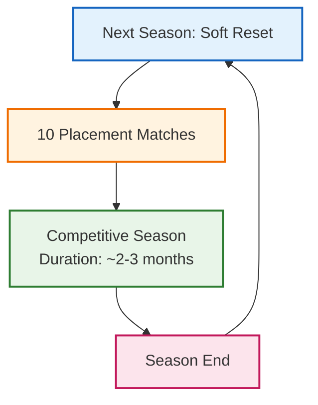
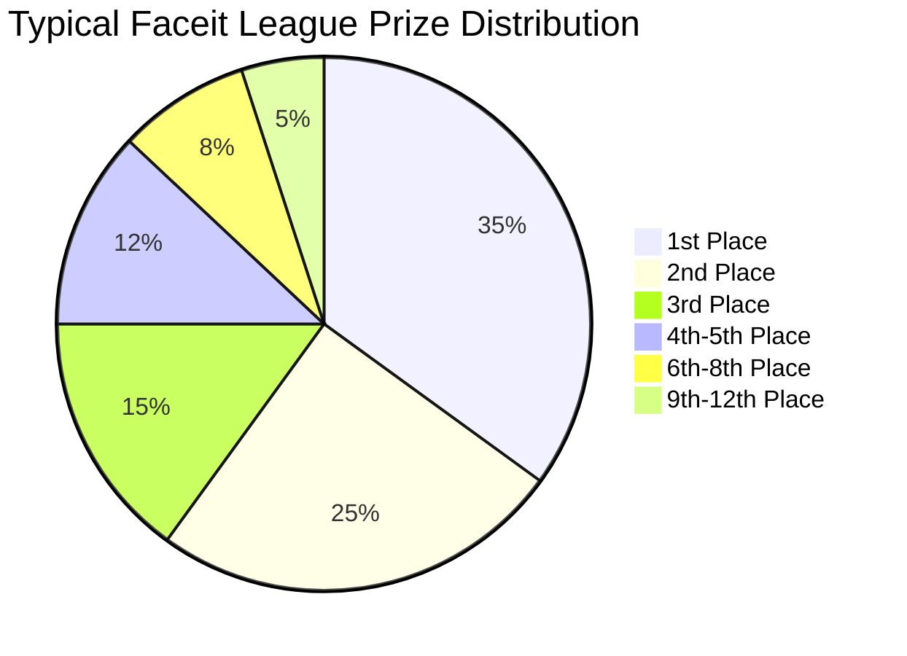

# Faceit Seasons Structure and Prize Distribution

## Seasonal Cycle Diagram

## Prize Distribution Structure

## Example: Faceit League Season 2 (2024)
- **Prize Pool:** $34,000
- **Duration:** July 16 - September 15, 2024
- **Participants:** 81 players
- **Format:** Regional qualifiers → Playoffs

## Key Points:
1. Seasons begin with a soft reset of player Elo ratings
2. Players complete 10 placement matches to establish season starting rank
3. Competitive season lasts approximately 2-3 months
4. Prize pools are distributed top-heavy, with significant rewards for top finishers
5. Prize amounts vary by season and region