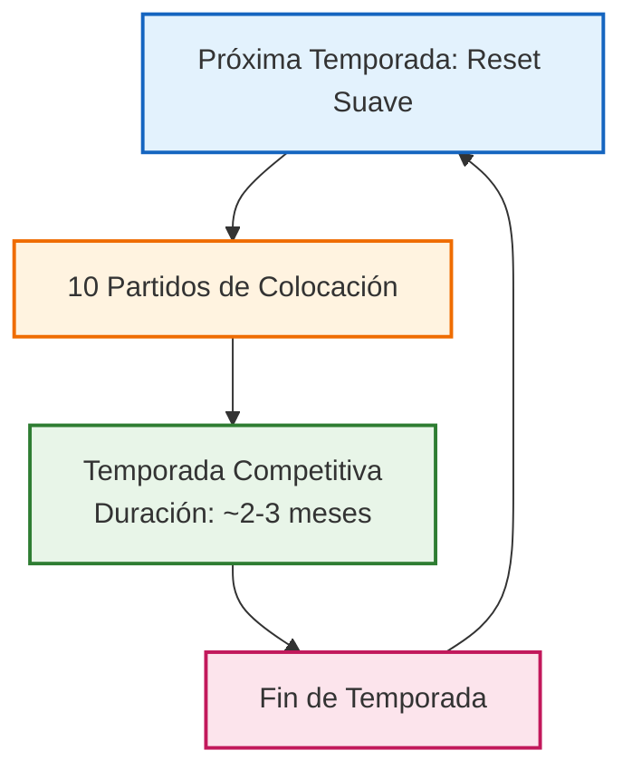
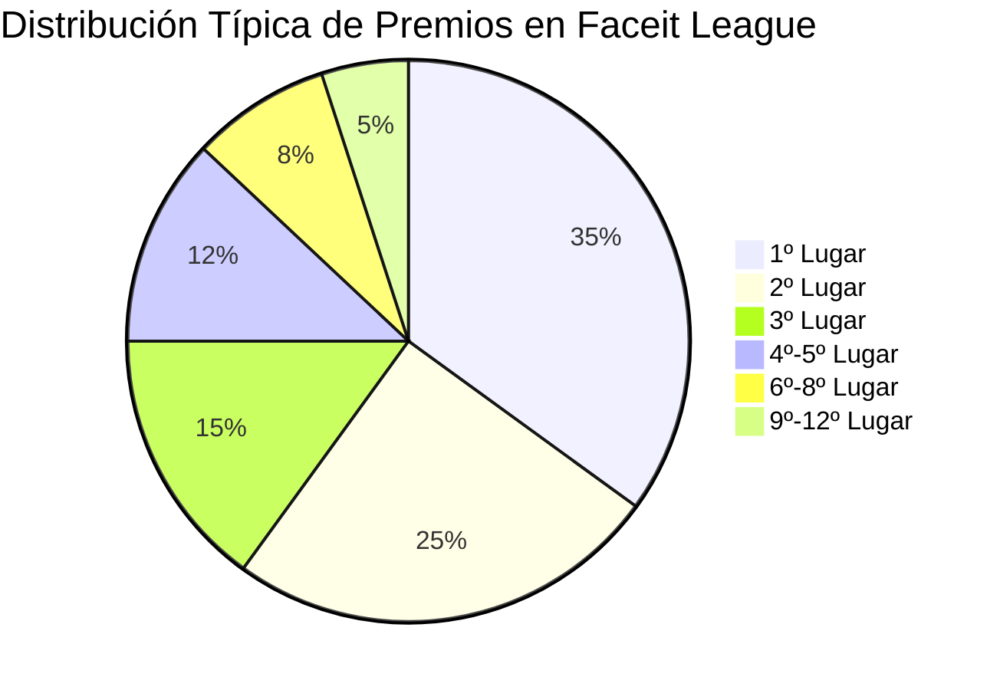

# Faceit Seasons Structure and Prize Distribution

## Seasonal Cycle Diagram

## Prize Distribution Structure

## Ejemplo: Faceit League Season 2 (2024)
- **Premio Total:** $34,000
- **Duración:** 16 de julio - 15 de septiembre, 2024
- **Participantes:** 81 jugadores
- **Formato:** Clasificatorios regionales → Playoffs

## Puntos Clave:
1. Las temporadas comienzan con un reset suave del Elo de los jugadores
2. Los jugadores completan 10 partidos de colocación para establecer su rango inicial
3. La temporada competitiva dura aproximadamente 2-3 meses
4. Los premios se distribuyen de forma sesgada hacia lo alto, con recompensas significativas para los mejores puestos
5. Los montos de premio varían según la temporada y región