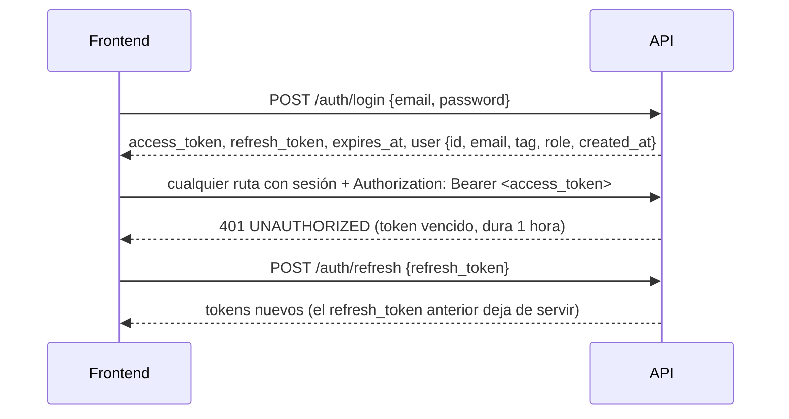

# Decisiones del backend y del modelo de datos: lo que afecta al frontend

Fecha: 2026-10-14. Estado: **decidido, todavía no implementado** (salvo lo marcado como "ya disponible"). Los nombres finales de endpoints y campos van a estar en la OpenAPI del backend.

## 1. Cómo se consume la API (ya disponible)

El frontend nuevo habla **solo con la API**. No usa `supabase-js` ni la clave pública de Supabase.

| Qué | Dónde |
|---|---|
| Contrato | `GET /api/openapi.json` (OpenAPI 3.1): se pueden generar tipos o un cliente desde ahí |
| Documentación interactiva | `GET /api/docs`: permite probar los endpoints con un token |
| Código y guía | `web/backend/README.md`, rama `feat/backend-api-fase-1` |
| URL en producción | `api.<dominio>`. El dominio todavía no está comprado: dejar la URL configurable por entorno |

### Sesión



- Guardar los dos tokens. No hay cookies.
- Ante un 401, renovar con `/auth/refresh` una sola vez y reintentar. Si el refresh también da 401, mandar al login.
- El `refresh_token` es de un solo uso: si hay varias pestañas, conviene que una sola renueve y comparta el resultado.

### Endpoints disponibles hoy

| Endpoint | Notas |
|---|---|
| `POST /auth/signup` | `{ email, password, tag }`. Si hay que confirmar el email, responde `session: null` y `needsConfirmation: true`: mostrar "revisa tu correo" |
| `POST /auth/login` | |
| `POST /auth/refresh` | |
| `POST /auth/logout` | |
| `GET /auth/me` | |
| `GET /api/v1/me/profile` | Cuenta, detalles, jugador vinculado, equipo actual y partidas jugadas |
| `PATCH /api/v1/me/profile` | Solo se cambian los campos enviados. `null` o `""` borran un campo |
| `POST /api/v1/me/avatar` | `multipart/form-data`, campo `file`. **JPEG, PNG o WebP, máximo 1 MB** (no GIF). Recortar a 256×256 antes de subir, como hace la web actual |
| `GET` y `POST /api/v1/me/profile-requests` | **Deprecado**: ver la sección 3 |
| `GET /api/v1/pcw/formats` | Sin sesión. `{ formats: [1, 3, 5] }`: los formatos que se pueden elegir al publicar una PCW. El formulario ofrece solo esos |
| `PUT /api/v1/admin/pcw/formats` | Solo admin. `{ formats: [1, 3] }`: al menos uno. Pantalla Admin → PCW con tres casillas (BO1, BO3, BO5) que no deja desmarcar la última |

### Errores

Siempre con este formato:

```json
{ "error": { "code": "VALIDATION_ERROR", "message": "...", "details": [{ "path": "tag", "message": "..." }], "requestId": "..." } }
```

- Decidir qué mostrar según `code`, no según el texto.
- `details` dice qué campo falló: sirve para marcar el input.
- Los mensajes de validación vienen en español.

| `code` | Qué mostrar |
|---|---|
| `VALIDATION_ERROR` | Error en el campo de `details[].path` |
| `BUSINESS_RULE` | El `message` tal cual: está escrito para el usuario |
| `INVALID_CREDENTIALS` | "Email o contraseña incorrectos" |
| `EMAIL_NOT_CONFIRMED` | "Confirma tu email" |
| `RATE_LIMITED` | Esperar los segundos del header `Retry-After` (login y registro: 10 intentos por minuto) |
| `UNAUTHORIZED` | Renovar la sesión o mandar al login |
| `FORBIDDEN`, `NOT_FOUND`, `CONFLICT` | Mensaje según la pantalla |
| `INVALID_FILE`, `FILE_TOO_LARGE` | Problema con la imagen |
| `INTERNAL` | Error genérico. Mostrar el `requestId` para poder rastrearlo |

## 2. Funciones que se mantienen

Se mantienen torneos (llaves, grupos, inscripciones, veto de mapas, reportes de resultado y chat de partida), PCW (publicar, aceptar y cancelar prácticas), equipos oficiales con solicitud de creación aprobada por un admin, y medallas y ficha del jugador (bio, historial de equipos, logros). Todo eso se va a migrar a la API en las próximas entregas.

## 3. Cambios que el frontend tiene que tener en cuenta

| Tema | Antes (web actual) | Después |
|---|---|---|
| **Stats de jugadores** | El admin las cargaba a mano, o salían de los mixes según `stats_auto`. Había stats por mapa cargadas a mano | **Solo salen de partidas jugadas en el servidor**: mixes, PCW y torneos. No hay pantalla de carga manual de stats; las stats por mapa también se calculan |
| **Reclamar un perfil de jugador** | Botón "Reclamar este perfil" → solicitud → aprobación de un admin | Se va a hacer desde el juego con `!claim <código>`: la web genera un código de un solo uso y el jugador lo escribe en el servidor. **Mientras tanto**, `/api/v1/me/profile-requests` sigue funcionando, marcado como deprecado. **No conviene invertir mucho en esa pantalla** |
| **Mixes** | Cada mix creaba dos equipos `mix` que aparecían mezclados con los equipos | Los bandos de un mix van **dentro de la partida**: nombre y jugadores de cada lado, y el ganador como bando 1, 2 o empate. Los listados de equipos solo tienen equipos reales (oficiales y PCW). Los equipos `mix` existentes se pasan a sus partidas y se borran; los mixes y el ELO no cambian |
| **Vincular una partida del servidor** | — | Cada partida de torneo y PCW tiene un **código de 5 caracteres**. En el servidor, un inscrito de un equipo escribe `!match <código>` y alguien del otro equipo lo confirma con el mismo código (un admin puede vincular solo). El mix queda como un mapa de esa partida, que suma el resultado mapa por mapa (BO1, BO3, BO5). **La web tiene que mostrar el código** en el detalle de las partidas de torneo y PCW, **solo a los integrantes de los dos equipos y a los admins**, y listar los mapas jugados (cada uno es un mix con su demo y sus stats). En el servidor, `!status` muestra el vínculo |
| **Reglas de plantel** | Una PCW aceptaba de 1 a 7 jugadores entre cuentas e invitados; inscribirse a un torneo no pedía mínimo | **Torneo:** el equipo necesita **5 jugadores** en su plantel para inscribirse, y en el servidor juegan solo inscritos. **PCW:** para publicarla o aceptarla hacen falta **4 jugadores con cuenta**; en el servidor cada lado puede sumar hasta 2 stand-ins sin cuenta. La base rechaza lo que no cumple, con un mensaje para mostrar |
| **Formato de una PCW** | Se elegía BO1, BO3 o BO5 libremente | El **admin decide qué formatos se pueden elegir** (al principio, los tres). La base rechaza un formato deshabilitado con su mensaje. Una PCW ya publicada o aceptada conserva su formato. El servidor usa el formato de cada partida para la serie de `!match` |
| **Miembros de un equipo** | Arreglo de ids en el equipo | Lista de miembros con rol y fechas de alta y baja. El **historial de equipos** de un jugador puede salir de ahí automáticamente |
| **Privacidad del perfil** | Tres opciones: público, solo miembros y privado | **Público o privado.** Privado oculta los datos personales (nombre real, redes); las stats y los mixes siguen siendo públicos |
| **Video y link de demo de la partida** | Campos "video" y "demo" cargados a mano | **Se eliminan.** La demo se descarga desde el botón que usa R2 (estado de la demo: `none`, `pending`, `uploaded`, `missing` o `expired`) |
| **IP del servidor de la partida** | Se mostraba para conectarse | Se mantiene |
| **Formato suizo de torneo** | Aparecía como opción, pero no generaba llave | **Se quita** de las opciones |
| **Email en el chat de partida** | Se guardaba y se podía leer | La API **no lo devuelve**: el autor se muestra con su tag |
| **Avatar** | Hasta 5 MB y GIF incluido | **1 MB, solo JPEG, PNG o WebP** |

## 4. Matchmaking

El matchmaking que había en la base (cola 1v1 a 5v5 y asignación a servidores) **se elimina** en el corte: ni la web ni el plugin lo usaban y no estaba terminado. **No hay que hacer pantallas de matchmaking.** Si más adelante se rehace, será desde cero y con su propio plan.

## 5. Lo que todavía no está definido

- Los endpoints de jugadores, equipos, partidas, torneos, PCW, ranking y admin. Salen en las próximas entregas, cada una documentada en `/api/docs`.
- El flujo exacto de `!claim` (dónde se genera y se muestra el código).
- El dominio y las URLs de producción.
