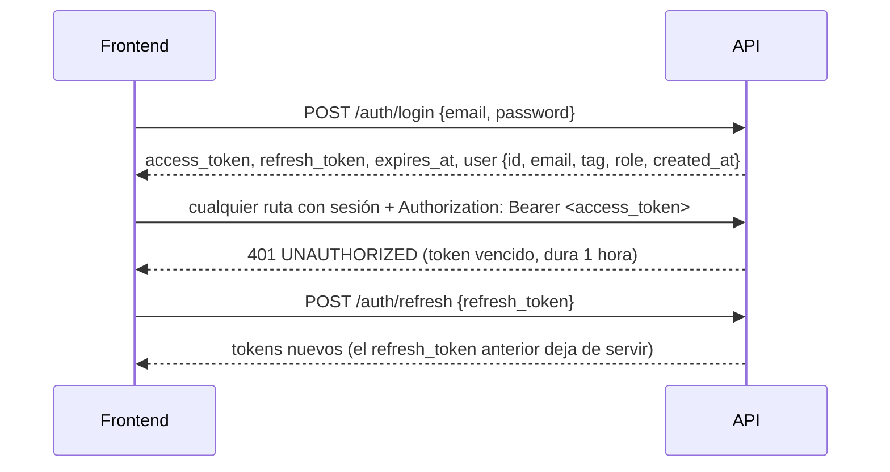
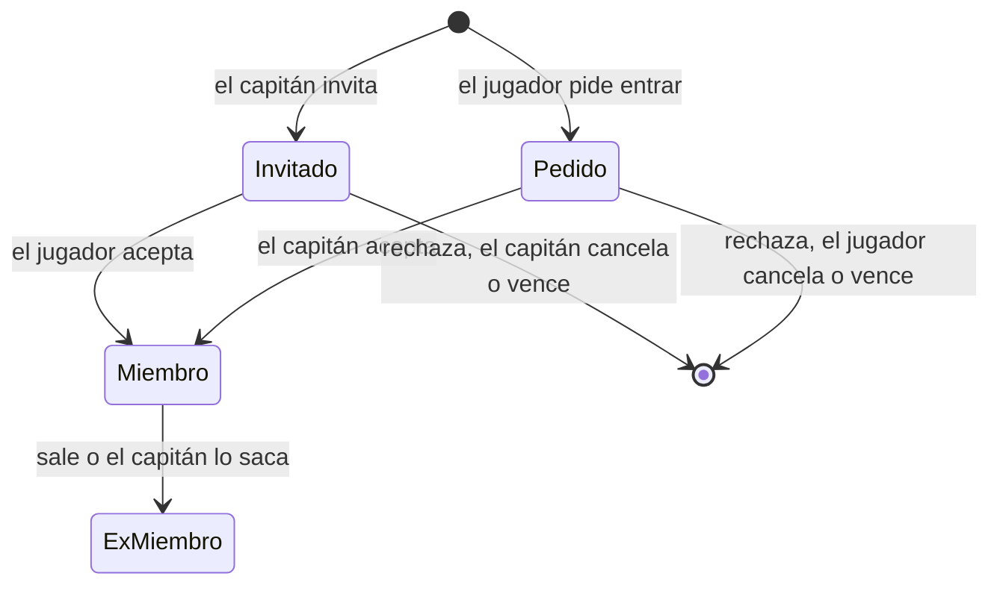

# Contrato para el frontend

Fecha: 2026-10-15. Reúne **todas las decisiones de diseño que afectan al frontend nuevo**, de todas las fases del backend: base y Auth, Mi perfil, replanteo del modelo de datos, `!match`, formatos de PCW y jugadores y equipos. Reemplaza como referencia única a [`2026-10-14-decisiones-para-frontend.md`](2026-10-14-decisiones-para-frontend.md), que queda como historia.

Los nombres exactos de endpoints, campos y tipos son los de la OpenAPI (`GET /api/openapi.json`). Si este documento y la OpenAPI no coinciden en un detalle, manda la OpenAPI. Las decisiones de diseño (qué se muestra, a quién y con qué reglas) mandan acá.

**Estado de cada parte:**

| Marca | Significa |
|---|---|
| **Disponible** | Implementado y probado en el backend (rama `feat/backend-api-fase-1`), sobre la Supabase local |
| **En implementación** | Aprobado; se está construyendo |
| **Pendiente** | Decidido a grandes rasgos, sin plan de endpoints todavía |

Nada está en producción: el backend y el esquema nuevo se publican juntos en el corte.

## 1. Cómo se consume la API (disponible)

El frontend habla **solo con la API**. No usa `supabase-js` ni la clave pública de Supabase.

| Qué | Dónde |
|---|---|
| Contrato | `GET /api/openapi.json` (OpenAPI 3.1): se pueden generar tipos o un cliente desde ahí |
| Documentación interactiva | `GET /api/docs`: permite probar los endpoints con un token |
| Estado del servicio | `GET /api/health` (`?deep=1` verifica también Supabase) |
| Código y guía | `web/backend/README.md` |
| URL en producción | `api.<dominio>`. El dominio todavía no está comprado: dejar la URL configurable por entorno |

### Sesión



- Guardar los dos tokens. No hay cookies.
- Ante un 401, renovar con `/auth/refresh` una sola vez y reintentar. Si el refresh también da 401, mandar al login.
- El `refresh_token` es de un solo uso: con varias pestañas, que una sola renueve y comparta el resultado.
- Las rutas públicas aceptan el token si viene: con sesión, la respuesta puede traer más datos (por ejemplo, los datos personales de un perfil privado que el usuario puede ver, o si el usuario es capitán de un equipo).
- `user.role` es `user` o `admin`. Las pantallas de admin se muestran solo a `admin`, pero la API lo vuelve a verificar.

### Errores

Siempre con este formato:

```json
{ "error": { "code": "VALIDATION_ERROR", "message": "...", "details": [{ "path": "tag", "message": "..." }], "requestId": "..." } }
```

- Decidir qué mostrar según `code`, no según el texto.
- `details` dice qué campo falló: sirve para marcar el input.
- Los mensajes vienen en español.

| `code` | Qué mostrar |
|---|---|
| `VALIDATION_ERROR` | Error en el campo de `details[].path` |
| `BUSINESS_RULE` | El `message` tal cual: está escrito para el usuario (por ejemplo, "El formato BO5 no está habilitado para las PCW") |
| `INVALID_CREDENTIALS` | "Email o contraseña incorrectos" |
| `EMAIL_NOT_CONFIRMED` | "Confirma tu email" |
| `RATE_LIMITED` | Esperar los segundos del header `Retry-After` (login y registro: 10 intentos por minuto) |
| `UNAUTHORIZED` | Renovar la sesión o mandar al login |
| `FORBIDDEN`, `NOT_FOUND` | Mensaje según la pantalla |
| `CONFLICT` | Algo ya existe o está tomado (por ejemplo, un alias). El `message` sirve para mostrar |
| `INVALID_FILE`, `FILE_TOO_LARGE` | Problema con la imagen |
| `INTERNAL` | Error genérico. Mostrar el `requestId` para poder rastrearlo |

### Listados

- Paginados en el servidor: `page` (desde 1) y `per`. La respuesta trae el total para armar el paginador.
- La búsqueda `q` no distingue mayúsculas ni tildes.

## 2. Cuenta y Mi perfil (disponible)

| Endpoint | Notas |
|---|---|
| `POST /auth/signup` | `{ email, password, tag }`. Si hay que confirmar el email, responde `session: null` y `needsConfirmation: true`: mostrar "revisa tu correo". El `tag` es el **alias** (sección 4): `409` si está tomado y `400` con `details[].path = "tag"` si tiene una palabra no permitida. Conviene validarlo antes con `GET /api/v1/aliases/{alias}/available` |
| `POST /auth/login`, `POST /auth/refresh`, `POST /auth/logout`, `GET /auth/me` | |
| `GET /api/v1/me/profile` | Cuenta, detalles, jugador vinculado, equipos actuales y partidas jugadas. `teams` es una lista (un jugador puede estar en varios equipos), con `is_captain` e `is_member`. `matches_played` cuenta las partidas que jugó en el servidor |
| `PATCH /api/v1/me/profile` | Solo se cambian los campos enviados. `null` o `""` borran un campo. Para el alias usar `PUT /me/alias` (sección 4) |
| `POST /api/v1/me/avatar` | `multipart/form-data`, campo `file`. **JPEG, PNG o WebP, máximo 1 MB** (no GIF). Recortar a 256×256 antes de subir |

- **Privacidad del perfil:** público o privado (ya no existe "solo miembros"). Privado oculta los **datos personales** (nombre real, país, redes); la ficha, las stats y las partidas siguen siendo públicas.

## 3. Modelo de datos nuevo (lo que cambia respecto de la web vieja)

| Tema | Antes | Después |
|---|---|---|
| **Stats de jugadores** | El admin las cargaba a mano, o salían de los mixes | **Solo salen de partidas jugadas en el servidor**: mixes, y PCW y torneos jugados con `!match`. No hay carga manual. Las stats por mapa también se calculan. Siempre están al día |
| **Mixes** | Cada mix creaba dos equipos `mix` mezclados con los equipos reales | Los bandos van **dentro de la partida**: nombre, jugadores y ganador (bando 1, 2 o empate) de cada lado. Los listados de equipos solo tienen equipos reales (oficiales y PCW) |
| **Jugadores sin cuenta en un mix** | | Quien juega sin estar vinculado aparece en el mix como **invitado** con el nombre que usaba en el juego. Su ELO se calcula igual (por SteamID). Cuando ese SteamID se vincula a un jugador, todos sus mixes pasan a mostrarlo con su alias y la ficha muestra su ELO y stats completos |
| **Miembros de un equipo** | Arreglo de ids | Lista con rol (`player`, `sub`, `coach`) y fechas de alta y baja. El **historial de equipos** sale de ahí |
| **Video y link de demo** | Campos cargados a mano | **Se eliminan.** La demo se descarga desde el botón que usa R2 (estado: `none`, `pending`, `uploaded`, `missing` o `expired`) |
| **IP del servidor de la partida** | Se mostraba para conectarse | Se mantiene |
| **Formato suizo de torneo** | Aparecía como opción sin generar llave | **Se quita** |
| **Email en el chat de partida** | Se guardaba y se podía leer | La API **no lo devuelve**: el autor se muestra con su alias |
| **Avatar** | Hasta 5 MB y GIF | **1 MB, solo JPEG, PNG o WebP** |
| **Matchmaking** | Cola 1v1 a 5v5 sin terminar | **Se elimina.** No hay pantallas de matchmaking |
| **Reclamar un perfil** | Botón "Reclamar este perfil" → aprobación de un admin | Va a pasar al juego con `!claim <código>` (plan sin aprobar). Mientras tanto `/api/v1/me/profile-requests` y los endpoints de admin de reclamos siguen, **deprecados**. No invertir mucho en esa pantalla |

## 4. Alias (disponible)

Un jugador con cuenta tiene **un solo nombre en la web: el alias**. Une lo que antes eran el tag de la cuenta y el nick del jugador.

- **Dónde se ve:** en todo: menú de la cuenta, Mi perfil, ficha, ranking, listados, planteles, chat.
- **Único:** sin distinguir mayúsculas ni espacios de los bordes. De 2 a 24 caracteres.
- **Quién lo cambia:**
  - **El usuario,** una vez cada **15 días** (`PUT /api/v1/me/alias`). Mostrar cuándo podrá volver a cambiarlo.
  - **El admin,** siempre, para moderar (`PUT /api/v1/admin/users/{id}/alias`).
- **Disponibilidad:** `GET /api/v1/aliases/{alias}/available`, para validar mientras se escribe en el registro y en Mi perfil.
- **Alias tomado:** `409 CONFLICT`. La respuesta de `PUT /me/alias` trae `next_change_at` (desde cuándo puede volver a cambiarlo).
- **Jugadores sin cuenta:** muestran el nombre que les pone el admin. Cuando alguien vincula ese jugador a su cuenta, pasa a mostrar el alias.
- **En el juego** cada uno usa el nombre que quiera: el servidor identifica por SteamID. En cada partida queda registrado el nombre que usó en el juego y la ficha lo puede mostrar como dato de esa partida.
- **Palabras bloqueadas:** un alias, un nombre o sigla de equipo o un nombre de bando de PCW que contenga una palabra de la lista se rechaza con `BUSINESS_RULE`. La comparación ignora mayúsculas, tildes, espacios y los reemplazos típicos (0→o, 1→i, 3→e, 4→a, 5→s, 7→t, @→a, $→s). La lista la gestiona el admin.

## 5. Jugadores (disponible)

- **URLs por id:** `#jugador/<id>` (o la ruta equivalente). El alias cambia, así que no sirve como enlace permanente.
- **Nivel:** lo manda la API ya calculado (1 a 10). Tramos de ELO: 0, 501, 751, 901, 1051, 1201, 1351, 1531, 1751 y 2001. El frontend solo elige el ícono.

| Endpoint | Pantalla |
|---|---|
| `GET /api/v1/players?q=&page=&per=&sort=elo\|alias` | **Jugadores** y **ranking de jugadores** (por defecto, ordenado por ELO): avatar, alias, nivel, ELO, partidas, equipos actuales, rating, K/D |
| `GET /api/v1/players/{id}` | **Ficha:** datos, ELO (actual, pico, partidas), nivel, stats, stats por mapa, medallas, equipos actuales, historial de equipos y datos personales. Si el perfil es privado y el usuario no puede verlos: `details: null` y `private: true` (mostrar "Perfil privado" en esa sección, no en toda la ficha) |
| `GET /api/v1/players/{id}/matches?page=&per=` | **Partidas del jugador:** fecha, mapa, tipo, bandos, resultado, si ganó, sus stats, su cambio de ELO y el nombre que usó en el juego |

## 6. Equipos y plantel (disponible)

### Reglas

| Regla | Detalle |
|---|---|
| Tamaño | Hasta **10** jugadores activos por equipo oficial |
| Cómo se entra | **Estilo FACEIT:** el capitán invita y el jugador acepta, o el jugador pide entrar y el capitán acepta. El admin puede todo, incluso sumar a alguien directamente |
| SteamID obligatorio | Solo puede entrar a un equipo quien tiene **cuenta con SteamID vinculado**. Si no lo tiene, la acción falla: mostrar cómo vincularlo |
| Varios equipos | Un jugador **puede estar en varios equipos** a la vez |
| Torneos | Un jugador no puede estar inscrito en un mismo torneo con dos equipos. La inscripción del segundo equipo falla con un mensaje que nombra al jugador y al otro equipo; se destraba cuando cualquiera de los dos equipos lo saca. Tampoco puede entrar a un equipo inscrito en un torneo donde ya está con otro equipo |
| PCW | No se puede jugar una PCW si un jugador está en el roster de los dos bandos: aceptarla falla con un mensaje. Al publicar o aceptar, el bando va a poder jugar **como uno de sus equipos oficiales** (todo el roster de ese plantel) para sumar al ranking: llega con la entrega de PCW |
| Vencimiento | Invitaciones y pedidos vencen a los **7 días** (`expires_at`). Uno abierto por jugador y equipo. Los listados de la API ya excluyen los vencidos |
| Capitán | No puede salir sin ceder antes la capitanía. La cede a un miembro con cuenta |
| Salir o ser sacado | El jugador queda como ex integrante (historial) |
| Equipos PCW | No usan invitaciones: se arman al publicar o aceptar la PCW |



### Endpoints

| Endpoint | Quién | Pantalla |
|---|---|---|
| `GET /api/v1/teams?kind=official\|pcw&q=&page=&per=` | Todos | **Equipos** (por defecto oficiales): nombre, sigla, capitán, jugadores (de 10) |
| `GET /api/v1/teams/{id}` | Todos | **Equipo:** datos, capitán, plantel activo (alias, rol, ELO, nivel), ex integrantes, récord y últimas partidas |
| `GET`/`PUT /api/v1/me/team-request` | Usuario | **Solicitar equipo nuevo** (nombre y sigla), una por usuario. Al aprobarla, el usuario queda como dueño, capitán y primer miembro |
| `GET /api/v1/me/team-invites` | Usuario | **Mis invitaciones** recibidas y pedidos enviados, abiertos |
| `POST /api/v1/teams/{id}/join-requests` | Usuario | Botón "Pedir entrar" en la página del equipo |
| `POST /api/v1/team-invites/{id}/accept` / `…/reject` | Invitado | Aceptar o rechazar |
| `DELETE /api/v1/join-requests/{id}` | Quien pidió | Cancelar su pedido |
| `POST /api/v1/teams/{id}/leave` | Miembro | Salir |
| `GET /api/v1/teams/{id}/pending` | Capitán o admin | **Gestión del equipo:** invitaciones enviadas y pedidos recibidos |
| `POST /api/v1/teams/{id}/invites` | Capitán o admin | Invitar por `alias` o `player_id` (el jugador necesita cuenta y SteamID) |
| `DELETE /api/v1/team-invites/{id}` | Capitán o admin | Cancelar una invitación |
| `POST /api/v1/join-requests/{id}/accept` / `…/reject` | Capitán o admin | Aceptar o rechazar un pedido |
| `DELETE /api/v1/teams/{id}/members/{playerId}` | Capitán o admin | Sacar a un jugador |
| `POST /api/v1/teams/{id}/captain` | Capitán o admin | `{ player_id }`: ceder la capitanía a un jugador con cuenta |

## 7. Ranking de equipos (disponible)

- `GET /api/v1/ranking/teams?pcw=0|1`: posición, equipo, PJ, G, P y puntos.
- **Por defecto cuenta solo torneos.** Un interruptor "Contar también PCW" pasa `pcw=1`: suman las PCW jugadas como el equipo (no las de bandos sueltos).
- **Los puntos son por partida ganada**, no por ganar el torneo entero. Al principio: **30 por partida de torneo** y **5 por PCW**. Los configura el admin y la respuesta trae los valores vigentes, para mostrarlos como leyenda.
- Si una partida vale más según la fase del torneo se decide en el plan de torneos.

## 8. Partidas, `!match` y PCW

### `!match` (base disponible; pantallas pendientes)

- Cada partida de torneo y PCW tiene un **código de 5 caracteres**. En el servidor, un inscrito de un equipo escribe `!match <código>` y alguien del otro equipo lo confirma con el mismo código (un admin puede vincular solo).
- Cada mapa jugado queda como un mix vinculado a la partida, con su demo y sus stats. La partida suma el resultado mapa por mapa (BO1, BO3, BO5). Los bandos del mix llevan el nombre de cada equipo.
- **La web muestra el código** en el detalle de las partidas de torneo y PCW **solo a los integrantes de los dos equipos y a los admins**, y lista los mapas jugados.
- En el servidor, `!status` muestra el vínculo.

### Reglas de plantel para jugar

| Tipo | Regla |
|---|---|
| Torneo | El equipo necesita **5 jugadores** en su plantel para inscribirse. En el servidor juegan solo inscritos |
| PCW | Para publicarla o aceptarla hacen falta **4 jugadores con cuenta** (roster de 1 a 7 entre cuentas e invitados). En el servidor cada lado puede sumar hasta **2 stand-ins**. Al menos 3 del roster por lado para que cuente |

La base rechaza lo que no cumple, con un mensaje para mostrar (`BUSINESS_RULE`).

### Formatos de PCW (disponible)

| Endpoint | Notas |
|---|---|
| `GET /api/v1/pcw/formats` | Sin sesión. `{ formats: [1, 3, 5] }`. El formulario de publicar una PCW ofrece solo esos |
| `PUT /api/v1/admin/pcw/formats` | Solo admin. `{ formats: [1, 3] }`, al menos uno. Pantalla Admin → PCW con tres casillas (BO1, BO3, BO5) que no deja desmarcar la última |

Una PCW ya publicada o aceptada conserva su formato.

### Pendiente

Endpoints de partidas (listado, detalle, chat, veto de mapas, reportes), torneos (creación, llaves, grupos, inscripción, cuántos jugadores inscribe cada equipo, máximo 10) y PCW (publicar, aceptar, cancelar). Se mantienen todas las funciones de la web vieja.

## 9. Admin

| Pantalla | Endpoints | Estado |
|---|---|---|
| Formatos de PCW | `PUT /api/v1/admin/pcw/formats` | Disponible |
| Jugadores | Alta, edición y baja (`/api/v1/admin/players`). El nick solo se edita en jugadores sin cuenta (en los vinculados manda el alias). Vincular una cuenta es `PATCH` con `user_id`. La baja falla con mensaje si tiene partidas | Disponible |
| Foto y medallas | `POST /api/v1/admin/players/{id}/photo` (mismas reglas que el avatar), `POST …/{id}/medals`, `DELETE /api/v1/admin/medals/{id}` | Disponible |
| SteamID sin vincular | `GET /api/v1/admin/steam/unlinked`, `POST /api/v1/admin/steam/link` | Disponible |
| Usuarios y alias | `GET /api/v1/admin/users?q=` (alias, rol, jugador). `PUT /api/v1/admin/users/{id}/alias`: si choca con una palabra bloqueada, ofrecer "Guardar igual" (`force: true`) | Disponible |
| Palabras bloqueadas | Lista, alta y baja, y "Nombres actuales que la contienen" (`/api/v1/admin/blocked-words`, `…/hits`) | Disponible |
| Equipos | Alta, edición y baja; sumar a un jugador directamente y cambiar su rol. Nombre o sigla con palabra bloqueada: ofrecer "Guardar igual" (`force: true`). La baja falla si tiene partidas o inscripciones | Disponible |
| Solicitudes de equipo nuevo | Listar (`has_steam` dice si se puede aprobar), aprobar y rechazar | Disponible |
| Puntos del ranking | `GET`/`PUT /api/v1/admin/ranking/config` | Disponible |
| Reclamos de perfil | Listar, aprobar y rechazar | Disponible, **deprecados** |

## 10. Lo que todavía no está definido

- El flujo exacto de `!claim` (dónde se genera y se muestra el código).
- Los endpoints de partidas, torneos, PCW y servidores.
- El dominio y las URLs de producción.
