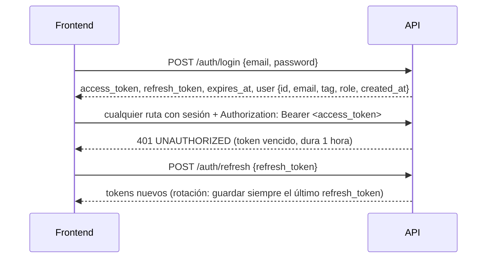
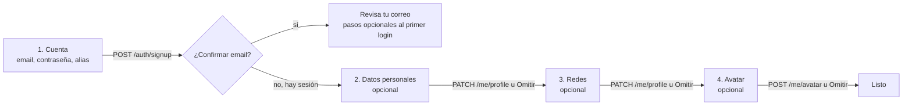
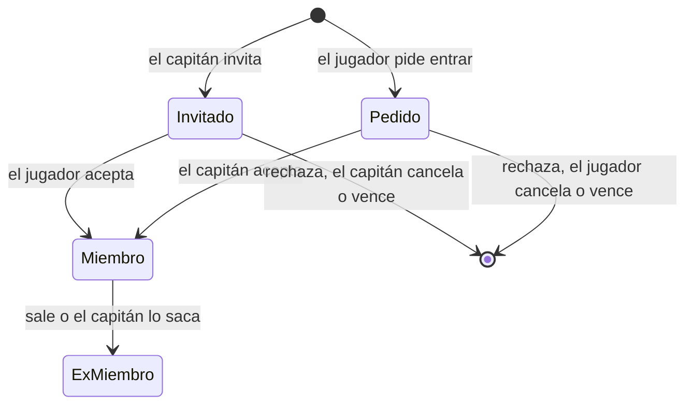
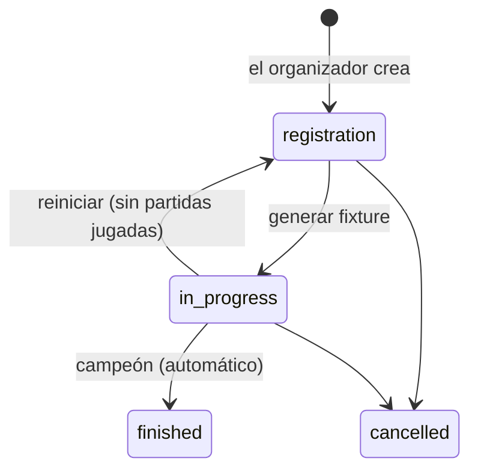

# Contrato para el frontend

Fecha: 2026-10-18. Reúne **todas las decisiones de diseño que afectan al frontend nuevo**, de todas las fases del backend: base y Auth, Mi perfil, replanteo del modelo de datos, `!match`, formatos de PCW, jugadores y equipos, partidas, torneos, PCW, ELO, listados, admin de servidores, configuración del ELO, demos, perfiles sin reclamar, `!claim`, mixes en vivo e interrumpidos la plantilla de grupos de doble eliminación con sorteo y las preferencias de la cuenta. Al final hay un registro de todas las decisiones con su fecha y su origen. Reemplaza como referencia única a [`2026-10-14-decisiones-para-frontend.md`](2026-10-14-decisiones-para-frontend.md), que queda como historia.

**La API de dominio está completa** (2026-10-16): todos los endpoints de este documento están **disponibles** en la rama `feat/backend-api-fase-1`, probados contra la Supabase local con el esquema nuevo (migraciones del replanteo 01 a 18).

Los nombres exactos de endpoints, campos y tipos son los de la OpenAPI (`GET /api/openapi.json`). Si este documento y la OpenAPI no coinciden en un detalle, manda la OpenAPI. Las decisiones de diseño (qué se muestra, a quién y con qué reglas) mandan acá.

**Estado de cada parte:**

| Marca | Significa |
|---|---|
| **Disponible** | Implementado y probado en el backend (rama `feat/backend-api-fase-1`), sobre la Supabase local |
| **En implementación** | Aprobado; se está construyendo |
| **Pendiente** | Decidido a grandes rasgos, sin plan de endpoints todavía |

Nada está en producción: el backend y el esquema nuevo se publican juntos en el corte.

## 0. Novedades desde la entrega del 2026-10-15

Lo que cambió o se sumó. Los puntos marcados **(rompe)** cambian algo que ya existía: revisar el código que lo use.

| Tema | Qué cambió | Dónde |
|---|---|---|
| **Listados (rompe)** | Todo `GET` de lista pagina, filtra y ordena en el servidor y responde `{ items, total, page, per, sort, order }`. `sort` fuera de la lista cerrada da `400` | Sección 1, "Listados" |
| **Detalles sin listas (rompe)** | La ficha del jugador, el equipo y el torneo ya no traen sus listas: van en sub-endpoints (`/players/{id}/map-stats`, `/medals`, `/teams`; `/teams/{id}/members`; `/events/{id}/registrations`, `/matches`, `/standings`) | Secciones 5, 6 y 8b |
| **Chat de partida (rompe)** | Pagina por cursor: `before`, `after`, `limit`; responde `{ items, has_more, limit }` | Sección 8 |
| **Mis PCW (rompe)** | `GET /api/v1/me/pcw` se dividió en `/me/pcw/post` (el anuncio abierto) y `/me/pcw/matches` (las prácticas) | Sección 8 |
| **Ranking (rompe)** | `points` pasó a `points_per_win` en la respuesta (los puntos de cada fila siguen en `points`) | Sección 7 |
| **Reclamos de perfil (rompe)** | Se borraron `/api/v1/me/profile-requests` y `/api/v1/admin/profile-requests`. El vínculo con el juego es `!claim` | Sección 5b |
| **Perfil sin reclamar** (nuevo) | Página pública por SteamID para quien jugó sin ficha; no va al ranking. El detalle de partida trae `steam_id` de los jugadores sin ficha para enlazarla | Sección 5b |
| **`!claim`** (nuevo) | Código en Mi perfil, `!claim <código>` en el servidor, varios SteamID por ficha con aprobación del admin. La ficha trae `steam_ids` | Secciones 5b y 9 |
| **Admin de servidores** (nuevo) | Alta con token y cfg, licencia, IP permitida, revocar, borrar | Sección 9 |
| **Configuración del ELO** (nuevo) | Lectura pública, vista previa, simulación y recálculo | Secciones 8c y 9 |
| **Demos** (nuevo) | Resumen, listado, reintentar una demo perdida, tokens del Worker | Sección 9 |
| **Doble confirmación** (nuevo) | Recalcular el ELO y generar un token nuevo del Worker piden escribir "estoy seguro"; la API exige `confirm` | Sección 9 |
| **Sesión** (aclaración) | El `refresh_token` rota pero no es estrictamente de un solo uso: guardar siempre el último | Sección 1, "Sesión" |
| **Mixes en vivo** (nuevo, 2026-10-17) | `GET /api/v1/mixes/live` y su detalle: marcador, rondas y stats parciales de los mixes que se están jugando. El detalle de una partida de torneo o PCW trae `live` con el mapa en juego | Sección 8d |
| **Preferencias de la cuenta** (nuevo, 2026-10-18) | `GET`/`PATCH /api/v1/me/profile` con `preferences.theme_fx` (efectos al cambiar de tema), guardado en la cuenta | Sección 2 |
| **Grupos de doble eliminación** (nuevo, 2026-10-18) | Plantilla `groups_double`: cada grupo juega una doble eliminación (1.º gana la final del upper, 2.º y 3.º salen de la final del lower) y los clasificados van a playoffs. La tabla del grupo llega con `stage: "group_double"` | Sección 8b |
| **Sorteo** (nuevo, 2026-10-18) | `POST /api/v1/events/{id}/draw` mezcla la siembra al azar; el detalle del torneo trae `draw` (cuándo y quién) | Sección 8b |
| **Mixes interrumpidos** (nuevo, 2026-10-17) | Un mix cortado por una caída queda cancelado con `cancel_reason: "crash"` y `review: "pending"`; un admin aplica el ELO (con doble confirmación) o lo descarta. El resumen de partida suma `cancel_reason` y `review`; el detalle, `review_detail` | Secciones 8d y 9 |

El chat de texto del servidor (vivos y muertos leen todo) y la voz por fases son cosas del servidor de juego: no afectan a la web.

## 1. Cómo se consume la API (disponible)

El frontend habla **solo con la API**. No usa `supabase-js` ni la clave pública de Supabase.

| Qué | Dónde |
|---|---|
| Contrato | `GET /api/openapi.json` (OpenAPI 3.1): se pueden generar tipos o un cliente desde ahí |
| Documentación interactiva | `GET /api/docs`: permite probar los endpoints con un token |
| Estado del servicio | `GET /api/health` (`?deep=1` verifica también Supabase) |
| Código y guía | `web/backend/README.md` |
| URL en producción | `api.<dominio>`. El dominio todavía no está comprado: dejar la URL configurable por entorno |

### Levantar la API en local

Requisitos: Node 24, pnpm 12 (con Corepack: `corepack enable pnpm`) y Docker Desktop corriendo.

```bash
cd web/backend
pnpm install --frozen-lockfile
cp .dev.vars.example .dev.vars   # apunta a la Supabase local; CORS ya acepta http://localhost:*
pnpm db:start                    # Supabase en Docker con el esquema nuevo (replanteo 01 a 15); la base arranca vacía
pnpm dev:node                    # API en http://localhost:8787 (documentación en /api/docs)
```

| Qué | Dónde |
|---|---|
| Correos de Auth (confirmación del registro) | http://127.0.0.1:54324 (Inbucket: los correos no salen de la máquina) |
| Ver y editar la base | http://127.0.0.1:54323 (Supabase Studio) |
| Hacer admin a una cuenta | En Studio, SQL: `update profiles set role = 'admin' where tag = '<alias>';`. Organizadores: `PUT /api/v1/admin/users/{id}/role` |
| Borrar todo y empezar de nuevo | `pnpm db:reset` |

- **Datos:** la base local arranca vacía. Las cuentas, equipos, torneos y PCW se crean con la API. Las partidas jugadas, stats y ELO llegan del servidor de juego. Para probar pantallas con datos de partidas se cargan a mano en Studio (`matches` y `match_player_stats`); si hace falta un script de datos de prueba, pedirlo.
- **Nunca** apuntar el `.dev.vars` a la Supabase de producción: la web vieja la sigue usando y el esquema nuevo no está ahí hasta el corte.

### Sesión



- Guardar los dos tokens. No hay cookies.
- Ante un 401, renovar con `/auth/refresh` una sola vez y reintentar. Si el refresh también da 401, mandar al login.
- **El `refresh_token` rota en cada renovación, pero no es estrictamente de un solo uso.** Cada `/auth/refresh` devuelve uno nuevo, y Supabase Auth igual acepta reusar el anterior por un rato (`refresh_token_reuse_interval`: 10 segundos en la configuración local; es el valor estándar de Supabase). Lo que se midió en local (GoTrue v2.197.0, 2026-10-16):
  - Reusar el anterior dentro de los 10 segundos devuelve **200** y el mismo token nuevo de la primera renovación.
  - Pasados los 10 segundos, y aunque el token nuevo ya se hubiera usado, el anterior también dio **200**, con un token nuevo de la misma sesión. El vigente siguió funcionando.
  - **Se deja el comportamiento por defecto de Supabase** (decisión de Daniel, 2026-10-16). La defensa si una cuenta se ve comprometida es cerrar sesión (`POST /auth/logout`), que revoca la sesión entera.
- **Qué hace el frontend:** guardar siempre el último `refresh_token` que llegó y no depender de que el anterior se rechace ni de que se acepte. Con varias pestañas, que una sola renueve y comparta el resultado (evita renovaciones duplicadas y carreras).
- Las rutas públicas aceptan el token si viene: con sesión, la respuesta puede traer más datos (por ejemplo, los datos personales de un perfil privado que el usuario puede ver, o si el usuario es capitán de un equipo).
- `user.role` es `user`, `organizer` o `admin`. Las pantallas de admin se muestran solo a `admin`; "Crear torneo" y la gestión de torneos, a `organizer` y `admin` (en un torneo concreto, `viewer.can_manage` dice si puede gestionarlo). La API lo vuelve a verificar.

### Errores

Siempre con este formato:

```json
{ "error": { "code": "VALIDATION_ERROR", "message": "...", "details": [{ "path": "tag", "message": "..." }], "requestId": "..." } }
```

- Decidir qué mostrar según `code`, no según el texto.
- `details` dice qué campo falló: sirve para marcar el input.
- Los mensajes vienen en español.

| `code` | Qué mostrar |
|---|---|
| `VALIDATION_ERROR` | Error en el campo de `details[].path` |
| `BUSINESS_RULE` | El `message` tal cual: está escrito para el usuario (por ejemplo, "El formato BO5 no está habilitado para las PCW") |
| `INVALID_CREDENTIALS` | "Email o contraseña incorrectos" |
| `EMAIL_NOT_CONFIRMED` | "Confirma tu email" |
| `RATE_LIMITED` | Esperar los segundos del header `Retry-After` (login y registro: 10 intentos por minuto) |
| `UNAUTHORIZED` | Renovar la sesión o mandar al login |
| `FORBIDDEN`, `NOT_FOUND` | Mensaje según la pantalla |
| `CONFLICT` | Algo ya existe o está tomado (por ejemplo, un alias). El `message` sirve para mostrar |
| `INVALID_FILE`, `FILE_TOO_LARGE` | Problema con la imagen |
| `INTERNAL` | Error genérico. Mostrar el `requestId` para poder rastrearlo |

### Listados (obligatorio: paginación, filtros y orden en el servidor)

**Todo `GET` que devuelve una lista** pagina, filtra y ordena en el servidor. El frontend no pagina, no filtra ni ordena nada por su cuenta.

```http
GET /api/v1/players?page=2&per=20&sort=rating&order=desc&q=mecha&has_steam=true
```

```json
{ "items": [ ... ], "total": 134, "page": 2, "per": 20, "sort": "rating", "order": "desc" }
```

| Parámetro | Regla |
|---|---|
| `page` | Desde 1 (por defecto 1) |
| `per` | De 1 a 100 (por defecto 20). En `/events/{id}/matches` y `/events/{id}/standings`, hasta 200 |
| `sort` | Uno de los campos permitidos de cada endpoint (lista cerrada; otro valor da `400 VALIDATION_ERROR`) |
| `order` | `asc` o `desc` |
| `q` | Texto libre, sin distinguir mayúsculas ni tildes |
| Booleanos | `true` o `false` |
| Fechas (`from`, `to`) | ISO 8601 (`2026-10-15` o con hora) |

- **Respuesta:** `total` es el total con los filtros aplicados, para armar el paginador. `sort` y `order` devuelven los que se usaron (incluidos los valores por defecto).
- **Orden estable:** cada endpoint suma un desempate fijo, así que las páginas no se mezclan.
- **Chat:** es la única excepción y pagina por cursor (sección 8).

**Listados, filtros y orden** (orden por defecto en **negrita**):

| Endpoint | Filtros | `sort` |
|---|---|---|
| `GET /api/v1/players` | `q` (alias y equipos), `team`, `has_account`, `has_steam`, `elo_min`, `elo_max` | **`elo` desc**, `alias`, `elo_matches`, `rating`, `kd`, `wins` |
| `GET /api/v1/players/{id}/matches` | `kind`, `result` (`won`, `lost`, `draw`), `map`, `from`, `to` | **`played_at` desc**, `rating`, `kills`, `elo_delta` |
| `GET /api/v1/players/{id}/map-stats` | `map` | **`maps` desc**, `rating`, `kd`, `adr`, `wins` |
| `GET /api/v1/players/{id}/medals` | — | **`created_at` desc**, `title` |
| `GET /api/v1/players/{id}/teams` | `active` | **`joined_at` desc**, `left_at`, `name` |
| `GET /api/v1/teams` | `kind` (por defecto `official`), `q`, `has_space` | **`name` asc**, `members` |
| `GET /api/v1/teams/{id}/members` | `active`, `role` | **`alias` asc**, `joined_at`, `left_at`, `elo` |
| `GET /api/v1/ranking/teams` | `pcw` (`0` o `1`), `q` | **`points` desc**, `won`, `played`, `name` |
| `GET /api/v1/matches` | `kind`, `status`, `event`, `team`, `player`, `map`, `from`, `to`, `q` | **`played_at` desc**, `starts_at` |
| `GET /api/v1/events` | `q`, `status`, `template`, `organizer`, `from`, `to` | **`starts_on` desc**, `name`, `status` |
| `GET /api/v1/events/{id}/registrations` | `q`, `start_stage` | **`seed` asc**, `name` |
| `GET /api/v1/events/{id}/matches` | `stage`, `phase`, `grp`, `round`, `status`, `team`, `include_byes` | **`bracket` asc** (fase, etapa, grupo, ronda, posición), `starts_at`, `played_at` |
| `GET /api/v1/events/{id}/standings` | `stage` (`group`, `swiss`), `grp`, `phase` | **`place` asc** |
| `GET /api/v1/pcw/posts` | `best_of`, `q`, `from`, `to` | **`created_at` desc**, `starts_at` |
| `GET /api/v1/maps` | `q`, `include_inactive` | **`position` asc**, `name` |
| `GET /api/v1/me/team-invites` | `kind` (`invite`, `request`), `team` | **`created_at` desc**, `expires_at` |
| `GET /api/v1/teams/{id}/pending` | `kind` | **`created_at` desc**, `expires_at` |
| `GET /api/v1/me/pcw/matches` | `status` | **`starts_at` desc**, `played_at` |
| `GET /api/v1/servers` | `q` | **`name` asc** |
| `GET /api/v1/players/unclaimed` | `q` (nombres que usó y SteamID) | **`last_played` desc**, `matches`, `elo`, `last_nick` |
| `GET /api/v1/players/steam/{steamid}/matches` | Como `/players/{id}/matches` | Como `/players/{id}/matches` |
| `GET /api/v1/players/steam/{steamid}/map-stats` | `map` | Como `/players/{id}/map-stats` |
| `GET /api/v1/me/steam-requests` | `status` | **`created_at` desc** |
| `GET /api/v1/admin/users` | `q`, `role`, `has_player`, `has_steam` | **`alias` asc**, `role` |
| `GET /api/v1/admin/steam/unlinked` | `q` (nombre o SteamID) | **`last_played` desc**, `matches`, `last_nick` |
| `GET /api/v1/admin/blocked-words` | `q` | **`word` asc**, `created_at` |
| `GET /api/v1/admin/blocked-words/hits` | `kind` | **`kind` asc**, `name` |
| `GET /api/v1/admin/team-requests` | `status`, `q` | **`status` asc** (pendientes primero), `name` |
| `GET /api/v1/admin/demos` | `status` (`pending`, `uploaded`, `missing`, `expired`), `server`, `kind`, `from`, `to`, `q` | **`played_at` desc**, `demo_size`, `demo_attempts`, `demo_uploaded_at`, `expires_at` |
| `GET /api/v1/admin/demo-workers` | `q`, `active`, `online` | **`name` asc**, `created_at`, `last_seen_at` |
| `GET /api/v1/admin/servers` | `q` (nombre, dirección, IPs, versión), `active`, `license` (`ok`, `expiring`, `expired`, `revoked`), `online`, `has_panel` | **`name` asc**, `created_at`, `last_seen_at`, `license_expires_at`, `matches` |
| `GET /api/v1/admin/steam-requests` | `status`, `q` | **`status` asc** (pendientes primero, después la más nueva), `created_at` |
| `GET /api/v1/admin/claims` | `ok`, `steam_id`, `q`, `from`, `to` | **`created_at` desc** |

**Los detalles no traen listas que crecen.** La ficha del jugador, el equipo y el torneo devuelven sus datos; sus listas van en los sub-endpoints de la tabla (`/players/{id}/map-stats`, `/medals`, `/teams`, `/matches`; `/teams/{id}/members`; `/events/{id}/registrations`, `/matches`, `/standings`). El detalle de una partida sí trae lo que es fijo y corto: rosters, mapas de la serie, jugadores de un mix y veto.

## 2. Cuenta y Mi perfil (disponible)

| Endpoint | Notas |
|---|---|
| `POST /auth/signup` | `{ email, password, tag }`. Si hay que confirmar el email, responde `session: null` y `needsConfirmation: true`: mostrar "revisa tu correo". El `tag` es el **alias** (sección 4): `409` si está tomado y `400` con `details[].path = "tag"` si tiene una palabra no permitida. Conviene validarlo antes con `GET /api/v1/aliases/{alias}/available` |
| `POST /auth/login`, `POST /auth/refresh`, `POST /auth/logout`, `GET /auth/me` | |
| `GET /api/v1/me/profile` | Cuenta, detalles, jugador vinculado, equipos actuales, partidas jugadas y `preferences`. `teams` es una lista (un jugador puede estar en varios equipos), con `is_captain` e `is_member`. `matches_played` cuenta las partidas que jugó en el servidor |
| `PATCH /api/v1/me/profile` | Solo se cambian los campos enviados. `null` o `""` borran un campo. Para el alias usar `PUT /me/alias` (sección 4). Acepta `preferences` (ver abajo) |
| `POST /api/v1/me/avatar` | `multipart/form-data`, campo `file`. **JPEG, PNG o WebP, máximo 1 MB** (no GIF). Recortar a 256×256 antes de subir |

- **Preferencias de la cuenta** (`preferences`, solo las ve y las cambia el propio usuario):
  - `GET /api/v1/me/profile` siempre trae el objeto con todas sus claves: `preferences: { theme_fx: "full" | "silent" | "off" | null }`. `null` = todavía no eligió.
  - `theme_fx`: efectos al cambiar de tema. `"full"` con sonido, `"silent"` sin sonido, `"off"` desactivados.
  - `PATCH /api/v1/me/profile` con `{ "preferences": { "theme_fx": "silent" } }` cambia solo esa clave; `null` la borra. Las claves que no se mandan no se tocan (las preferencias futuras no se pisan).
  - Otro valor, o una clave desconocida dentro de `preferences`, responde `400 VALIDATION_ERROR` con el campo en `details[].path`.
  - Al iniciar sesión, tomar el valor del servidor y reemplazar el del navegador; si es `null`, quedarse con el del navegador. Sin sesión, solo el navegador.
- **Privacidad del perfil:** público o privado (ya no existe "solo miembros"). Privado oculta los **datos personales** (nombre real, país, redes); la ficha, las stats y las partidas siguen siendo públicas.

### Registro por pasos

Lo único obligatorio es crear la cuenta. Todo lo demás se completa con sesión y se puede omitir.

**Paso obligatorio: `POST /auth/signup`**

| Campo | Reglas |
|---|---|
| `email` | Email válido, hasta 254 caracteres |
| `password` | De 6 a 72 caracteres (Supabase puede exigir más según su configuración) |
| `tag` | El **alias**: de 2 a 24 caracteres, sin `<` ni `>`, único sin distinguir mayúsculas y sin palabras bloqueadas |

- **Alias en vivo:** se valida mientras se escribe con `GET /api/v1/aliases/{alias}/available`. Responde `available` y `reason`: `length`, `chars`, `blocked` o `taken`.
- **Errores del alias:** si está tomado, `409`; si tiene una palabra bloqueada, `400`. En los dos casos `details[0].path = "tag"`.
- **Con confirmación de email** (`needsConfirmation: true`): **no hay sesión hasta que confirme**. Mostrar "revisa tu correo" y ofrecer los pasos opcionales después del primer login.
- **Sin confirmación:** la respuesta ya trae la sesión y se sigue directo.
- **Límite:** 10 intentos por minuto por IP, compartido con el login.

**Pasos opcionales**

- **Datos personales y redes:** `PATCH /api/v1/me/profile`. Exige al menos un campo; si el usuario omite el paso, no se llama. Un paso o dos, da igual: acepta cualquier subconjunto.

  | Campo | Reglas |
  |---|---|
  | `real_name` | Hasta 60 caracteres: letras, espacios, punto, apóstrofe y guion |
  | `country` | Uno de la lista (países de Latinoamérica, España, Estados Unidos, "Otro") |
  | `game_role` | AWPer, Rifler, IGL, Support, Entry fragger, Lurker u Otro |
  | `steam` | SteamID64, `STEAM_X:Y:Z`, link del perfil o nombre de perfil |
  | `faceit` | Nickname o link de faceit.com |
  | `discord` | Nombre de usuario, de 2 a 40 caracteres, sin espacios |

- **Avatar:** `POST /api/v1/me/avatar`, con las reglas de la tabla de arriba.
- **Si el perfil está completo:** se ve en `details` de `GET /api/v1/me/profile`, para ofrecer "completa tu perfil" a quien lo omitió.

**Lo que no se hace en el registro**

- **Vincular el SteamID** (lo que hace falta para entrar a un equipo) **no es** el campo `steam` del perfil, que es solo un dato para mostrar. El vínculo real se hace con `!claim <código>` desde el juego (sección 5b). El registro conviene que avise que, para entrar a un equipo, hay que vincularlo.
- **La privacidad** es del jugador vinculado, no de la cuenta, y hoy la cambia el admin. Una cuenta nueva no tiene jugador.



## 3. Modelo de datos nuevo (lo que cambia respecto de la web vieja)

| Tema | Antes | Después |
|---|---|---|
| **Stats de jugadores** | El admin las cargaba a mano, o salían de los mixes | **Solo salen de partidas jugadas en el servidor**: mixes, y PCW y torneos jugados con `!match`. No hay carga manual. Las stats por mapa también se calculan. Siempre están al día |
| **Mixes** | Cada mix creaba dos equipos `mix` mezclados con los equipos reales | Los bandos van **dentro de la partida**: nombre, jugadores y ganador (bando 1, 2 o empate) de cada lado. Los listados de equipos solo tienen equipos reales (oficiales y PCW) |
| **Jugadores sin cuenta en un mix** | | Quien juega sin estar vinculado aparece en el mix con el nombre que usaba en el juego, sus stats y su cambio de ELO (por SteamID), y tiene un **perfil sin reclamar** (sección 5b). Cuando ese SteamID se vincula a una ficha, todos sus mixes pasan a mostrarla con su alias y la ficha muestra su ELO y stats completos |
| **Miembros de un equipo** | Arreglo de ids | Lista con rol (`player`, `sub`, `coach`) y fechas de alta y baja. El **historial de equipos** sale de ahí |
| **Video y link de demo** | Campos cargados a mano | **Se eliminan.** La demo se descarga desde el botón que usa R2 (estado: `none`, `pending`, `uploaded`, `missing` o `expired`) |
| **IP del servidor de la partida** | Se mostraba para conectarse | Se mantiene |
| **Formato suizo de torneo** | Aparecía como opción sin generar llave | **Vuelve como plantilla nueva**, "suizo + playoffs" al estilo del Major de CS2, con su motor (sección 8b) |
| **Resultados de torneos y PCW** | Cada capitán cargaba mapas, rondas y capturas; un admin aprobaba | **Llegan solos del servidor con `!match`.** A mano los cargan el organizador o el admin. No hay pantalla de reportes ni capturas |
| **Email en el chat de partida** | Se guardaba y se podía leer | La API **no lo devuelve**: el autor se muestra con su alias |
| **Avatar** | Hasta 5 MB y GIF | **1 MB, solo JPEG, PNG o WebP** |
| **Matchmaking** | Cola 1v1 a 5v5 sin terminar | **Se elimina.** No hay pantallas de matchmaking |
| **Reclamar un perfil** | Botón "Reclamar este perfil" → aprobación de un admin | **`!claim <código>` desde el juego** (sección 5b). Los reclamos viejos se borraron: no hay pantalla de reclamos |

## 4. Alias (disponible)

Un jugador con cuenta tiene **un solo nombre en la web: el alias**. Une lo que antes eran el tag de la cuenta y el nick del jugador.

- **Dónde se ve:** en todo: menú de la cuenta, Mi perfil, ficha, ranking, listados, planteles, chat.
- **Único:** sin distinguir mayúsculas ni espacios de los bordes. De 2 a 24 caracteres.
- **Quién lo cambia:**
  - **El usuario,** una vez cada **15 días** (`PUT /api/v1/me/alias`). Mostrar cuándo podrá volver a cambiarlo.
  - **El admin,** siempre, para moderar (`PUT /api/v1/admin/users/{id}/alias`).
- **Disponibilidad:** `GET /api/v1/aliases/{alias}/available`, para validar mientras se escribe en el registro y en Mi perfil.
- **Alias tomado:** `409 CONFLICT`. La respuesta de `PUT /me/alias` trae `next_change_at` (desde cuándo puede volver a cambiarlo).
- **Jugadores sin cuenta:** muestran el nombre que les pone el admin. Cuando alguien vincula ese jugador a su cuenta, pasa a mostrar el alias.
- **En el juego** cada uno usa el nombre que quiera: el servidor identifica por SteamID. En cada partida queda registrado el nombre que usó en el juego y la ficha lo puede mostrar como dato de esa partida.
- **Palabras bloqueadas:** un alias, un nombre o sigla de equipo o un nombre de bando de PCW que contenga una palabra de la lista se rechaza con `BUSINESS_RULE`. La comparación ignora mayúsculas, tildes, espacios y los reemplazos típicos (0→o, 1→i, 3→e, 4→a, 5→s, 7→t, @→a, $→s). La lista la gestiona el admin.

## 5. Jugadores (disponible)

- **URLs por id:** `#jugador/<id>` (o la ruta equivalente). El alias cambia, así que no sirve como enlace permanente.
- **Nivel:** lo manda la API ya calculado (1 a 10). Tramos de ELO: 0, 501, 751, 901, 1051, 1201, 1351, 1531, 1751 y 2001. El frontend solo elige el ícono.

| Endpoint | Pantalla |
|---|---|
| `GET /api/v1/players` | **Jugadores** y **ranking de jugadores** (por defecto, ordenado por ELO): avatar, alias, nivel, ELO, partidas, equipos actuales, rating, K/D |
| `GET /api/v1/players/{id}` | **Ficha:** datos, ELO (actual, pico, partidas), nivel, stats, equipos actuales, `steam_ids` (todos sus SteamID, el principal primero) y datos personales. Una ficha con SteamID pero sin cuenta (`has_account: false`) muestra "¿Sos vos? Vinculala con `!claim`". Si el perfil es privado y el usuario no puede verlos: `details: null` y `private: true` (mostrar "Perfil privado" en esa sección, no en toda la ficha) |
| `GET /api/v1/players/{id}/map-stats` · `/medals` · `/teams` | Pestañas de la ficha: stats por mapa, medallas e historial de equipos |
| `GET /api/v1/players/{id}/matches` | **Partidas del jugador:** fecha, mapa, tipo, bandos, resultado, si ganó, sus stats, su cambio de ELO y el nombre que usó en el juego |

## 5b. Perfiles sin reclamar y `!claim` (disponible en la API; el comando del servidor sale con el plugin 2.2.0)

**Tres cosas distintas:** la **cuenta** (email, alias), la **ficha** de jugador (la página del jugador, va al ranking) y el **SteamID** (con el que el servidor registra cada partida). La ficha une una cuenta con sus SteamID.

**Perfil sin reclamar:** un SteamID que jugó y no es de ninguna ficha. **No es una ficha** y **no aparece en el ranking ni en la lista de jugadores**.

| Endpoint | Pantalla |
|---|---|
| `GET /api/v1/players/steam/{steamid}` | **Perfil sin reclamar:** último nombre que usó y los anteriores, ELO, nivel, stats, primera y última partida, y el cartel "Perfil sin reclamar: ¿sos vos? Registrate y usá `!claim` en el servidor". Si ese SteamID ya es de una ficha, responde `claimed: true` y `player_id`: redirigir a la ficha |
| `GET /api/v1/players/steam/{steamid}/matches` · `/map-stats` | Sus pestañas, igual que en la ficha |
| `GET /api/v1/players/unclaimed` | Buscar perfiles sin reclamar (aparte del ranking) |
| Detalle de partida | Cada jugador sin ficha trae `steam_id`: su nombre enlaza al perfil sin reclamar |

**Vincular el SteamID con `!claim`** (Mi perfil, tarjeta "Vincular con el servidor"):

| Endpoint | Qué hace |
|---|---|
| `POST /api/v1/me/claim-code` | Código de 6 caracteres, válido 10 minutos (hasta 5 por hora): `{ code, expires_at, command }`. El anterior sin usar deja de valer |
| `GET /api/v1/me/claim-code` | `steam_ids` (el principal primero), `max_steam_ids`, `last_code` (`status`: `pending`, `used` o `expired`, y `result`: el mensaje que vio el jugador) y `pending_requests`. Consultarlo cada 5 segundos mientras el código está `pending` |
| `GET /api/v1/me/steam-requests` | Mis pedidos de SteamID adicional: `pending`, `approved`, `rejected` (con `reason`) o `expired` |

1. El usuario genera el código y la tarjeta muestra el código grande, la cuenta regresiva y "Entrá al servidor y escribí `!claim K7P2QX`".
2. En el servidor escribe el comando. El servidor responde en el chat.
3. **Primer SteamID:** se vincula al instante. Si la cuenta no tenía ficha, se crea con su alias y todo el historial de ese SteamID. Funciona aunque nunca haya jugado (la ficha nace vacía y ya puede entrar a un equipo).
4. **SteamID adicional** (otra PC u otro servidor): queda **pendiente** hasta que lo apruebe un admin. Mostrar "Pedido enviado: un admin lo tiene que aprobar" y la lista de pedidos, con el aviso: "Hasta que un admin lo apruebe, `!match` no te reconoce desde esa PC" (en un torneo no puede jugar con su equipo desde ahí; en una PCW entra como stand-in).
5. Todos los SteamID de una ficha suman a **un solo ELO**.

Mensajes que puede ver el jugador en el servidor (`result`): "Listo: tu cuenta quedó vinculada", "Pedido enviado: un admin lo tiene que aprobar", "Tu cuenta ya está vinculada a este SteamID", "Ya pediste este SteamID…", "Llegaste al máximo de SteamID…", "Ese SteamID pertenece a otra cuenta", "Ese SteamID es de otra ficha…", "Ese SteamID tiene un pedido pendiente de otra cuenta", "Código inválido o vencido…", "Demasiados intentos…".

## 6. Equipos y plantel (disponible)

### Reglas

| Regla | Detalle |
|---|---|
| Tamaño | Hasta **10** jugadores activos por equipo oficial |
| Cómo se entra | **Estilo FACEIT:** el capitán invita y el jugador acepta, o el jugador pide entrar y el capitán acepta. El admin puede todo, incluso sumar a alguien directamente |
| SteamID obligatorio | Solo puede entrar a un equipo quien tiene **cuenta con SteamID vinculado**. Si no lo tiene, la acción falla: mostrar cómo vincularlo |
| Varios equipos | Un jugador **puede estar en varios equipos** a la vez |
| Torneos | Un jugador no puede estar **inscrito** en un mismo torneo con dos equipos (sección 8b). Entrar a un equipo es libre: lo que se controla es la inscripción |
| PCW | No se puede jugar una PCW si un jugador está en el roster de los dos bandos: aceptarla falla con un mensaje. Al publicar o aceptar, el bando puede jugar **como uno de sus equipos oficiales** (sección 8) |
| Vencimiento | Invitaciones y pedidos vencen a los **7 días** (`expires_at`). Uno abierto por jugador y equipo. Los listados de la API ya excluyen los vencidos |
| Capitán | No puede salir sin ceder antes la capitanía. La cede a un miembro con cuenta |
| Salir o ser sacado | El jugador queda como ex integrante (historial) |
| Equipos PCW | No usan invitaciones: se arman al publicar o aceptar la PCW |



### Endpoints

| Endpoint | Quién | Pantalla |
|---|---|---|
| `GET /api/v1/teams` | Todos | **Equipos** (por defecto oficiales): nombre, sigla, capitán, jugadores (de 10) |
| `GET /api/v1/teams/{id}` | Todos | **Equipo:** datos, capitán, récord y `viewer` |
| `GET /api/v1/teams/{id}/members` | Todos | Plantel (`active=true`: alias, rol, ELO, nivel, capitán) y ex integrantes (`active=false`). Las partidas del equipo: `GET /api/v1/matches?team={id}` |
| `GET`/`PUT /api/v1/me/team-request` | Usuario | **Solicitar equipo nuevo** (nombre y sigla), una por usuario. Al aprobarla, el usuario queda como dueño, capitán y primer miembro |
| `GET /api/v1/me/team-invites` | Usuario | **Mis invitaciones** recibidas (`kind=invite`) y pedidos enviados (`kind=request`), abiertos |
| `POST /api/v1/teams/{id}/join-requests` | Usuario | Botón "Pedir entrar" en la página del equipo |
| `POST /api/v1/team-invites/{id}/accept` / `…/reject` | Invitado | Aceptar o rechazar |
| `DELETE /api/v1/join-requests/{id}` | Quien pidió | Cancelar su pedido |
| `POST /api/v1/teams/{id}/leave` | Miembro | Salir |
| `GET /api/v1/teams/{id}/pending` | Capitán o admin | **Gestión del equipo:** invitaciones enviadas (`kind=invite`) y pedidos recibidos (`kind=request`) |
| `POST /api/v1/teams/{id}/invites` | Capitán o admin | Invitar por `alias` o `player_id` (el jugador necesita cuenta y SteamID) |
| `DELETE /api/v1/team-invites/{id}` | Capitán o admin | Cancelar una invitación |
| `POST /api/v1/join-requests/{id}/accept` / `…/reject` | Capitán o admin | Aceptar o rechazar un pedido |
| `DELETE /api/v1/teams/{id}/members/{playerId}` | Capitán o admin | Sacar a un jugador |
| `POST /api/v1/teams/{id}/captain` | Capitán o admin | `{ player_id }`: ceder la capitanía a un jugador con cuenta |

## 7. Ranking de equipos (disponible)

- `GET /api/v1/ranking/teams?pcw=0|1`: posición, equipo, PJ, G, P y puntos, paginado. `points_per_win` trae los puntos vigentes por victoria.
- **Por defecto cuenta solo torneos.** Un interruptor "Contar también PCW" pasa `pcw=1`: suman las PCW jugadas como el equipo (no las de bandos sueltos).
- **Los puntos son por partida ganada**, no por ganar el torneo entero. Al principio: **30 por partida de torneo** y **5 por PCW**. Los configura el admin y la respuesta trae los valores vigentes, para mostrarlos como leyenda.
- Toda partida de torneo ganada vale lo mismo, sin importar la fase. Los W.O. no suman.

## 8. Partidas, `!match` y PCW (disponible)

### Partidas

| Endpoint | Pantalla |
|---|---|
| `GET /api/v1/matches` | **Partidas, Resultados y Mixes** (filtros en la sección 1): `kind` `official` (torneo), `pcw` o `mix`. Cada una trae `label` con la fase ("Semifinal", "Grupo A · fecha 2", "Suizo · fase 1 · ronda 3"…), los dos bandos con equipo y marcador, y `parent_match_id` si es un mapa vinculado con `!match` |
| `GET /api/v1/matches/{id}` | **Detalle**: serie (`maps_detail`) y mapas jugados (`games`, cada uno es un mix con su propio detalle), roster de cada lado (en torneo, los inscritos; en PCW, el roster con invitados), servidor (para el botón "Conectar"), `demo_url` (mix), stats y MVP (mix), veto, código de `!match` y `viewer` (`can_veto`, `can_chat`, `can_manage`, `is_participant`) |
| `GET /api/v1/matches/{id}/chat` | Chat **por cursor**: sin parámetros, los últimos `limit` (50 por defecto, máximo 100); con `before=<id>`, los anteriores (historial); con `after=<id>`, los nuevos. Responde `{ items, has_more, limit }`, del más viejo al más nuevo |
| `POST /api/v1/matches/{id}/chat` · `DELETE /api/v1/chat/{id}` | Escribir (en torneos y PCW: los dos equipos, el organizador y los admins; en mixes, cualquiera con sesión) y borrar el propio |
| `POST /api/v1/matches/{id}/veto` (`{ map, version? }`) | Veto del capitán en su turno |
| `GET /api/v1/maps` | Pool del veto con versiones (`include_inactive=true` para el admin) |

- **Actualización en vivo:**
  - El detalle de partida y de torneo, y las partidas y tablas de un torneo, responden con `ETag`. Conviene consultar cada 3 a 5 segundos mandando `If-None-Match` con el último `ETag`.
  - Si no cambió, la API responde `304` sin cuerpo.
  - Para el chat se usa `after` con el id del último mensaje.
- **Veto:**
  - `veto.sequence` es la secuencia de bans y picks según el BO; `veto.next` dice a qué equipo y qué acción le toca (null si terminó).
  - `veto.maps_to_play` trae los mapas en orden con su versión, el decisivo al final.
  - Si el mapa tiene más de una versión (Inferno: `de_inferno` o `de_inferno_classic`), el pick pide elegirla. La versión del decisivo la fija el organizador (en PCW, la normal).
- **Demo:** `demo_url` viene armado cuando la demo está subida; si no, mostrar el estado (`pending`, `missing`, `expired`).

### `!match`

- **Código:**
  - Cada partida de torneo y PCW tiene un **código de 5 caracteres**, que viene en `link_code` del detalle **solo** para los integrantes de los dos equipos, el organizador y los admins.
  - En el servidor, un jugador de un equipo escribe `!match <código>` y alguien del otro lo confirma.
- **Resultado automático:**
  - Cada mapa terminado suma a la serie.
  - Cuando un equipo gana la serie, la partida se cierra sola y el torneo avanza solo: la llave, la ronda siguiente del suizo, los playoffs y el campeón.
  - **No hay pantalla para que los capitanes carguen el resultado.**
- **Si no se pudo jugar en el servidor:** en torneos, el organizador o el admin cargan el resultado (`POST /api/v1/matches/{id}/result`). Una PCW sin `!match` no tiene resultado; solo el admin puede cargarle uno.
- **Overtime:** no hay mapas empatados, el servidor juega overtime.

### Reglas para jugar

| Tipo | Regla |
|---|---|
| Torneo | En el servidor juegan **solo los jugadores inscritos** de cada equipo (sin stand-ins); el mínimo por lado es `players_min` del torneo |
| PCW | Para publicarla o aceptarla hacen falta **4 jugadores con cuenta** (roster de 1 a 7 entre cuentas e invitados). En el servidor cada lado puede sumar hasta **2 stand-ins**; al menos 3 del roster por lado para que cuente |

### PCW

| Endpoint | Pantalla |
|---|---|
| `GET /api/v1/pcw/posts` | Anuncios abiertos: formato, mapas, hora, nota, roster y, si juega como un equipo, cuál |
| `POST /api/v1/pcw/posts` | Publicar: `best_of` (de `GET /api/v1/pcw/formats`), `players`, `guests`, `team_id` opcional, `starts_at`, `maps`, `note`, `name` |
| `POST /api/v1/pcw/posts/{id}/accept` | Aceptar con el roster propio (`team_id` opcional). Devuelve el id de la partida: abrir su detalle |
| `GET /api/v1/me/pcw/post` · `GET /api/v1/me/pcw/matches` | **Mis PCW**: mi anuncio abierto (o `null`) y mis prácticas (`status` para ver las pendientes) |
| `DELETE /api/v1/pcw/posts/{id}` · `POST /api/v1/pcw/matches/{id}/cancel` | Cancelar mi anuncio o una práctica sin mapas jugados |

- **"Jugar como equipo":** el capitán o dueño de un equipo oficial puede elegirlo al publicar o aceptar. Todo el roster con cuenta tiene que ser de ese plantel y la PCW ganada suma al ranking del equipo (con `pcw=1`). El formulario puede cargar el plantel del equipo elegido.
- **Vencimiento:** una PCW que no se jugó a las 48 h de su hora se cancela sola.

### Formatos de PCW

| Endpoint | Notas |
|---|---|
| `GET /api/v1/pcw/formats` | Sin sesión. `{ formats: [1, 3, 5] }`. El formulario de publicar una PCW ofrece solo esos |
| `PUT /api/v1/admin/pcw/formats` | Solo admin. `{ formats: [1, 3] }`, al menos uno. Pantalla Admin → PCW con tres casillas (BO1, BO3, BO5) que no deja desmarcar la última |

## 8b. Torneos (disponible)

### Quién

- **Organizador:** un usuario con `role = 'organizer'`, que nombra el admin. Crea torneos y en **los suyos** hace todo lo del admin. El admin gestiona todos.
- **En cada torneo,** `viewer.can_manage` del detalle dice si quien consulta puede gestionarlo.

### Plantillas y valores por defecto

El organizador elige una plantilla y ajusta `config`. En cada fase elige **BO1, BO3 o BO5**.

| Plantilla (`template`) | Fases | Por defecto |
|---|---|---|
| `single` (eliminación directa) | Llave | Todas las rondas y la final BO3; 3.er puesto apagado |
| `double` (doble eliminación) | Upper, lower, final del upper, final del lower, gran final | BO3; gran final BO5; **sin reset**; mapa de ventaja apagado |
| `groups` (grupos + playoffs) | Grupos A, B, C… de todos contra todos → playoffs | 2 grupos, clasifican 2; grupos BO1; playoffs y final BO3 |
| `swiss` (suizo + playoffs) | 1 a 3 fases suizas de 16 (u 8) → playoffs | 3 victorias clasifican y 3 derrotas eliminan (2 y 2 con 8); BO1, decisivas BO3; playoffs y final BO3 |
| `groups_double` (grupos de doble eliminación + playoffs) | Grupos A, B… con una doble eliminación cada uno → playoffs | 2 grupos, clasifican 3; grupos BO3; playoffs BO3 y **final BO5**; 3.er puesto apagado |

- **Mapa de ventaja** (doble eliminación): el campeón del upper empieza la gran final 1-0, en BO3 o BO5. El marcador ya lo muestra desde el principio.
- **3.er puesto:** opcional. Si se activa, BO3.
- **Grupos:**
  - Victoria 3 puntos, derrota 0.
  - Desempate, en orden:
    1. Puntos.
    2. Diferencia de rondas.
    3. Resultado entre los empatados.
    4. Rondas ganadas.
    5. El organizador.
  - En playoffs, el 1.º de un grupo se cruza con el 2.º de otro.
  - Con 1 grupo y 1 clasificado funciona como una liga.
- **Suizo:**
  - Se cruzan equipos con el mismo récord (0-0, después 1-0 y 0-1…), sin repetir rival.
  - Cada equipo empieza en la fase 1, salvo que el organizador lo ponga en otra (equipos que entran directo, como en el Major).
  - Hacen falta exactamente 16 (u 8) en la fase 1 y la mitad en cada fase siguiente.
- **Grupos de doble eliminación** (`groups_double`):
  - De 1 a 8 grupos, de 4 a 8 equipos por grupo (reparto en serpentina por la siembra). Clasifican 2 o 3 por grupo; siempre hay playoffs.
  - Cada grupo es una doble eliminación **sin final del grupo**: 1.º gana la final del upper; 2.º gana la final del lower; 3.º la pierde. Un equipo queda afuera con su segunda derrota.
  - Con menos de 8 en un grupo hay libres para los primeros de la siembra: con 6, los lugares 1 y 2 pasan directo a la ronda 2 del upper. Los libres del lower se resuelven solos cuando bajan los perdedores.
  - Los que pierden la ronda 2 del upper bajan **cruzados** (para no repetir rival enseguida).
  - Playoffs: los 1.º, después los 2.º, después los 3.º. Con 2 grupos y 3 clasificados: cuartos 2.º B vs 3.º A y 2.º A vs 3.º B; los 1.º esperan en semifinales (1.º A con el ganador de 2.º B–3.º A).
  - Nombres de las fases (`label`): "Grupo A · upper · ronda 1", "Grupo A · final del upper", "Grupo B · lower · ronda 2", "Grupo B · final del lower".
  - Tabla del grupo: `GET /events/{id}/standings?stage=group_double`. Cada fila: `place` (los eliminados en la misma ronda comparten puesto), `won`, `lost`, rondas y `state` (`active` mientras sigue en carrera, `qualified` o `eliminated`). No hay empates para resolver.
  - Diagrama con un ejemplo completo: https://claude.ai/artifact/3zRgeGRrE8VS7VUAcuy13y
- **Sorteo** (todas las plantillas):
  - `POST /api/v1/events/{id}/draw` (organizador o admin, antes de generar) mezcla al azar la siembra con todos los inscritos y la devuelve (`seeds`, `drawn_at`). Se puede repetir hasta generar.
  - Con grupos, el sorteo decide el grupo y el lugar dentro del grupo.
  - El detalle del torneo trae `draw: { at, by: { user_id, alias } }`: mostrarlo ("Sorteado por X el …") para que los equipos vean que no se acomodó a mano. Cambiar la siembra a mano, o una inscripción o baja, lo borra (`draw: null`).
- **Empate sin resolver en un grupo:**
  - `tie_pending: { grp }` indica el grupo, y la fila trae `tied: true` en los empatados.
  - El organizador ordena esos equipos con `POST /api/v1/events/{id}/ties` y los playoffs se arman solos.

### Inscripción

- **Quién:** el capitán inscribe a su equipo eligiendo **qué jugadores juegan**, entre `players_min` y `players_max` del torneo (por defecto 5 y 7; máximo 10). Tienen que ser del plantel y tener SteamID.
- **Un jugador, un equipo:** si un jugador ya está inscrito con otro equipo en el mismo torneo, la inscripción falla con un mensaje que nombra al jugador y al equipo.
- **Cambios:** el capitán cambia los inscritos o da de baja al equipo hasta que se genera el fixture. Después, solo el organizador cambia jugadores.
- **Si un inscrito sale del equipo,** deja de estar inscrito. Mostrar un aviso si el equipo queda por debajo del mínimo.

### Flujo



- **Antes de generar:** el formato (plantilla, configuración, inscritos por equipo) y la siembra solo se cambian antes de generar.
- **Después de generar, todo avanza solo** con cada resultado. El organizador puede:
  - Asignar hora y servidor a cada partida (`PATCH /api/v1/matches/{id}`; la lista sale de `GET /api/v1/servers`, que trae solo los servidores activos con licencia vigente).
  - Cargar o corregir un resultado (`POST /api/v1/matches/{id}/result` con `maps`, `walkover` o `clear`). Una corrección falla si ya se jugaron partidas que dependían de esa.
  - Marcar **W.O.**: gana el equipo que se presentó. Cuenta para la llave, pero **no suma puntos en el ranking**.
  - Reiniciar el veto de una partida.
- **Borrar un torneo:** solo sin partidas jugadas; si no, se cancela.

### Endpoints

| Endpoint | Quién | Pantalla |
|---|---|---|
| `GET /api/v1/events` | Todos | **Torneos** |
| `GET /api/v1/events/{id}` | Todos | **Torneo**: configuración, estado, campeón, empate pendiente y `viewer`. Con `ETag` |
| `GET /api/v1/events/{id}/registrations` | Todos | Inscritos con siembra y jugadores |
| `GET /api/v1/events/{id}/matches` | Todos | Partidas (con `stage`, `phase`, `grp`, `round`, `pos` y `bye` para dibujar la llave; hasta 200 por página). Con `ETag` |
| `GET /api/v1/events/{id}/standings` | Todos | Tablas de grupos (`group`), grupos de doble eliminación (`group_double`) y del suizo, con la posición. Con `ETag` |
| `PUT`/`DELETE /api/v1/events/{id}/registrations/{teamId}` | Capitán u organizador | Inscribir, cambiar inscritos (`{ players, start_stage? }`) o dar de baja |
| `POST /api/v1/events`, `PATCH`/`DELETE /api/v1/events/{id}`, `POST …/cancel` | Organizador o admin | Crear, editar, borrar, cancelar |
| `PUT /api/v1/events/{id}/seeds` | Organizador o admin | Orden de siembra a mano (todos los inscritos) |
| `POST /api/v1/events/{id}/draw` | Organizador o admin | Sorteo de la siembra (`{ seeds, drawn_at }`) |
| `POST /api/v1/events/{id}/generate` · `…/reset` · `…/ties` | Organizador o admin | Fixture y empates |

**Para dibujar las llaves:** las partidas traen `stage` y la posición.
- **`stage`:** `ko`, `third`, `upper`, `lower`, `grand`, `group` o `swiss`.
- **Posición:** `phase` (fase), `round` (columna) y `pos` (fila).
- **Byes:** no vienen en el listado.

## 8c. ELO y stats

| Tema | Decisión |
|---|---|
| A quién se le calcula | A cada **SteamID** que juega un mix en el servidor, tenga o no cuenta o ficha. Al vincular el SteamID a un jugador, su ELO y su historial aparecen completos en la ficha (no se recalcula: ya estaba al día) |
| Valor inicial | 1000 |
| Participación | Quien juega menos del **35 %** de las rondas no recibe ELO; desde el 90 % cuenta completo. Entre medio, proporcional. Valores configurables por el admin |
| Nivel | 1 a 10, calculado por la API con los tramos de la sección 5 |
| Stats | Solo de partidas terminadas en el servidor (mixes, y PCW y torneos con `!match`). Una partida cancelada no cuenta |
| Ranking de jugadores | Es el listado de jugadores ordenado por ELO (`GET /api/v1/players`) |
| Configuración | `GET /api/v1/elo/config`, sin sesión: los valores vigentes, para una página "Cómo se calcula el ELO" |

## 8d. Mixes en vivo e interrumpidos (disponible)

El servidor manda una foto del mix al final de cada ronda. Si el servidor se cae (o se reinicia) con un mix en curso, al volver lo guarda como **interrumpido** con la última ronda, y un admin decide si cuenta para el ELO.

| Endpoint | Pantalla |
|---|---|
| `GET /api/v1/mixes/live` | **Mixes → En vivo**, arriba de la lista. Filtros: `server`, `player`, `map`, `stale`, `q`; orden `updated_at` (por defecto, desc) o `started_at`. Cada uno: servidor, mapa, bandos con marcador, `rounds_played` de `max_rounds`, `updated_at` (última ronda), `stale` y `parent_match_id` si se juega con `!match` |
| `GET /api/v1/mixes/live/{uid}` | **Detalle en vivo**: lo mismo, más `seq`, `rounds` (ganador y lado del bando 1 en cada ronda) y `players` (stats parciales por bando, con `alias` si tiene ficha o `steam_id` para el perfil sin reclamar). `404` cuando terminó: ir al detalle de la partida |
| `GET /api/v1/matches?review=pending` | Mixes interrumpidos pendientes de revisión (también `applied` y `discarded`) |
| `GET /api/v1/matches/{id}` | `review_detail` en un interrumpido; `live` en una partida de torneo o PCW con un mapa en juego |

- **Refresco:** consultar el listado cada 20 segundos y el detalle con `If-None-Match` (responde `304` hasta la próxima ronda). Cuando un mix desaparece del listado, terminó: su resultado está en `GET /api/v1/matches?kind=mix`.
- **`stale: true`:** más de 10 minutos sin fotos. Mostrarlo atenuado ("sin novedades del servidor"). Al admin, ofrecer "Cerrar como interrumpido".
- **Marcador del mapa en juego de una serie** (`live` del detalle de partida): ya viene en el orden de los bandos de la partida (`score1` es el del equipo 1).
- **Un interrumpido en las listas:**
  - Cancelado con `cancel_reason: "crash"`: etiqueta "Interrumpida", más "ELO pendiente" mientras `review` sea `pending`.
  - Aprobado: queda terminado con `end_reason: "crash"` y su ganador. Etiqueta "Interrumpida".
- **Reglas para aprobar** (las valida la API; `review_detail` las trae calculadas):
  - Mínimo **35 %** de las rondas del mix (`min_rounds`), redondeado hacia arriba. Sin empate.
  - Gana el bando que iba adelante, y cuenta para el ELO, las victorias y las stats como cualquier mix terminado.
  - Si se jugaba con `!match`, al aprobarlo se vincula a su partida de torneo o PCW y suma el mapa. Si no se aprueba, el organizador puede cargar el resultado a mano.

## 9. Admin

| Pantalla | Endpoints | Estado |
|---|---|---|
| Formatos de PCW | `PUT /api/v1/admin/pcw/formats` | Disponible |
| Organizadores | `PUT /api/v1/admin/users/{id}/role` (`user` u `organizer`); la lista sale de `GET /api/v1/admin/users` | Disponible |
| Pool de mapas | `GET /api/v1/maps` y `PUT /api/v1/admin/maps` (lista completa en orden, con versiones y activos) | Disponible |
| Resultado de una PCW | `POST /api/v1/admin/pcw/matches/{id}/result` (`{ maps }`) | Disponible |
| Partidas huérfanas | `DELETE /api/v1/admin/matches/{id}` (sin stats) | Disponible |
| Torneos | Lo mismo que el organizador, sobre todos los torneos | Disponible |
| Jugadores | Alta, edición y baja (`/api/v1/admin/players`). El nick solo se edita en jugadores sin cuenta (en los vinculados manda el alias). Vincular una cuenta es `PATCH` con `user_id`. La baja falla con mensaje si tiene partidas | Disponible |
| Foto y medallas | `POST /api/v1/admin/players/{id}/photo` (mismas reglas que el avatar), `POST …/{id}/medals`, `DELETE /api/v1/admin/medals/{id}` | Disponible |
| SteamID sin vincular | `GET /api/v1/admin/steam/unlinked`, `POST /api/v1/admin/steam/link` (suma el SteamID a la ficha: principal si no tiene, adicional si ya tiene; hasta 4; `player_id: null` lo quita) | Disponible |
| SteamID de las fichas | Ver "SteamID y `!claim` (admin)" abajo | Disponible |
| Usuarios y alias | `GET /api/v1/admin/users?q=` (alias, rol, jugador). `PUT /api/v1/admin/users/{id}/alias`: si choca con una palabra bloqueada, ofrecer "Guardar igual" (`force: true`) | Disponible |
| Palabras bloqueadas | Lista, alta y baja, y "Nombres actuales que la contienen": `GET`/`POST /api/v1/admin/blocked-words`, `DELETE /api/v1/admin/blocked-words/{id}`, `GET /api/v1/admin/blocked-words/hits` | Disponible |
| Equipos | Alta, edición y baja; sumar a un jugador directamente y cambiar su rol. Nombre o sigla con palabra bloqueada: ofrecer "Guardar igual" (`force: true`). La baja falla si tiene partidas o inscripciones. Caminos: `POST /api/v1/admin/teams`, `PATCH`/`DELETE /api/v1/admin/teams/{id}`, `POST /api/v1/admin/teams/{id}/members`, `PATCH /api/v1/admin/teams/{id}/members/{playerId}` (rol) | Disponible |
| Solicitudes de equipo nuevo | Listar (`has_steam` dice si se puede aprobar), aprobar y rechazar: `GET /api/v1/admin/team-requests`, `POST /api/v1/admin/team-requests/{userId}/approve` y `/reject` | Disponible |
| Puntos del ranking | `GET`/`PUT /api/v1/admin/ranking/config` | Disponible |
| Servidores | Ver "Servidores (admin)" abajo | Disponible |
| ELO | Ver "ELO (admin)" abajo | Disponible |
| Demos | Ver "Demos (admin)" abajo | Disponible |

### Servidores (admin)

| Endpoint | Qué hace |
|---|---|
| `GET /api/v1/admin/servers` | Lista (filtros en la sección 1). Cada servidor: `name`, `active`, `license_state`, `license_expires_at`, `allowed_ip`, `online`, `last_seen_at`, `last_ip`, `plugin_version`, `connect_address`, `panel_server_id`, `matches`, `last_match_at` |
| `GET /api/v1/admin/servers/{id}` | Un servidor, con los mismos campos |
| `POST /api/v1/admin/servers` | Alta. Body: `name` (obligatorio, de 2 a 40, único sin distinguir mayúsculas), `connect_address` (`host:puerto`), `panel_server_id`, `license_expires_at` (ISO 8601), `allowed_ip`. Responde `201` con `{ id, token, cfg, build_command }` |
| `PATCH /api/v1/admin/servers/{id}` | Cualquiera de los campos del alta (`null` o `""` borra), más `active` (`false` revoca, `true` reactiva). Devuelve el servidor |
| `POST /api/v1/admin/servers/{id}/token` | Token nuevo: el anterior deja de funcionar al instante y el servidor queda activo. Mismo cuerpo de respuesta que el alta |
| `DELETE /api/v1/admin/servers/{id}` | Solo sin partidas. Con partidas, `400 BUSINESS_RULE`: ofrecer "Revocar" |

- **El token se muestra una sola vez** (la base guarda su hash). Mostrar `cfg` en un cuadro con "Copiar" y avisar que no se vuelve a ver; si se pierde, se genera otro.
- **`build_command`:** para servidores externos (como RBK), que llevan el build licenciado. Mostrarlo junto al token.
- **`license_state`:** `ok`; `expiring` (vence en 7 días o menos: aviso amarillo); `expired` (el servidor no puede jugar mixes ni subir resultados: aviso rojo); `revoked`.
- **`online`:** el servidor validó su licencia en los últimos 35 minutos (lo hace al cargar cada mapa y cada 30 minutos).
- **IP permitida:** `last_ip` es la IP de la última conexión válida; ofrecer "Usar la última IP" para cargarla en `allowed_ip`.
- Nombre repetido: `409 CONFLICT`.

### ELO (admin)

| Endpoint | Qué hace |
|---|---|
| `GET /api/v1/elo/config` | `{ config, updated_at, updated_by }`. `config` tiene los siete valores; `updated_by` (`{ id, alias }`) solo lo ve un admin |
| `POST /api/v1/admin/elo/preview` | Body: los siete valores. Devuelve los ejemplos (`even`, `high_rating`, `low_rating`, `new_player`, `floor` y `participation`). No guarda nada: llamarlo mientras el admin edita, con un pequeño retardo entre teclas |
| `POST /api/v1/admin/elo/simulate` | Body: los siete valores. Listado (`q`, `changed`; `sort`: **`abs_delta` desc**, `delta`, `elo_after`, `elo_before`, `name`) de cómo quedaría cada jugador si se recalcula todo: `elo_before`, `elo_after`, `delta`, partidas antes y después. No guarda nada |
| `PUT /api/v1/admin/elo/config` | Body: `{ config, recompute, confirm }`. Sin `recompute`, vale para los mixes nuevos y `recomputed` es `null`. Con `recompute: true`, también recalcula todo y pide `confirm` |
| `POST /api/v1/admin/elo/recompute` | Body: `{ confirm }`. Recalcula todo con la configuración actual. Responde `{ recomputed }` (mixes aplicados) |

| Valor | Rango | Qué es |
|---|---|---|
| `base` | 5 a 100 | ELO que gana o pierde cada uno con equipos parejos |
| `bonus_max` | 0 a 20 | Tope del bonus o castigo por rendimiento |
| `bonus_factor` | 0 a 50 (admite decimales) | Bonus por cada punto de rating sobre o bajo 1,00 |
| `elo_floor` | 0 a 1000 | Nadie baja de este ELO |
| `start_elo` | 100 a 5000, no menor que `elo_floor` | ELO de un jugador nuevo |
| `min_pct` | 1 a 100 | Con menos de este % de las rondas, el ELO no cambia |
| `full_pct` | `min_pct` a 100 | Desde este % de las rondas cuenta completo |

**Recalcular pide doble confirmación (obligatorio).** Recalcular rehace el ELO de todos los jugadores con todo el historial y no se puede deshacer desde la web. Antes de enviar `PUT /api/v1/admin/elo/config` con `recompute: true` o `POST /api/v1/admin/elo/recompute`, el frontend:
1. Pregunta si está seguro, con un resumen de lo que va a pasar (sugerencia: mostrar la simulación con los valores nuevos).
2. Pide escribir **`estoy seguro`** en un campo de texto. El botón de enviar queda deshabilitado hasta que el texto coincide (sin distinguir mayúsculas ni espacios en los bordes).
3. Manda ese texto en `confirm`. La API también lo exige: sin él, o con otro texto, responde `400 VALIDATION_ERROR` en el campo `confirm` y no recalcula.

### Demos (admin)

| Endpoint | Qué hace |
|---|---|
| `GET /api/v1/admin/demos/summary` | `pending`, `uploaded`, `missing`, `expired`, `uploaded_bytes` (lo que ocupan en R2), `oldest_pending_at`, `worker_online` y `worker_last_seen_at` |
| `GET /api/v1/admin/demos` | Listado (filtros en la sección 1). Cada demo: partida (`match_id`, tipo, estado, mapa, fecha, bandos, marcador, `parent_match_id`), `server` (`{ id, name, has_panel }`), `demo_status`, `demo_size` (bytes), `demo_attempts`, `demo_uploaded_at`, `expires_at`, `demo_url` y `can_retry` |
| `POST /api/v1/admin/demos/{matchId}/retry` | Una demo `missing` vuelve a la cola del Worker. `204`, o `400` con el motivo (ya subida, vencida, ya en la cola o servidor sin id del panel) |
| `GET /api/v1/admin/demo-workers` | Workers de demos: `name`, `active`, `online`, `last_seen_at` |
| `POST /api/v1/admin/demo-workers` | Alta. Body: `name` (único). `201` con `{ id, token, secret_command }` |
| `PATCH /api/v1/admin/demo-workers/{id}` | `name` o `active` (`false` revoca). Devuelve el Worker |
| `POST /api/v1/admin/demo-workers/{id}/token` | Token nuevo. Body: `{ confirm }`. Responde como el alta |
| `DELETE /api/v1/admin/demo-workers/{id}` | `204` |

- **Avisos en el resumen:** `worker_online: false` (el Worker no está corriendo: las demos no se suben), `missing > 0` (ofrecer el filtro de perdidas) y `oldest_pending_at` de hace más de una hora.
- **Vencimiento:** las demos se guardan 90 días; mostrar `expires_at` y el tamaño en MB.
- **Reintentar:** el botón solo con `can_retry: true`. Después, la demo aparece como pendiente y el Worker la busca en los próximos 10 minutos.
- **Token del Worker:** se muestra una sola vez, con `secret_command` (cómo cargarlo en Cloudflare).
- **Token nuevo, con doble confirmación (obligatorio):** el Worker deja de subir demos hasta que se carga el token nuevo en Cloudflare. Igual que al recalcular el ELO: preguntar si está seguro, pedir escribir **`estoy seguro`** (el botón queda deshabilitado hasta que coincide) y mandarlo en `confirm`. La API lo exige: sin él, `400 VALIDATION_ERROR` en `confirm`.

### Mixes interrumpidos (admin)

| Endpoint | Qué hace |
|---|---|
| `GET /api/v1/matches?kind=mix&review=pending` | Pendientes. En el detalle, `review_detail`: `rounds_played`, `max_rounds`, `min_rounds`, `can_apply` y `blocked_reason` |
| `POST /api/v1/admin/mixes/{id}/apply-elo` | Aplicar el ELO. Body `{ confirm }`. `204`; `400 BUSINESS_RULE` con el motivo (no llega al 35 %, empate, ya revisado); `404` si no es un interrumpido |
| `POST /api/v1/admin/mixes/{id}/discard` | Descartar: queda cancelado, sin ELO. `204`; `404` si no está pendiente |
| `GET /api/v1/mixes/live?stale=true` | Mixes en vivo sin fotos hace más de 10 minutos (el servidor se cayó y no volvió) |
| `POST /api/v1/admin/mixes/live/{uid}/close` | Cerrarlo como interrumpido con la última foto. `200` con `{ match_id }`; `400` si todavía manda fotos; `404` si ya no está en vivo |

- **Aplicar el ELO, con doble confirmación (obligatorio).** Igual que al recalcular: preguntar si está seguro, mostrando quién gana y con cuántas rondas; pedir escribir **`estoy seguro`**; mandarlo en `confirm`. El botón solo con `can_apply: true`; si no, mostrar `blocked_reason`.
- **Descartar** y **Cerrar como interrumpido** llevan una confirmación simple.

### SteamID y `!claim` (admin)

| Endpoint | Qué hace |
|---|---|
| `GET /api/v1/admin/steam-requests` | Pedidos de SteamID adicional: SteamID, nick que usó, ficha, cuenta, servidor, `matches`, `player_steam_count` y `shares_match` |
| `POST /api/v1/admin/steam-requests/{id}/approve` | Aprobar: lo suma a la ficha, le pasa el historial y **recalcula el ELO de todos**. Falla (`400`) si comparte partidas con otro SteamID de la ficha (`shares_match: true`: no mostrar el botón) |
| `POST /api/v1/admin/steam-requests/{id}/reject` | Rechazar. Body `{ reason }` (`reason` opcional; lo ve el jugador) |
| `GET /api/v1/admin/claims` | Registro de cada `!claim`, aceptado o no, y de los reclamos del sistema viejo |
| `GET` / `PUT /api/v1/admin/steam/config` | `max_steam_ids`: tope de SteamID por ficha que se pueden pedir con `!claim` (de 1 a 4, por defecto 3) |
| `DELETE /api/v1/admin/steam/{steamid}` | Quitar un SteamID de su ficha: sus partidas vuelven a quedar sin ficha. Si era el principal, el adicional más viejo pasa a serlo |
| `POST /api/v1/admin/steam/{steamid}/primary` | Hacer principal un SteamID adicional |

- Aprobar, quitar o cambiar el principal **recalculan el ELO de todos** (pueden mover un poco los cambios de ELO de otros jugadores). Avisarlo en la confirmación.
- Los pedidos pendientes **reservan** el SteamID y vencen a los 30 días.

## 10. Lo que todavía no está definido

- El dominio y las URLs de producción.

## 11. Registro de decisiones

Todas las decisiones de diseño que afectan al frontend, en orden. "Daniel" son las que tomó Daniel; "Propuesta aceptada" son propuestas técnicas que quedaron en un plan aprobado; "Frontend" son aclaraciones que reportó el equipo de frontend y se verificaron.

| Fecha | Tema | Decisión | Origen |
|---|---|---|---|
| 2026-10-14 | Arquitectura | El frontend habla solo con la API (OpenAPI en `/api/openapi.json`); no usa Supabase directo | Daniel |
| 2026-10-14 | Sesión | Tokens Bearer (sin cookies), renovación con `/auth/refresh` de un solo uso | Propuesta aceptada |
| 2026-10-14 | Hosting | VPS de Hostinger con dominio propio; la URL de la API es configurable | Daniel |
| 2026-10-14 | Avatar | 1 MB, JPEG, PNG o WebP (sin GIF), recortado a 256×256 | Propuesta aceptada |
| 2026-10-14 | Privacidad | Solo público o privado; privado oculta datos personales, no la ficha ni las stats | Daniel |
| 2026-10-14 | Stats | Solo desde partidas jugadas en el servidor; sin carga manual | Daniel |
| 2026-10-14 | Mixes | Sin equipos `mix`: los bandos van dentro de la partida | Daniel |
| 2026-10-14 | Demos | Se quitan los campos manuales de video y demo; la demo sale de R2 | Daniel |
| 2026-10-14 | Matchmaking | Se elimina; no hay pantallas | Daniel |
| 2026-10-14 | Torneo suizo | Se quita de las opciones | Daniel |
| 2026-10-14 | Reclamo de perfil | Va a pasar al juego con `!claim`; los endpoints actuales quedan deprecados | Daniel |
| 2026-10-15 | `!match` | Código de 5 caracteres por partida de torneo y PCW, visible solo para los dos equipos y los admins | Daniel |
| 2026-10-15 | Reglas para jugar | Torneo: 5 en el plantel y sin stand-ins. PCW: 4 con cuenta para publicar o aceptar, hasta 2 stand-ins por lado | Daniel |
| 2026-10-15 | Formatos de PCW | Los decide el admin (BO1, BO3, BO5) | Daniel |
| 2026-10-15 | Plantel | Estilo FACEIT: el capitán invita y el jugador pide entrar | Daniel |
| 2026-10-15 | Tamaño del plantel | Hasta 10 jugadores | Daniel |
| 2026-10-15 | Varios equipos | Un jugador puede estar en varios equipos, pero no en dos del mismo torneo | Daniel |
| 2026-10-15 | PCW con un jugador compartido | No se puede jugar | Daniel |
| 2026-10-15 | SteamID | Obligatorio para entrar a un equipo (y para pedir uno nuevo) | Daniel |
| 2026-10-15 | Alias | Un solo nombre en la web, único; el usuario lo cambia cada 15 días y el admin siempre | Daniel |
| 2026-10-15 | Palabras bloqueadas | Lista del admin; se aplica a alias, equipos y bandos de PCW, con "Guardar igual" para el admin | Daniel (lista); propuesta aceptada (alcance) |
| 2026-10-15 | Jugadores con nick distinto del alias | Pasan a mostrar el alias | Daniel |
| 2026-10-15 | Ranking de equipos | Puntos por partida ganada: 30 de torneo y 5 de PCW, configurables; por defecto solo torneos, con opción de sumar PCW | Daniel |
| 2026-10-15 | PCW en el ranking | Suma solo si el bando juega como uno de sus equipos oficiales | Daniel |
| 2026-10-15 | Torneos | El creador define cuántos inscribe cada equipo (máximo 10) y el formato de las partidas | Daniel |
| 2026-10-15 | URLs | Por id de jugador y de equipo (el alias puede cambiar) | Propuesta aceptada |
| 2026-10-15 | Nivel | Lo calcula la API (1 a 10) con los tramos de la web vieja | Propuesta aceptada |
| 2026-10-15 | Listados | Paginados en el servidor, búsqueda sin tildes ni mayúsculas | Propuesta aceptada |
| 2026-10-15 | Creador de torneos | El admin y los **organizadores** que nombra el admin; el organizador gestiona solo sus torneos | Daniel |
| 2026-10-15 | Resultados | Llegan del servidor con `!match`; a mano solo el organizador o el admin; se quitan los reportes y capturas de los capitanes | Daniel |
| 2026-10-15 | PCW sin `!match` | No tiene resultado (solo el admin puede cargarle uno) | Daniel |
| 2026-10-15 | Plantillas | Eliminación directa, doble eliminación, grupos + playoffs y suizo + playoffs (como el Major de CS2, hasta 3 fases) | Daniel |
| 2026-10-15 | BO | El organizador elige BO1, BO3 o BO5 en cada fase; valores por defecto en la sección 8b | Daniel |
| 2026-10-15 | Gran final | Sin reset; "mapa de ventaja" opcional | Daniel |
| 2026-10-15 | Empates | Overtime obligatorio; en grupos, desempate por diferencia de rondas y después el resto de criterios | Daniel |
| 2026-10-15 | Pool de mapas | dust2_ob, cache, cbble, inferno (normal o classic), mirage_rc1, nuke_old_blue, season, tuscan; el admin lo puede cambiar | Daniel |
| 2026-10-15 | Mapa decisivo con versiones | Lo fija el organizador | Daniel |
| 2026-10-15 | Chat de torneos y PCW | Escriben los dos equipos, el organizador y los admins | Daniel |
| 2026-10-15 | Puntos del ranking | Valor único por partida ganada (no cambia según la fase) | Daniel |
| 2026-10-15 | Motor de torneos | En la base: el torneo avanza solo con cada resultado | Propuesta aceptada |
| 2026-10-15 | W.O. | Avanza el que se presentó; no suma puntos en el ranking | Propuesta aceptada |
| 2026-10-15 | Código de `!match` | Oculto en la base; solo los dos equipos, el organizador y los admins | Propuesta aceptada |
| 2026-10-15 | Partidas sueltas | Se quita "crear partida suelta" | Propuesta aceptada |
| 2026-10-15 | Borrar un torneo | Solo sin partidas jugadas; si no, se cancela | Propuesta aceptada |
| 2026-10-15 | PCW vencidas | Se cancelan solas a las 48 h de su hora | Propuesta aceptada |
| 2026-10-15 | En vivo | `ETag` y `304` en los detalles | Propuesta aceptada |
| 2026-10-15 | Demo | La API arma `demo_url` | Propuesta aceptada |
| 2026-10-15 | Listados | **Todo GET de lista pagina, filtra y ordena en el servidor** (`page`, `per`, `sort`, `order` y filtros); los detalles no traen listas que crecen; el chat pagina por cursor | Daniel |
| 2026-10-16 | Servidores | Nombre único; borrar solo sin partidas (con partidas se revoca); para asignar partidas, solo servidores activos con licencia vigente | Propuesta aceptada |
| 2026-10-16 | Servidores | Sin estado en vivo desde el panel de Pterodactyl por ahora: alcanza con `online` | Propuesta aceptada |
| 2026-10-16 | ELO | La vista previa de la configuración la calcula la API (la fórmula no se copia en el frontend) | Propuesta aceptada |
| 2026-10-16 | ELO | Simulación del recálculo antes de aplicarlo (`POST /api/v1/admin/elo/simulate`) | Daniel |
| 2026-10-16 | ELO | **Recalcular pide doble confirmación**: preguntar si está seguro y escribir "estoy seguro" para habilitar el envío; la API exige el texto en `confirm` | Daniel |
| 2026-10-16 | Demos | Panel de demos del admin: resumen, listado con vencimiento y descarga, reintentar una demo perdida y tokens del Worker de demos | Propuesta aceptada |
| 2026-10-16 | Demos | **El token nuevo del Worker pide doble confirmación** ("estoy seguro"), como el recálculo del ELO | Propuesta aceptada |
| 2026-10-16 | Demos | Fuera por ahora: borrar una demo antes de que venza y correr el Worker a mano desde la web | Propuesta aceptada |
| 2026-10-16 | Sesión | Aclaración: el `refresh_token` **rota** en cada renovación, pero Supabase acepta reusar el anterior (`refresh_token_reuse_interval`, 10 s). No es estrictamente de un solo uso; el frontend guarda siempre el último y no depende del rechazo del anterior. Lo reportó el equipo de frontend y se midió en local | Frontend |
| 2026-10-16 | Perfil sin reclamar | Un SteamID que jugó sin ficha tiene una página pública armada con sus partidas; no se crea ninguna ficha hasta reclamarlo, y **no va al ranking** | Daniel |
| 2026-10-16 | `!claim` | Código de 6 caracteres generado en Mi perfil y `!claim <código>` en el servidor. El primer SteamID se vincula al instante (crea la ficha si no hay); los reclamos viejos con aprobación se borran | Daniel |
| 2026-10-16 | Varios SteamID | Una ficha puede tener varios SteamID (tope configurable, de 1 a 4, por defecto 3). Los adicionales los pide el usuario con `!claim` y los aprueba un admin. Un SteamID es de una sola ficha. **Un solo ELO por ficha** | Daniel |
| 2026-10-16 | Sesión | Se deja el reuso del refresh token como lo maneja Supabase por defecto; el frontend guarda siempre el último. Cerrar sesión revoca la sesión entera | Daniel |
| 2026-10-17 | Mixes en vivo | La lista de mixes muestra los que se están jugando, actualizados al final de cada ronda | Daniel |
| 2026-10-17 | Mix interrumpido | Un mix cortado por una caída o un reinicio del servidor se guarda con la última ronda. Cuenta para el ELO solo si un admin lo aprueba: mínimo 35 % de las rondas del mix y sin empate; gana el que iba adelante | Daniel |
| 2026-10-17 | Aprobar el ELO de un interrumpido | Doble confirmación ("estoy seguro"), como el recálculo | Daniel |
| 2026-10-17 | Interrumpido con `!match` | Al aprobarlo, también se vincula a su partida de torneo o PCW. Si no se aprueba, el organizador carga el resultado a mano | Daniel |
| 2026-10-17 | Mapa en juego de una serie | El detalle de una partida de torneo o PCW muestra el mapa que se está jugando | Daniel |
| 2026-10-18 | Preferencias de la cuenta | `preferences.theme_fx` (`full`, `silent`, `off` o `null`) en `GET`/`PATCH /me/profile`, dentro de un objeto para sumar otras; solo del propio usuario y sin pisar otras claves | Frontend (aprobado por Daniel) |
| 2026-10-18 | Plantilla `groups_double` | "Grupos de doble eliminación + playoffs": doble eliminación por grupo sin final del grupo (1.º gana la final del upper, 2.º y 3.º salen de la final del lower), libres para los primeros lugares, playoffs con los 1.º esperando en semifinales. Por defecto 2 grupos, clasifican 3, grupos BO3, playoffs BO3 y final BO5 | Daniel |
| 2026-10-18 | Sorteo | Se sortea todo (grupos y lugar dentro del grupo) con `POST /events/{id}/draw`, para todas las plantillas; queda registrado quién y cuándo sorteó | Daniel |
| 2026-10-18 | Tamaños de `groups_double` | De 1 a 8 grupos, de 4 a 8 equipos por grupo, clasifican 2 o 3; siempre hay playoffs. Los perdedores de la ronda 2 del upper bajan cruzados | Propuesta aceptada |
