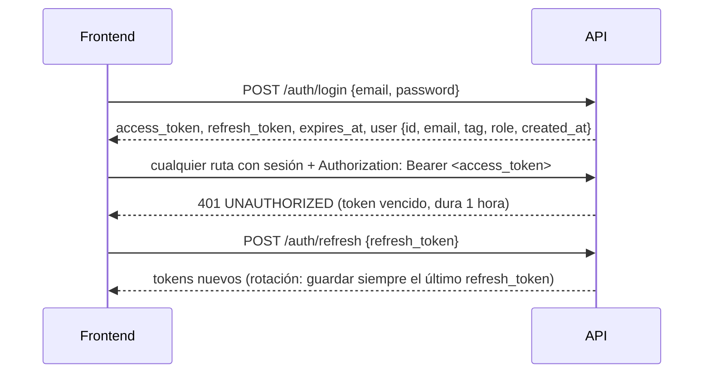

# Contrato para el frontend: Cómo se consume la API

> Parte del contrato para el frontend. Índice, estado y novedades: [`README.md`](README.md). Las decisiones de todos los módulos están en [`decisiones.md`](decisiones.md).

## 1. Cómo se consume la API (disponible)

El frontend habla **solo con la API**. No usa `supabase-js` ni la clave pública de Supabase.

| Qué | Dónde |
|---|---|
| Contrato | `GET /api/openapi.json` (OpenAPI 3.1): se pueden generar tipos o un cliente desde ahí |
| Documentación interactiva | `GET /api/docs`: permite probar los endpoints con un token |
| Estado del servicio | `GET /api/health` (`?deep=1` verifica también Supabase) |
| Código y guía | `web/backend/README.md` |
| URL en producción | `api.<dominio>`. El dominio todavía no está comprado: dejar la URL configurable por entorno |

### Levantar la API en local

Requisitos: Node 24, pnpm 12 (con Corepack: `corepack enable pnpm`) y Docker Desktop corriendo.

```bash
cd web/backend
pnpm install --frozen-lockfile
cp .dev.vars.example .dev.vars   # apunta a la Supabase local; CORS ya acepta http://localhost:*
pnpm db:start                    # Supabase en Docker con el esquema nuevo (replanteo 01 a 19); la base arranca vacía
pnpm dev:node                    # API en http://localhost:8787 (documentación en /api/docs)
```

| Qué | Dónde |
|---|---|
| Correos de Auth (confirmación del registro) | http://127.0.0.1:54324 (Inbucket: los correos no salen de la máquina) |
| Ver y editar la base | http://127.0.0.1:54323 (Supabase Studio) |
| Hacer admin a una cuenta | En Studio, SQL: `update profiles set role = 'admin' where tag = '<alias>';`. Organizadores: `PUT /api/v1/admin/users/{id}/role` |
| Borrar todo y empezar de nuevo | `pnpm db:reset` |

- **Datos:** la base local arranca vacía. Las cuentas, equipos, torneos y PCW se crean con la API. Las partidas jugadas, stats y ELO llegan del servidor de juego. Para probar pantallas con datos de partidas se cargan a mano en Studio (`matches` y `match_player_stats`); si hace falta un script de datos de prueba, pedirlo.
- **Nunca** apuntar el `.dev.vars` a la Supabase de producción: la web vieja la sigue usando y el esquema nuevo no está ahí hasta el corte.

### Sesión



- Guardar los dos tokens. No hay cookies.
- Ante un 401, renovar con `/auth/refresh` una sola vez y reintentar. Si el refresh también da 401, mandar al login.
- **El `refresh_token` rota en cada renovación, pero no es estrictamente de un solo uso.** Cada `/auth/refresh` devuelve uno nuevo, y Supabase Auth igual acepta reusar el anterior por un rato (`refresh_token_reuse_interval`: 10 segundos en la configuración local; es el valor estándar de Supabase). Lo que se midió en local (GoTrue v2.197.0, 2026-10-16):
  - Reusar el anterior dentro de los 10 segundos devuelve **200** y el mismo token nuevo de la primera renovación.
  - Pasados los 10 segundos, y aunque el token nuevo ya se hubiera usado, el anterior también dio **200**, con un token nuevo de la misma sesión. El vigente siguió funcionando.
  - **Se deja el comportamiento por defecto de Supabase** (decisión de Daniel, 2026-10-16). La defensa si una cuenta se ve comprometida es cerrar sesión (`POST /auth/logout`), que revoca la sesión entera.
- **Qué hace el frontend:** guardar siempre el último `refresh_token` que llegó y no depender de que el anterior se rechace ni de que se acepte. Con varias pestañas, que una sola renueve y comparta el resultado (evita renovaciones duplicadas y carreras).
- Las rutas públicas aceptan el token si viene: con sesión, la respuesta puede traer más datos (por ejemplo, los datos personales de un perfil privado que el usuario puede ver, o si el usuario es capitán de un equipo).
- `user.role` es `user`, `organizer` o `admin`. Las pantallas de admin se muestran solo a `admin`; "Crear torneo" y la gestión de torneos, a `organizer` y `admin` (en un torneo concreto, `viewer.can_manage` dice si puede gestionarlo). La API lo vuelve a verificar.

### Errores

Siempre con este formato:

```json
{ "error": { "code": "VALIDATION_ERROR", "message": "...", "details": [{ "path": "tag", "message": "..." }], "requestId": "..." } }
```

- Decidir qué mostrar según `code`, no según el texto.
- `details` dice qué campo falló: sirve para marcar el input.
- Los mensajes vienen en español.

| `code` | Qué mostrar |
|---|---|
| `VALIDATION_ERROR` | Error en el campo de `details[].path` |
| `BUSINESS_RULE` | El `message` tal cual: está escrito para el usuario (por ejemplo, "El formato BO5 no está habilitado para las PCW") |
| `INVALID_CREDENTIALS` | "Email o contraseña incorrectos" |
| `WRONG_PASSWORD`, `SAME_PASSWORD` | Al cambiar la contraseña: la actual no es correcta, o la nueva es igual (sección [2](cuenta.md)) |
| `EMAIL_NOT_CONFIRMED` | "Confirma tu email" |
| `RATE_LIMITED` | Esperar los segundos del header `Retry-After` (login y registro: 10 intentos por minuto por IP; cambio de contraseña: 5 por minuto por cuenta) |
| `UNAUTHORIZED` | Renovar la sesión o mandar al login |
| `FORBIDDEN`, `NOT_FOUND` | Mensaje según la pantalla |
| `CONFLICT` | Algo ya existe o está tomado (por ejemplo, un alias). El `message` sirve para mostrar |
| `INVALID_FILE`, `FILE_TOO_LARGE` | Problema con la imagen |
| `NOT_AVAILABLE` | `501`: la función no existe en este despliegue (hoy solo el estado de los servidores fuera de Node) |
| `INTERNAL` | Error genérico. Mostrar el `requestId` para poder rastrearlo |

### Listados (obligatorio: paginación, filtros y orden en el servidor)

**Todo `GET` que devuelve una lista** pagina, filtra y ordena en el servidor. El frontend no pagina, no filtra ni ordena nada por su cuenta.

```http
GET /api/v1/players?page=2&per=20&sort=rating&order=desc&q=mecha&has_steam=true
```

```json
{ "items": [ ... ], "total": 134, "page": 2, "per": 20, "sort": "rating", "order": "desc" }
```

| Parámetro | Regla |
|---|---|
| `page` | Desde 1 (por defecto 1) |
| `per` | De 1 a 100 (por defecto 20). En `/events/{id}/matches` y `/events/{id}/standings`, hasta 200 |
| `sort` | Uno de los campos permitidos de cada endpoint (lista cerrada; otro valor da `400 VALIDATION_ERROR`) |
| `order` | `asc` o `desc` |
| `q` | Texto libre, sin distinguir mayúsculas ni tildes |
| Booleanos | `true` o `false` |
| Fechas (`from`, `to`) | ISO 8601 (`2026-10-15` o con hora) |

- **Respuesta:** `total` es el total con los filtros aplicados, para armar el paginador. `sort` y `order` devuelven los que se usaron (incluidos los valores por defecto).
- **Orden estable:** cada endpoint suma un desempate fijo, así que las páginas no se mezclan.
- **Chat:** pagina por cursor (sección [8](partidas.md)).
- **Estado de los servidores** (`GET /api/v1/servers/status`): no es un listado paginado. Son pocos servidores y la respuesta es una foto completa con totales (sección [8e](partidas.md)).

**Listados, filtros y orden** (orden por defecto en **negrita**):

| Endpoint | Filtros | `sort` |
|---|---|---|
| `GET /api/v1/players` | `q` (alias y equipos), `team`, `has_account`, `has_steam`, `elo_min`, `elo_max` | **`elo` desc**, `alias`, `elo_matches`, `rating`, `kd`, `wins` |
| `GET /api/v1/players/{id}/matches` | `kind`, `result` (`won`, `lost`, `draw`), `map`, `from`, `to` | **`played_at` desc**, `rating`, `kills`, `elo_delta` |
| `GET /api/v1/me/matches` | Como `/players/{id}/matches` | Como `/players/{id}/matches` |
| `GET /api/v1/players/{id}/map-stats` | `map` | **`maps` desc**, `rating`, `kd`, `adr`, `wins` |
| `GET /api/v1/players/{id}/medals` | — | **`created_at` desc**, `title` |
| `GET /api/v1/players/{id}/teams` | `active` | **`joined_at` desc**, `left_at`, `name` |
| `GET /api/v1/teams` | `kind` (por defecto `official`), `q`, `has_space` | **`name` asc**, `members` |
| `GET /api/v1/teams/{id}/members` | `active`, `role` | **`alias` asc**, `joined_at`, `left_at`, `elo` |
| `GET /api/v1/ranking/teams` | `pcw` (`0` o `1`), `q` | **`points` desc**, `won`, `played`, `name` |
| `GET /api/v1/matches` | `kind`, `status`, `event`, `team`, `player`, `server`, `map`, `from`, `to`, `q` | **`played_at` desc**, `starts_at` |
| `GET /api/v1/events` | `q`, `status`, `template`, `organizer`, `from`, `to` | **`starts_on` desc**, `name`, `status` |
| `GET /api/v1/events/{id}/registrations` | `q`, `start_stage` | **`seed` asc**, `name` |
| `GET /api/v1/events/{id}/matches` | `stage`, `phase`, `grp`, `round`, `status`, `team`, `include_byes` | **`bracket` asc** (fase, etapa, grupo, ronda, posición), `starts_at`, `played_at` |
| `GET /api/v1/events/{id}/standings` | `stage` (`group`, `swiss`), `grp`, `phase` | **`place` asc** |
| `GET /api/v1/pcw/posts` | `best_of`, `q`, `from`, `to` | **`created_at` desc**, `starts_at` |
| `GET /api/v1/maps` | `q`, `include_inactive` | **`position` asc**, `name` |
| `GET /api/v1/me/team-invites` | `kind` (`invite`, `request`), `team` | **`created_at` desc**, `expires_at` |
| `GET /api/v1/teams/{id}/pending` | `kind` | **`created_at` desc**, `expires_at` |
| `GET /api/v1/me/pcw/matches` | `status` | **`starts_at` desc**, `played_at` |
| `GET /api/v1/servers` | `q` | **`name` asc** |
| `GET /api/v1/players/unclaimed` | `q` (nombres que usó y SteamID) | **`last_played` desc**, `matches`, `elo`, `last_nick` |
| `GET /api/v1/players/steam/{steamid}/matches` | Como `/players/{id}/matches` | Como `/players/{id}/matches` |
| `GET /api/v1/players/steam/{steamid}/map-stats` | `map` | Como `/players/{id}/map-stats` |
| `GET /api/v1/me/steam-requests` | `status`, `kind` (`add`, `remove`) | **`created_at` desc** |
| `GET /api/v1/admin/users` | `q`, `role`, `has_player`, `has_steam` | **`alias` asc**, `role` |
| `GET /api/v1/admin/steam/unlinked` | `q` (nombre o SteamID) | **`last_played` desc**, `matches`, `last_nick` |
| `GET /api/v1/admin/blocked-words` | `q` | **`word` asc**, `created_at` |
| `GET /api/v1/admin/blocked-words/hits` | `kind` | **`kind` asc**, `name` |
| `GET /api/v1/admin/team-requests` | `status`, `q` | **`status` asc** (pendientes primero), `name` |
| `GET /api/v1/admin/demos` | `status` (`pending`, `uploaded`, `missing`, `expired`), `server`, `kind`, `from`, `to`, `q` | **`played_at` desc**, `demo_size`, `demo_attempts`, `demo_uploaded_at`, `expires_at` |
| `GET /api/v1/admin/demo-workers` | `q`, `active`, `online` | **`name` asc**, `created_at`, `last_seen_at` |
| `GET /api/v1/admin/servers` | `q` (nombre, dirección, IPs, versión, región), `active`, `license` (`ok`, `expiring`, `expired`, `revoked`), `online`, `has_panel`, `mode` | **`name` asc**, `created_at`, `last_seen_at`, `license_expires_at`, `matches` |
| `GET /api/v1/admin/steam-requests` | `status`, `kind` (`add`, `remove`), `q` | **`status` asc** (pendientes primero, después la más nueva), `created_at` |
| `GET /api/v1/admin/claims` | `ok`, `steam_id`, `q`, `from`, `to` | **`created_at` desc** |

**Los detalles no traen listas que crecen.** La ficha del jugador, el equipo y el torneo devuelven sus datos; sus listas van en los sub-endpoints de la tabla (`/players/{id}/map-stats`, `/medals`, `/teams`, `/matches`; `/teams/{id}/members`; `/events/{id}/registrations`, `/matches`, `/standings`). El detalle de una partida sí trae lo que es fijo y corto: rosters, mapas de la serie, jugadores de un mix y veto.
