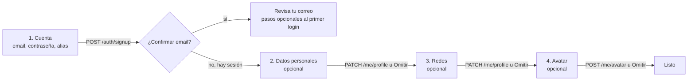

# Contrato para el frontend: Cuenta, Mi perfil y alias

> Parte del contrato para el frontend. Índice, estado y novedades: [`README.md`](README.md). Las decisiones de todos los módulos están en [`decisiones.md`](decisiones.md).

## 2. Cuenta y Mi perfil (disponible)

| Endpoint | Notas |
|---|---|
| `POST /auth/signup` | `{ email, password, tag }`. Si hay que confirmar el email, responde `session: null` y `needsConfirmation: true`: mostrar "revisa tu correo". El `tag` es el **alias** (sección 4): `409` si está tomado y `400` con `details[].path = "tag"` si tiene una palabra no permitida. Conviene validarlo antes con `GET /api/v1/aliases/{alias}/available` |
| `POST /auth/login`, `POST /auth/refresh`, `POST /auth/logout`, `GET /auth/me` | |
| `GET /api/v1/me/profile` | Cuenta, detalles, jugador vinculado, equipos actuales, partidas jugadas y `preferences`. `teams` es una lista (un jugador puede estar en varios equipos), con `is_captain` e `is_member`. `matches_played` cuenta las partidas que jugó en el servidor |
| `PATCH /api/v1/me/profile` | Solo se cambian los campos enviados. `null` o `""` borran un campo. Para el alias usar `PUT /me/alias` (sección 4). Acepta `preferences` (ver abajo) |
| `POST /api/v1/me/avatar` | `multipart/form-data`, campo `file`. **JPEG, PNG o WebP, máximo 1 MB** (no GIF). Recortar a 256×256 antes de subir |
| `POST /api/v1/me/password` | **Cambiar la contraseña** (ver abajo) |
| `GET /api/v1/me/matches` | **Mis partidas** (ver abajo) |

- **Preferencias de la cuenta** (`preferences`, solo las ve y las cambia el propio usuario):
  - `GET /api/v1/me/profile` siempre trae el objeto con todas sus claves: `preferences: { theme_fx: "full" | "silent" | "off" | null, notifications: { team: true, …, news: false } }`. `null` = todavía no eligió.
  - `theme_fx`: efectos al cambiar de tema. `"full"` con sonido, `"silent"` sin sonido, `"off"` desactivados.
  - `PATCH /api/v1/me/profile` con `{ "preferences": { "theme_fx": "silent" } }` cambia solo esa clave; `null` la borra. Las claves que no se mandan no se tocan (las preferencias futuras no se pisan).
  - `notifications`: categorías de notificaciones prendidas o apagadas (sección [12](notificaciones.md)). `{ "preferences": { "notifications": { "news": true } } }` cambia solo esas categorías y conserva las demás.
  - Otro valor, o una clave desconocida dentro de `preferences`, responde `400 VALIDATION_ERROR` con el campo en `details[].path`.
  - Al iniciar sesión, tomar el valor del servidor y reemplazar el del navegador; si es `null`, quedarse con el del navegador. Sin sesión, solo el navegador.
- **Cambiar la contraseña** (`POST /api/v1/me/password`, disponible desde el 2026-10-19):
  - Cuerpo: `{ "current_password": "...", "new_password": "..." }`. La nueva sigue las reglas del registro: de 6 a 72 caracteres.
  - Responde **`200` con una sesión nueva** (`access_token`, `refresh_token`, `expires_at`, `user`, como el login). **Guardarla en lugar de la anterior:** el cambio cierra todas las demás sesiones de la cuenta (otras PCs, el celular) y también la que hizo el pedido.
  - Errores: `400 WRONG_PASSWORD` (la actual no es correcta: marcar el campo `current_password`), `400 SAME_PASSWORD` (la nueva es igual a la actual), `400 VALIDATION_ERROR` (la nueva es corta o débil), `429` (más de 5 intentos por minuto de la misma cuenta).
  - Conviene avisar antes de confirmar: "Se va a cerrar la sesión en tus otros dispositivos".
  - **Fecha del último cambio** (disponible desde el 2026-10-19): `user.password_changed_at` (ISO) en `GET /auth/me`, en `user` de cada sesión (también la que devuelve el cambio) y en `user` de `GET /api/v1/me/profile`. Mostrarla como "Último cambio: …". **`null`:** no la cambió desde que se guarda la fecha (2026-10-19, también las cuentas nuevas): mostrar "Nunca" o no mostrar nada. Cuenta cualquier cambio, también el futuro "Olvidé mi contraseña".
  - El otro dispositivo, con su sesión cerrada, recibe `401` en `GET /auth/me` y vuelve al login.
  - **"Olvidé mi contraseña" todavía no existe:** necesita el envío de correos, que llega con el despliegue en el VPS.
- **Mis partidas** (`GET /api/v1/me/matches`, disponible desde el 2026-10-19):
  - Igual que `GET /api/v1/players/{id}/matches` con la ficha de la cuenta: mismos filtros, orden y respuesta, con las stats y el cambio de ELO de cada partida (sección [1](api.md), "Listados").
  - **Sin ficha** (la cuenta todavía no usó `!claim`): `200` con `items: []` y `total: 0`. Mostrar "Vinculá tu cuenta con `!claim` en el servidor para ver tus partidas" (sección [5b](jugadores.md)).
  - **Todas las partidas** de los servidores son `GET /api/v1/matches` (sección [8](partidas.md)); con `server=<id>`, las de un servidor.
- **Privacidad del perfil:** público o privado (ya no existe "solo miembros"). Privado oculta los **datos personales** (nombre real, país, redes); la ficha, las stats y las partidas siguen siendo públicas.

### Registro por pasos

Lo único obligatorio es crear la cuenta. Todo lo demás se completa con sesión y se puede omitir.

**Paso obligatorio: `POST /auth/signup`**

| Campo | Reglas |
|---|---|
| `email` | Email válido, hasta 254 caracteres |
| `password` | De 6 a 72 caracteres (Supabase puede exigir más según su configuración) |
| `tag` | El **alias**: de 2 a 24 caracteres, sin `<` ni `>`, único sin distinguir mayúsculas y sin palabras bloqueadas |

- **Alias en vivo:** se valida mientras se escribe con `GET /api/v1/aliases/{alias}/available`. Responde `available` y `reason`: `length`, `chars`, `blocked` o `taken`.
- **Errores del alias:** si está tomado, `409`; si tiene una palabra bloqueada, `400`. En los dos casos `details[0].path = "tag"`.
- **Con confirmación de email** (`needsConfirmation: true`): **no hay sesión hasta que confirme**. Mostrar "revisa tu correo" y ofrecer los pasos opcionales después del primer login.
- **Sin confirmación:** la respuesta ya trae la sesión y se sigue directo.
- **Límite:** 10 intentos por minuto por IP, compartido con el login.

**Pasos opcionales**

- **Datos personales y redes:** `PATCH /api/v1/me/profile`. Exige al menos un campo; si el usuario omite el paso, no se llama. Un paso o dos, da igual: acepta cualquier subconjunto.

  | Campo | Reglas |
  |---|---|
  | `real_name` | Hasta 60 caracteres: letras, espacios, punto, apóstrofe y guion |
  | `country` | Uno de la lista (países de Latinoamérica, España, Estados Unidos, "Otro") |
  | `game_role` | AWPer, Rifler, IGL, Support, Entry fragger, Lurker u Otro |
  | `steam` | SteamID64, `STEAM_X:Y:Z`, link del perfil o nombre de perfil |
  | `faceit` | Nickname o link de faceit.com |
  | `discord` | Nombre de usuario, de 2 a 40 caracteres, sin espacios |

- **Avatar:** `POST /api/v1/me/avatar`, con las reglas de la tabla de arriba.
- **Si el perfil está completo:** se ve en `details` de `GET /api/v1/me/profile`, para ofrecer "completa tu perfil" a quien lo omitió.

**Lo que no se hace en el registro**

- **Vincular el SteamID** (lo que hace falta para entrar a un equipo) **no es** el campo `steam` del perfil, que es solo un dato para mostrar. El vínculo real se hace con `!claim <código>` desde el juego (sección [5b](jugadores.md)). El registro conviene que avise que, para entrar a un equipo, hay que vincularlo.
- **La privacidad** es del jugador vinculado, no de la cuenta, y hoy la cambia el admin. Una cuenta nueva no tiene jugador.

## 4. Alias (disponible)

Un jugador con cuenta tiene **un solo nombre en la web: el alias**. Une lo que antes eran el tag de la cuenta y el nick del jugador.

- **Dónde se ve:** en todo: menú de la cuenta, Mi perfil, ficha, ranking, listados, planteles, chat.
- **Único:** sin distinguir mayúsculas ni espacios de los bordes. De 2 a 24 caracteres.
- **Quién lo cambia:**
  - **El usuario,** una vez cada **15 días** (`PUT /api/v1/me/alias`). Mostrar cuándo podrá volver a cambiarlo.
  - **El admin,** siempre, para moderar (`PUT /api/v1/admin/users/{id}/alias`).
- **Disponibilidad:** `GET /api/v1/aliases/{alias}/available`, para validar mientras se escribe en el registro y en Mi perfil.
- **Alias tomado:** `409 CONFLICT`. La respuesta de `PUT /me/alias` trae `next_change_at` (desde cuándo puede volver a cambiarlo).
- **Jugadores sin cuenta:** muestran el nombre que les pone el admin. Cuando alguien vincula ese jugador a su cuenta, pasa a mostrar el alias.
- **En el juego** cada uno usa el nombre que quiera: el servidor identifica por SteamID. En cada partida queda registrado el nombre que usó en el juego y la ficha lo puede mostrar como dato de esa partida.
- **Palabras bloqueadas:** un alias, un nombre o sigla de equipo o un nombre de bando de PCW que contenga una palabra de la lista se rechaza con `BUSINESS_RULE`. La comparación ignora mayúsculas, tildes, espacios y los reemplazos típicos (0→o, 1→i, 3→e, 4→a, 5→s, 7→t, @→a, $→s). La lista la gestiona el admin.
