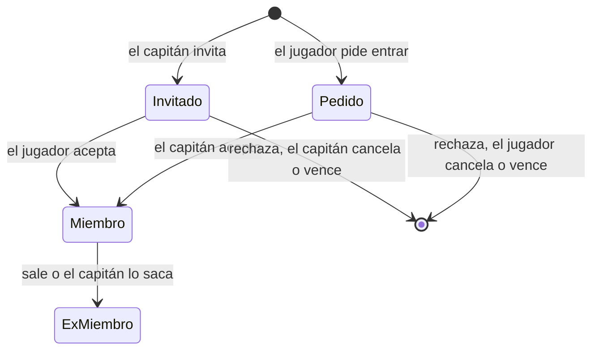

# Contrato para el frontend: Equipos, plantel y ranking

> Parte del contrato para el frontend. Índice, estado y novedades: [`README.md`](README.md). Las decisiones de todos los módulos están en [`decisiones.md`](decisiones.md).

## 6. Equipos y plantel (disponible)

### Reglas

| Regla | Detalle |
|---|---|
| Tamaño | Hasta **10** jugadores activos por equipo oficial |
| Cómo se entra | **Estilo FACEIT:** el capitán invita y el jugador acepta, o el jugador pide entrar y el capitán acepta. El admin puede todo, incluso sumar a alguien directamente |
| SteamID obligatorio | Solo puede entrar a un equipo quien tiene **cuenta con SteamID vinculado**. Si no lo tiene, la acción falla: mostrar cómo vincularlo |
| Varios equipos | Un jugador **puede estar en varios equipos** a la vez |
| Torneos | Un jugador no puede estar **inscrito** en un mismo torneo con dos equipos (sección [8b](torneos.md)). Entrar a un equipo es libre: lo que se controla es la inscripción |
| PCW | No se puede jugar una PCW si un jugador está en el roster de los dos bandos: aceptarla falla con un mensaje. Al publicar o aceptar, el bando puede jugar **como uno de sus equipos oficiales** (sección [8](partidas.md)) |
| Vencimiento | Invitaciones y pedidos vencen a los **7 días** (`expires_at`). Uno abierto por jugador y equipo. Los listados de la API ya excluyen los vencidos |
| Capitán | No puede salir sin ceder antes la capitanía. La cede a un miembro con cuenta |
| Salir o ser sacado | El jugador queda como ex integrante (historial) |
| Equipos PCW | No usan invitaciones: se arman al publicar o aceptar la PCW |

### Endpoints

| Endpoint | Quién | Pantalla |
|---|---|---|
| `GET /api/v1/teams` | Todos | **Equipos** (por defecto oficiales): nombre, sigla, capitán, jugadores (de 10) |
| `GET /api/v1/teams/{id}` | Todos | **Equipo:** datos, capitán, récord y `viewer` |
| `GET /api/v1/teams/{id}/members` | Todos | Plantel (`active=true`: alias, rol, ELO, nivel, capitán) y ex integrantes (`active=false`). Las partidas del equipo: `GET /api/v1/matches?team={id}` |
| `GET`/`PUT /api/v1/me/team-request` | Usuario | **Solicitar equipo nuevo** (nombre y sigla), una por usuario. Al aprobarla, el usuario queda como dueño, capitán y primer miembro |
| `GET /api/v1/me/team-invites` | Usuario | **Mis invitaciones** recibidas (`kind=invite`) y pedidos enviados (`kind=request`), abiertos |
| `POST /api/v1/teams/{id}/join-requests` | Usuario | Botón "Pedir entrar" en la página del equipo |
| `POST /api/v1/team-invites/{id}/accept` / `…/reject` | Invitado | Aceptar o rechazar |
| `DELETE /api/v1/join-requests/{id}` | Quien pidió | Cancelar su pedido |
| `POST /api/v1/teams/{id}/leave` | Miembro | Salir |
| `GET /api/v1/teams/{id}/pending` | Capitán o admin | **Gestión del equipo:** invitaciones enviadas (`kind=invite`) y pedidos recibidos (`kind=request`) |
| `POST /api/v1/teams/{id}/invites` | Capitán o admin | Invitar por `alias` o `player_id` (el jugador necesita cuenta y SteamID) |
| `DELETE /api/v1/team-invites/{id}` | Capitán o admin | Cancelar una invitación |
| `POST /api/v1/join-requests/{id}/accept` / `…/reject` | Capitán o admin | Aceptar o rechazar un pedido |
| `DELETE /api/v1/teams/{id}/members/{playerId}` | Capitán o admin | Sacar a un jugador |
| `POST /api/v1/teams/{id}/captain` | Capitán o admin | `{ player_id }`: ceder la capitanía a un jugador con cuenta |
## 7. Ranking de equipos (disponible)

- `GET /api/v1/ranking/teams?pcw=0|1`: posición, equipo, PJ, G, P y puntos, paginado. `points_per_win` trae los puntos vigentes por victoria.
- Desde el 2026-10-24 cada fila suma, en el modo pedido (con o sin PCW):
  - `win_rate`: % de victorias (0 a 100; null sin partidas).
  - `trend`: puestos que subió (positivo, "▲n") o bajó (negativo, "▼n") desde hace 30 días; `0` igual ("–"); `null` si hace 30 días no tenía partidas en ese modo ("–").
  - `form`: últimos 5 resultados (`W`/`L`), del más viejo al más nuevo.
- **Desempate:** más victorias y después menos derrotas. Los empatados en todo comparten posición.
- **Sin logo:** los equipos no tienen logo; mostrar la sigla en un cuadro.
- **Por defecto cuenta solo torneos.** Un interruptor "Contar también PCW" pasa `pcw=1`: suman las PCW jugadas como el equipo (no las de bandos sueltos).
- **Los puntos son por partida ganada**, no por ganar el torneo entero. Al principio: **30 por partida de torneo** y **5 por PCW**. Los configura el admin y la respuesta trae los valores vigentes, para mostrarlos como leyenda.
- Toda partida de torneo ganada vale lo mismo, sin importar la fase. Los W.O. no suman.
