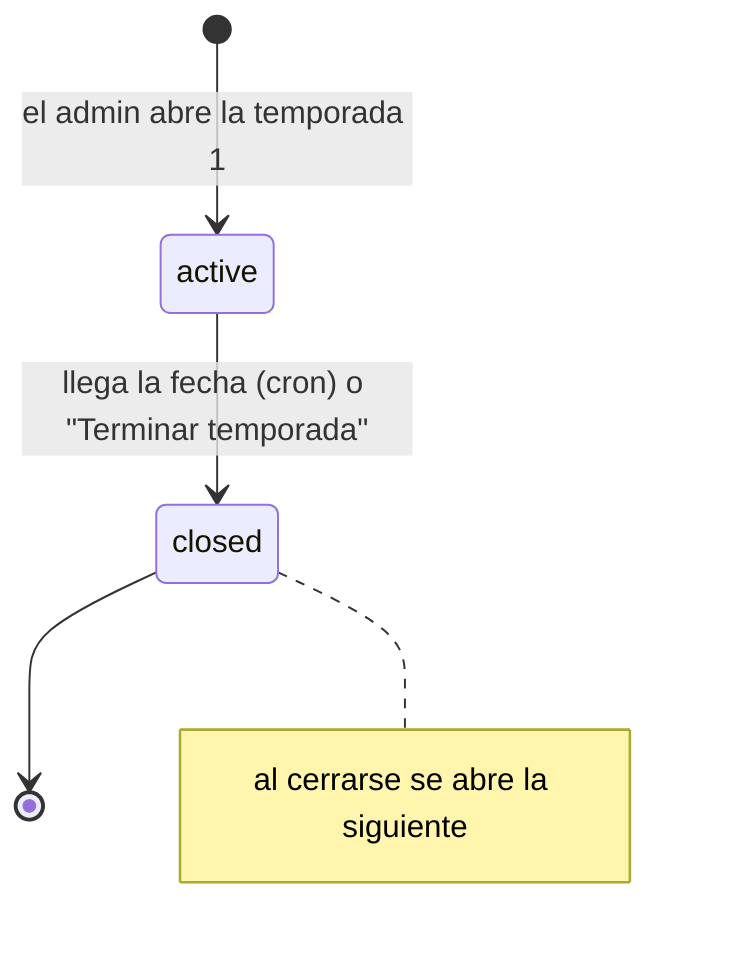

# Contrato para el frontend: Temporadas

> Parte del contrato para el frontend. Índice, estado y novedades: [`README.md`](README.md). Las decisiones de todos los módulos están en [`decisiones.md`](decisiones.md).

## 8f. Temporadas (disponible desde el 2026-10-21)

Cada cierto tiempo se cierra una **temporada**. Al cerrarse:
- Se guarda una **foto del ranking final**, que después no cambia.
- Los del **top N** que jugaron el **mínimo de mixes** reciben una **medalla por tramo**.
- Los **nivel 10** se reinician cerca del inicio del nivel 10.
- Se abre la temporada siguiente.

Solo para jugadores, no para equipos. Lo jugado antes de la temporada 1 cuenta para el ELO pero no da medallas ("pretemporada").



### Reglas

| Regla | Valor por defecto | Detalle |
|---|---|---|
| Duración | **30 días** | La cierra un cron a las **06:00 de Argentina** (09:00 UTC) del día de fin. Si hay un mix en vivo, espera a que termine (hasta 6 horas) |
| Top | **20** | Reciben medalla los puestos 1 a N |
| Mínimo para el ranking | **20 mixes** jugados en la temporada | Cuentan los mixes terminados que le movieron el ELO (los interrumpidos que aprobó un admin también). Con menos, el jugador aparece sin puesto (`rank: null`) |
| Puesto | ELO | Desempate: más mixes en la temporada; después, quien llegó antes a ese ELO |
| Reinicio | **10 %** sobre **2001** | Solo nivel 10. Conserva el porcentaje de lo que tenía sobre el piso. Debajo del piso no cambia |
| ELO pico | De la temporada | Al empezar cada temporada, `peak_elo` arranca en el ELO actual |

**Fórmula del reinicio** (para calcularla en el navegador, sin pedirla a la API):

```
si elo > piso:  nuevo = piso + redondear((elo − piso) × porcentaje / 100)
si no:          nuevo = elo
```

`redondear` es al entero más cercano, y las mitades se alejan del cero (como `Math.round` para valores positivos). Ejemplos con 10 % y piso 2001: 2540 → 2055, 2200 → 2021, 2010 → 2002, 1990 → 1990. Con 0 %, todos los nivel 10 vuelven a 2001.

**Medallas por tramo** (por defecto; el admin las edita):

| Puestos | Medalla |
|---|---|
| 1 | 🏆 Campeón |
| 2 | 🥈 Subcampeón |
| 3 | 🥉 Tercer puesto |
| 4 a 10 | 🎖️ Top 10 |
| 11 al top N | 🏅 Top {top} ("Top 20") |

- Cada tramo es `{ from, to, name, icon }`. Van en orden desde el puesto 1, sin huecos, y solo el último tiene `to: null` (llega hasta el top N).
- En `name`, `{top}` se reemplaza por el top N.
- La medalla queda en la ficha con el título "Temporada 1 · #3" y el ícono del tramo.

**Parámetros congelados:** cada temporada tiene su top, mínimo, porcentaje, piso y tramos. Cambiar la configuración después no cambia temporadas cerradas, ni siquiera si se recalcula el ELO.

### Endpoints públicos

| Endpoint | Pantalla |
|---|---|
| `GET /api/v1/seasons` | Selector de temporada y listado: `number`, `name`, `status` (`active` o `closed`), fechas, parámetros, `tiers`, `champion` (`{ id, alias }`, `null` en la activa) y `medals`. Filtro `status`; `sort`: **`number` desc** |
| `GET /api/v1/seasons/current` | La activa, con `ends_at` para la **cuenta regresiva**. `404` si no hay ninguna |
| `GET /api/v1/seasons/{id}/standings` | **Ranking de la temporada**. En la activa es en vivo; en una cerrada es la foto del cierre. Cada fila: `rank`, `player` (`id`, `alias`, `photo_url`), `eligible`, `elo`, `level`, `peak_elo`, `matches`, `wins`, `losses`, `elo_after` (en la activa: si cerrara ahora) y `medal` (`{ name, icon }` o `null`). Filtros `q` y `eligible`; `sort`: **`rank` asc** (los que no llegan al mínimo van al final, por ELO), `elo`, `matches`, `alias` |
| `GET /api/v1/players/{id}/seasons` | Pestaña **Temporadas** de la ficha: lo mismo por cada temporada cerrada, con `season` (`{ id, number, name }`) en vez de `player`. `sort`: **`number` desc** |
| `GET /api/v1/players/{id}/medals` | Cada medalla suma `season` (`{ id, number, name }`, `null` en las que da el admin a mano) y `rank` |

**Pantallas sugeridas:**
- **Ranking:** selector de temporada (la activa por defecto) y cuenta regresiva hasta `ends_at`. Quien no llega al mínimo se marca con su avance ("12/20 mixes": `matches` sobre `min_matches` de la temporada). Se puede mostrar la medalla que tendría cada uno si cerrara ahora.
- **Ficha del jugador:** historial de temporadas y medallas con su temporada.

### Admin

| Endpoint | Qué hace |
|---|---|
| `GET`/`PUT /api/v1/admin/seasons/config` | Valores con los que se abre la **próxima** temporada: `duration_days` (1 a 365), `top_n` (1 a 500), `min_matches` (1 a 1000), `reset_pct` (0 a 100), `reset_floor` (0 a 10000) y `tiers` |
| `POST /api/v1/admin/seasons` | Abre la temporada 1 (o la siguiente, si no hay ninguna activa). Body opcional: `name` y `ends_at` (futura). `409` si ya hay una activa. Después, cada cierre abre la siguiente solo |
| `PATCH /api/v1/admin/seasons/{id}` | Cambia la **activa**: `name`, `ends_at` (futura), `top_n`, `min_matches`, `reset_pct`, `reset_floor` y `tiers`. Lo que no llega no cambia. Una cerrada da `400` |
| `GET /api/v1/admin/seasons/preview` | **Vista previa del cierre** con `top_n`, `min_matches`, `reset_pct` y `reset_floor` en la query (obligatorios): quién recibe cada medalla y cómo queda cada uno. Cada fila: `rank`, `player` (`id`, `alias`), `eligible`, `elo`, `matches`, `medal`, `elo_after` y `reset` (se reinicia). Filtros `q`, `reset` y `medal`; `sort`: **`rank` asc**, `elo`, `alias`. Suma `summary`: `players`, `eligible`, `medals`, `reset`, `avg_drop` y `max_drop`. No guarda nada |
| `POST /api/v1/admin/seasons/{id}/close` | **Terminar temporada** ya. Body: `{ confirm }`. Responde `season_id`, `next_season_id`, `medals`, `reset` (cuántos se reiniciaron) y `closed_at`. No se deshace |

**Prueba interactiva del porcentaje (pedido de Daniel):** en la configuración, elegir un jugador (o escribir un ELO) y mover el porcentaje con un control deslizante; se ve en el momento "2540 → 2055". Se calcula en el navegador con la fórmula de arriba, sin una consulta por cada movimiento. Al lado, la vista previa del cierre con los valores del formulario (esa sí consulta la API, con un pequeño retardo).

**"Terminar temporada" pide doble confirmación (obligatorio),** como deshacer un ajuste de ELO:
1. Pregunta si está seguro, con un resumen de lo que va a pasar (el `summary` de la vista previa: cuántas medallas y cuántos nivel 10 bajan).
2. Pide escribir **`estoy seguro`**. El botón queda deshabilitado hasta que el texto coincide (sin distinguir mayúsculas ni espacios en los bordes).
3. Manda ese texto en `confirm`. Sin él, o con otro texto, la API responde `400 VALIDATION_ERROR` en `confirm` y no cierra.

El cierre por fecha no tiene endpoint: lo hace el cron del servidor.
