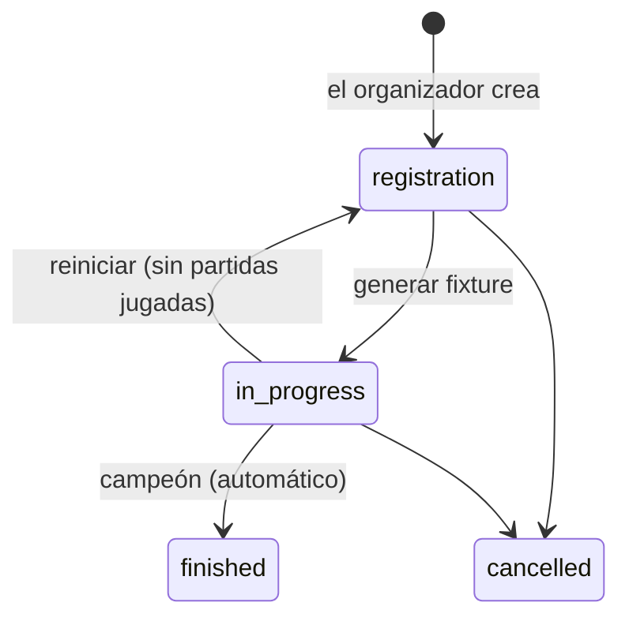

# Contrato para el frontend: Torneos

> Parte del contrato para el frontend. Índice, estado y novedades: [`README.md`](README.md). Las decisiones de todos los módulos están en [`decisiones.md`](decisiones.md).

> **2026-10-28 (rompe):** `players_min` y `players_max` ya no existen. Cada torneo tiene un modo de juego (`game_mode`, con sus `players_per_team`) y `subs_max`, y la inscripción es `{ active, subs }` sin el coach. Suma banner, cierre de inscripciones, BO y fase actual en el listado, y `live_match`. El detalle está en [`contrato-frontend-equipo-torneos.md`](../../../contrato-frontend-equipo-torneos.md); donde esta sección diga otra cosa, manda ese archivo.

## 8b. Torneos (disponible)

### Quién

- **Organizador:** un usuario con `role = 'organizer'`, que nombra el admin. Crea torneos y en **los suyos** hace todo lo del admin. El admin gestiona todos.
- **En cada torneo,** `viewer.can_manage` del detalle dice si quien consulta puede gestionarlo.

### Plantillas y valores por defecto

El organizador elige una plantilla y ajusta `config`. En cada fase elige **BO1, BO3 o BO5**.

| Plantilla (`template`) | Fases | Por defecto |
|---|---|---|
| `single` (eliminación directa) | Llave | Todas las rondas y la final BO3; 3.er puesto apagado |
| `double` (doble eliminación) | Upper, lower, final del upper, final del lower, gran final | BO3; gran final BO5; **sin reset**; mapa de ventaja apagado |
| `groups` (grupos + playoffs) | Grupos A, B, C… de todos contra todos → playoffs | 2 grupos, clasifican 2; grupos BO1; playoffs y final BO3 |
| `swiss` (suizo + playoffs) | 1 a 3 fases suizas de 16 (u 8) → playoffs | 3 victorias clasifican y 3 derrotas eliminan (2 y 2 con 8); BO1, decisivas BO3; playoffs y final BO3 |
| `groups_double` (grupos de doble eliminación + playoffs) | Grupos A, B… con una doble eliminación cada uno → playoffs | 2 grupos, clasifican 3; grupos BO3; playoffs BO3 y **final BO5**; 3.er puesto apagado |

- **Mapa de ventaja** (doble eliminación): el campeón del upper empieza la gran final 1-0, en BO3 o BO5. El marcador ya lo muestra desde el principio.
- **3.er puesto:** opcional. Si se activa, BO3.
- **Grupos:**
  - Victoria 3 puntos, derrota 0.
  - Desempate, en orden:
    1. Puntos.
    2. Diferencia de rondas.
    3. Resultado entre los empatados.
    4. Rondas ganadas.
    5. El organizador.
  - En playoffs, el 1.º de un grupo se cruza con el 2.º de otro.
  - Con 1 grupo y 1 clasificado funciona como una liga.
- **Suizo:**
  - Se cruzan equipos con el mismo récord (0-0, después 1-0 y 0-1…), sin repetir rival.
  - Cada equipo empieza en la fase 1, salvo que el organizador lo ponga en otra (equipos que entran directo, como en el Major).
  - Hacen falta exactamente 16 (u 8) en la fase 1 y la mitad en cada fase siguiente.
- **Grupos de doble eliminación** (`groups_double`):
  - De 1 a 8 grupos, de 4 a 8 equipos por grupo (reparto en serpentina por la siembra). Clasifican 2 o 3 por grupo; siempre hay playoffs.
  - Cada grupo es una doble eliminación **sin final del grupo**: 1.º gana la final del upper; 2.º gana la final del lower; 3.º la pierde. Un equipo queda afuera con su segunda derrota.
  - Con menos de 8 en un grupo hay libres para los primeros de la siembra: con 6, los lugares 1 y 2 pasan directo a la ronda 2 del upper. Los libres del lower se resuelven solos cuando bajan los perdedores.
  - Los que pierden la ronda 2 del upper bajan **cruzados** (para no repetir rival enseguida).
  - Playoffs: los 1.º, después los 2.º, después los 3.º. Con 2 grupos y 3 clasificados: cuartos 2.º B vs 3.º A y 2.º A vs 3.º B; los 1.º esperan en semifinales (1.º A con el ganador de 2.º B–3.º A).
  - Nombres de las fases (`label`): "Grupo A · upper · ronda 1", "Grupo A · final del upper", "Grupo B · lower · ronda 2", "Grupo B · final del lower".
  - Tabla del grupo: `GET /events/{id}/standings?stage=group_double`. Cada fila: `place` (los eliminados en la misma ronda comparten puesto), `won`, `lost`, rondas y `state` (`active` mientras sigue en carrera, `qualified` o `eliminated`). No hay empates para resolver.
  - Diagrama con un ejemplo completo: https://claude.ai/artifact/3zRgeGRrE8VS7VUAcuy13y
- **Sorteo** (todas las plantillas):
  - `POST /api/v1/events/{id}/draw` (organizador o admin, antes de generar) mezcla al azar la siembra con todos los inscritos y la devuelve (`seeds`, `drawn_at`). Se puede repetir hasta generar.
  - Con grupos, el sorteo decide el grupo y el lugar dentro del grupo.
  - El detalle del torneo trae `draw: { at, by: { user_id, alias } }`: mostrarlo ("Sorteado por X el …") para que los equipos vean que no se acomodó a mano. Cambiar la siembra a mano, o una inscripción o baja, lo borra (`draw: null`).
- **Empate sin resolver en un grupo:**
  - `tie_pending: { grp }` indica el grupo, y la fila trae `tied: true` en los empatados.
  - El organizador ordena esos equipos con `POST /api/v1/events/{id}/ties` y los playoffs se arman solos.

### Inscripción

- **Quién:** el capitán inscribe a su equipo eligiendo **qué jugadores juegan**, entre `players_min` y `players_max` del torneo (por defecto 5 y 7; máximo 10). Tienen que ser del plantel y tener SteamID.
- **Un jugador, un equipo:** si un jugador ya está inscrito con otro equipo en el mismo torneo, la inscripción falla con un mensaje que nombra al jugador y al equipo.
- **Cambios:** el capitán cambia los inscritos o da de baja al equipo hasta que se genera el fixture. Después, solo el organizador cambia jugadores.
- **Si un inscrito sale del equipo,** deja de estar inscrito. Mostrar un aviso si el equipo queda por debajo del mínimo.

### Flujo

- **Antes de generar:** el formato (plantilla, configuración, inscritos por equipo) y la siembra solo se cambian antes de generar.
- **Después de generar, todo avanza solo** con cada resultado. El organizador puede:
  - Asignar hora y servidor a cada partida (`PATCH /api/v1/matches/{id}`; la lista sale de `GET /api/v1/servers`, que trae solo los servidores activos con licencia vigente).
  - Cargar o corregir un resultado (`POST /api/v1/matches/{id}/result` con `maps`, `walkover` o `clear`). Una corrección falla si ya se jugaron partidas que dependían de esa.
  - Marcar **W.O.**: gana el equipo que se presentó. Cuenta para la llave, pero **no suma puntos en el ranking**.
  - Reiniciar el veto de una partida.
- **Borrar un torneo:** solo sin partidas jugadas; si no, se cancela.

### Endpoints

| Endpoint | Quién | Pantalla |
|---|---|---|
| `GET /api/v1/events` | Todos | **Torneos** |
| `GET /api/v1/events/{id}` | Todos | **Torneo**: configuración, estado, campeón, empate pendiente y `viewer`. Con `ETag` |
| `GET /api/v1/events/{id}/registrations` | Todos | Inscritos con siembra y jugadores |
| `GET /api/v1/events/{id}/matches` | Todos | Partidas (con `stage`, `phase`, `grp`, `round`, `pos` y `bye` para dibujar la llave; hasta 200 por página). Con `ETag` |
| `GET /api/v1/events/{id}/standings` | Todos | Tablas de grupos (`group`), grupos de doble eliminación (`group_double`) y del suizo, con la posición. Con `ETag` |
| `PUT`/`DELETE /api/v1/events/{id}/registrations/{teamId}` | Capitán u organizador | Inscribir, cambiar inscritos (`{ players, start_stage? }`) o dar de baja |
| `POST /api/v1/events`, `PATCH`/`DELETE /api/v1/events/{id}`, `POST …/cancel` | Organizador o admin | Crear, editar, borrar, cancelar. `map_pool` (opcional): el pool del veto del torneo, entre los mapas disponibles del catálogo (`GET /maps`, por ejemplo `de_russka` aunque no esté en el pool por defecto), sin repetir y con al menos tantos mapas como el BO más alto de `config`. `null` = el pool por defecto. **No cambia después del primer veto** de una partida del torneo (`400`). El detalle lo devuelve en `map_pool` |
| `PUT /api/v1/events/{id}/seeds` | Organizador o admin | Orden de siembra a mano (todos los inscritos) |
| `POST /api/v1/events/{id}/draw` | Organizador o admin | Sorteo de la siembra (`{ seeds, drawn_at }`) |
| `POST /api/v1/events/{id}/generate` · `…/reset` · `…/ties` | Organizador o admin | Fixture y empates |

**Para dibujar las llaves:** las partidas traen `stage` y la posición.
- **`stage`:** `ko`, `third`, `upper`, `lower`, `grand`, `group` o `swiss`.
- **Posición:** `phase` (fase), `round` (columna) y `pos` (fila).
- **Byes:** no vienen en el listado.
