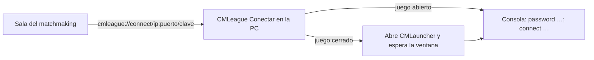

# Ideas para el matchmaking (para Daniel)

> Armado por Kyan el 2026-11-03. Son ideas, no planes aprobados: ninguna está empezada. Cada una dice qué parte tocaría: **base** (Supabase), **API**, **web** o **servidor** (plugin).

## Antes de las ideas: lo que cambió y te toca

- **2.9.3 en flow y MVZG (2026-11-03).** Vi que subiste nuestra 2.9.2 a los dos para producción (flow licenciada con `cedf12a8-…`, MVZG genérica). Les subí la **2.9.3**, con la misma licencia en cada uno: arregla que la ronda de cuchillo empezara con las armas del deathmatch del calentamiento (`csstv_qol` 1.3.1). `csstv_state` ahora cambia en el mismo cuadro que el estado. No toqué tus cfg. También subí `csstv_password` 1.1.0 a flow y aurav34, que tenían la 1.0.0.
- **MVZG tenía la 2.9.2.** Es tu 2.9.1 más la cuarta tanda de QOL. Se juntó tu rama `feat/mm-claim-en-sala` (`eea1821`) en `kyan/pruebas` (commit `8693f59`). El único conflicto fue la versión. Tu `csstv_reporter.cfg` quedó igual (`csstv_mm "1"`, `csstv_claim "1"`), con 4 ConVars nuevas sumadas. La 2.9.1 está en `plugins/disabled/csstv_reporter_2.9.1.smx`. Detalle: [`2026-11-02-qol-tanda-4`](../bitacora/2026-11-02-qol-tanda-4/GUIA_IMPLEMENTACION.md).
- **Estado sin la consola.** El reporter publica el estado en la ConVar `csstv_state` ("calentamiento", "en vivo"…). Los modos publican `sm_retake_on`, `sm_2v2_on` y `sm_dm_on`. Antes, `csstv_qol`, `csstv_coach` y `csstv_pedir` le pedían `sm_csstv_status` al reporter cada segundo, y la consola de los servidores se llenaba con esas respuestas. Si sumás un plugin que necesite el estado, leé la ConVar.
- **`!rr` sin admin.** Lo piden los dos capitanes. Para los admins, el permiso ahora se pregunta con el override `csstv_rr_admin` (ADMFLAG_GENERIC), porque `sm_rr` pasó a ser un comando para todos.
- **El botón Conectar de la sala** (`RoomOverview`) y "Volver a la partida" (`ReconnectBanner`) ya no usan `steam://`. Ese link abre el CS:S de Steam, no el v34. Ahora usan `cmleague://connect/<ip:puerto>/<contraseña>`, que atiende CMLeague Conectar (`hud/conectar/`): se instala una vez y escribe `password …; connect …` en el juego. Abajo del botón hay un link a `/descargas/cmleague-conectar.zip`. Acepta solo contraseñas de letras, números, `-` y `_`, de hasta 32 caracteres. Las de `Mm_RotatePassword` entran; si la web genera contraseñas con otros caracteres, avisame. **Falta probarlo en una PC con el juego.**

## Las que le gustaron a Kyan (para más adelante)

Anotadas en `docs/PENDIENTES.md`, en "Decisiones anotadas para planes futuros". No se hacen todavía.

| Idea | Qué es | Toca |
|---|---|---|
| **Repetición 2D de cada ronda** | El servidor guarda la posición de cada jugador cada segundo. La web muestra el radar del mapa con los puntos moviéndose, las kills y la bomba, ronda por ronda | Servidor (mandar posiciones), base, API y web |
| **Mapa de calor** | Por jugador y por mapa: dónde mata y dónde muere | Lo mismo: sale de las posiciones de cada kill |

Las dos necesitan que el reporter mande posiciones; hoy solo manda el tick de cada kill, para los clips. También hace falta una imagen de radar por mapa, con su escala y su origen.

## Ideas nuevas

### En el juego (las puedo hacer yo en el plugin, con datos de la web)

| # | Idea | Toca |
|---|---|---|
| 1 | Tu nivel (1 a 10) delante del nombre en el TAB, como en FACEIT | Servidor + el nivel desde la web |
| 2 | Al empezar, la predicción de ELO: "Si ganan: +24 · Si pierden: −26" | Servidor + cálculo del ELO de la API |
| 3 | El ELO promedio de cada equipo en el encabezado del cuchillo | Servidor + la reserva de la sala |
| 4 | "Fulano lleva 5 partidas ganadas seguidas" al empezar | Servidor + la racha desde la web |
| 5 | Títulos al final, además del MVP: "Entry de la partida", "Ancla", "Rey del clutch", "Más utilidad" | Servidor (y la web los puede mostrar en la partida) |
| 6 | Bombas plantadas y desactivadas en el resumen final | Servidor |
| 7 | Votación del MVP entre los diez al terminar, que suma a la nota de conducta | Servidor + base |
| 8 | Consejos para las primeras 3 partidas de un jugador nuevo (cómo pausar, `!tech`, `!rr`) | Servidor + cuántas partidas lleva |

### Matchmaking (tu parte)

| # | Idea | Toca |
|---|---|---|
| 9 | **Reemplazo:** si alguien abandona, la web le ofrece el lugar a alguien de la cola | Base, API, web y servidor (aceptar al nuevo en el plantel) |
| 10 | **Seguro de abandono:** si un compañero abandona, tu equipo pierde menos ELO | Base (cálculo del ELO) |
| 11 | **Canales de voz automáticos en Discord:** al armarse la sala, el bot crea un canal por equipo y mueve a cada uno | Bot de Discord + API |
| 12 | **Modo draft:** los dos de más ELO son capitanes y eligen jugadores por turnos | Base, API y web (sala) |
| 13 | **Cola rápida 2v2** con el plugin `v34_wingman`, para cuando no hay diez | Base, API, web y servidor |
| 14 | Que CMLeague Conectar te vuelva a entrar solo si se te cierra el juego en plena partida | `hud/conectar` + saber si la partida sigue |

### Web

| # | Idea | Toca |
|---|---|---|
| 17 | Comparación cara a cara: "vos vs Fulano" en todas las partidas juntos | API y web |
| 18 | Misiones diarias ("3 kills con Deagle") que dan monedas para la tienda | Base, API, web y servidor (contar) |
| 19 | Pase de temporada con los avatares y fondos de la tienda como premios | Base, API y web |
| 20 | Rondas con lag marcadas en la partida de la web (fps del servidor, pérdida de paquetes) | Servidor (`csstv_perf` ya mide) + web |

## Ideas anteriores que tocan el matchmaking

De la lista "para que sea el mejor matchmaking". Kyan dice que **la mayoría ya la tenemos**: revisá cuáles faltan.

| Idea | Qué es |
|---|---|
| Revisión de reportes | Al terminar, `!report` desde el juego. Jugadores de nivel alto revisan la demo en la web y votan; con varios votos en contra, sanción |
| Jugadas sospechosas | Con los ticks de las kills, marcar a quien tiene un porcentaje de headshot o un tiempo de reacción fuera de lo normal en varias partidas |
| SourceTV atrasada | `tv_delay 90` en el matchmaking |
| Anti-smurf | 10 partidas de ubicación; las cuentas que suben demasiado rápido se marcan |
| Ping en la búsqueda | Elegir el servidor con mejor ping para los diez |
| Grupos contra grupos | Un grupo de 4 o 5 juega contra otro grupo |
| ELO según el rendimiento | Pierde menos el que juega mejor, con un tope chico |
| Tu ELO al final, en el juego | "Tu ELO: 1240 → 1265 (+25)" en el chat |
| Elogios y nota de conducta | "Amistoso", "líder", "buen compañero"; los de nota baja se cruzan entre ellos |
| Silenciar a alguien del equipo | Votación del equipo, por voz y chat, lo que queda de la partida |
| Filtro de insultos | Aviso y, si sigue, silencio automático |
| Encuesta al final | "¿Cómo estuvo la partida?" de 1 a 5 |
| Temporadas | Reinicio parcial del ELO cada mes, con medallas y fondos de perfil |
