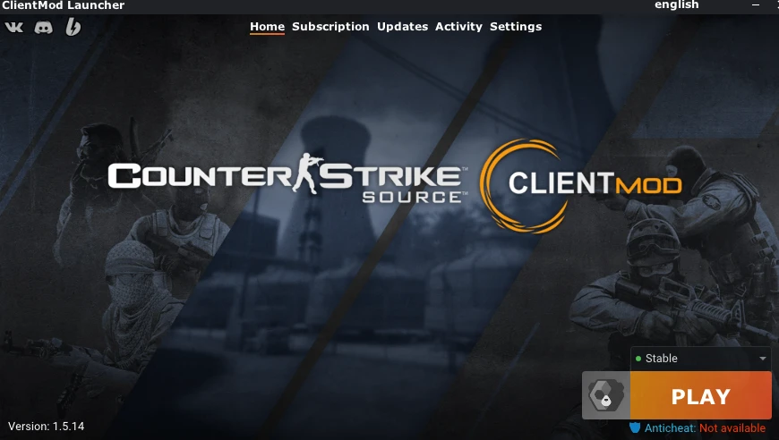

Los servidores de CMLeague pueden exigir **CMLeague Anticheat**, una aplicación para Windows que tienes que tener abierta mientras juegas. Si un servidor la exige y no la tienes, te avisa en el chat y te saca a los 20 segundos.

## Instalarlo y vincularlo

1. Bájalo con **Descargar CMLeague Anticheat**, en [Jugar](/play) debajo del botón para buscar partida (o directo desde [descargas.cmleague.lat](https://descargas.cmleague.lat/anticheat/CMLeagueAC.exe)), y ábrelo: se instala solo. La primera vez te pide que aceptes los términos y la política de privacidad. Si Windows dice "Windows protegió tu PC", toca **Más información** y después **Ejecutar de todas formas**.
2. Toca **Vincular con cmleague.lat**. Se abre la web con un código: confírmalo con tu cuenta.
3. Listo. Desde ahí, ábrelo antes de jugar y déjalo abierto hasta terminar. Si dice **Todo listo para jugar**, puedes entrar al servidor.

Tiene que estar abierto **en la misma PC donde juegas**.

## Si todavía no vinculaste tu SteamID

El servidor sabe que el anticheat es tuyo por tu SteamID, así que tiene que estar vinculado a tu cuenta (ver [Vincular tu SteamID](/help/jugador/vincular-steamid)). Si entras con uno que no lo está, por ejemplo en tu primera partida o desde otra PC, el servidor te avisa en el chat y tienes **1 minuto** desde que entraste para escribir el `!claim` que te muestra la sala. Apenas lo escribes, el servidor te vuelve a revisar. Si no lo escribes en ese minuto, te saca con `AC-1`.

## ClientMod, sin su anticheat

En nuestros servidores se juega con ClientMod **con su anticheat (EAC) apagado**. Antes de abrir el juego, en CM Launcher deja **gris** el botón del anticheat: debajo de **Play** tiene que decir `Anticheat: Disabled` o `Anticheat: Not available` (las dos quieren decir que está apagado). Si está **azul** y dice `Anticheat: Enabled`, tócalo para apagarlo.

Si lo abriste con el EAC prendido, CMLeague Anticheat te lo dice con un aviso naranja. Cierra el juego, deja gris el botón del anticheat en CM Launcher (`Anticheat: Disabled` o `Not available`) y vuelve a abrirlo.

## Los códigos del servidor

Si el servidor te avisa o te saca, te da un código:

| Código | Qué hacer |
|---|---|
| `AC-0` | El servidor no pudo leer tu SteamID. Sal y vuelve a entrar |
| `AC-1` | Abre CMLeague Anticheat y revisa que esté vinculado y con conexión. Tiene que estar en la misma PC del juego. Si el servidor te pidió el `!claim`, vincula tu SteamID |
| `AC-2` | Abre el juego con ClientMod (CM Launcher) en la misma PC donde está abierto el anticheat |
| `AC-3` | Cierra cualquier otro juego que corra como `hl2.exe` (por ejemplo, otro Counter-Strike: Source o Garry's Mod). Este te saca siempre |
| `AC-4` | Actualiza CMLeague Anticheat a la última versión, bajándolo de nuevo desde la web |
| `AC-5` | Habla con el staff |
| `AC-6` | En CM Launcher, deja gris el botón del anticheat de ClientMod (EAC): debajo de **Play** tiene que decir `Anticheat: Disabled` o `Not available`. Después vuelve a abrir el juego |

> **Ojo:** si crees que te sacó por error, habla con el staff y dile el código.

Qué datos junta el anticheat y por cuánto tiempo los guarda está en la [política de privacidad](/privacidad).
