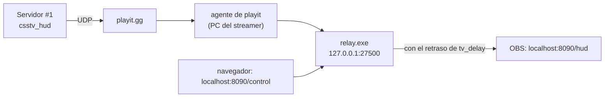

# Relay del HUD de observer

Recibe los paquetes UDP del plugin `csstv_hud`, los retrasa igual que la SourceTV (`tv_delay`) y se los pasa al HUD que se muestra en OBS. Plan y decisiones: [`docs/bitacora/2026-10-22-hud-observer/`](../../docs/bitacora/2026-10-22-hud-observer/PLAN.md).



## Guía para el streamer

### Una sola vez

1. **playit.gg:** crear una cuenta, instalar el agente en *Your computer* y crear un túnel:

   | Campo | Valor |
   |---|---|
   | Tipo | UDP |
   | Port count | 1 |
   | Dirección local | `127.0.0.1:27500` |
   | Proxy protocol | None |

   Pasarle a Daniel, **por privado**, la dirección pública que da playit (dominio y puerto).
2. **Relay:** poner `relay.exe` en una carpeta propia, por ejemplo `Documentos\CMLeague HUD\`, y abrirlo una vez. Crea `relay.json` y se cierra.
   - Windows puede mostrar "Windows protegió tu PC", porque el `.exe` no está firmado: *Más información* → *Ejecutar de todas formas*.
3. Abrir `relay.json` con el Bloc de notas y reemplazar `PEGAR_ACA_LA_CLAVE` por la clave que pasa Daniel. No tocar lo demás.
   - **Íconos del HUD** (feed de kills y tarjetas de los jugadores): el relay usa la fuente del kill feed de ClientMod (`cstrike\resource\clientmodkillfeed.ttf`) y `cstrike\resource\cs.ttf` (el kit), y las busca solo en `C:\CSSv34_ClientMod` a `F:\CSSv34_ClientMod`. Si ClientMod está en otra carpeta, ponerla en `"gameDir"`, con la barra doble: `"gameDir": "D:\\Juegos\\CSSv34_ClientMod"`. Al abrir, la consola dice "Íconos: …" si la encontró.
4. **OBS**, en la escena de la transmisión:
   - Una *Captura de juego* de CS:S, conectado a la SourceTV del servidor #1. Mejor con el juego en 1920×1080.
   - **Encima**, una fuente *Navegador*:
     - URL `http://localhost:8090/hud`
     - Ancho `1920` y alto `1080`
     - El CSS personalizado se deja como viene: hace el fondo transparente.
     - **Desmarcada** la opción "Apagar la fuente cuando no está visible".

### Cada vez que transmite

1. Abrir el agente de playit y `relay.exe`, en cualquier orden.
2. Abrir OBS y conectarse a la SourceTV.
3. Abrir `http://localhost:8090/control` en el navegador normal:
   - Nombres de los equipos. En el **medio tiempo**, tocar *Intercambiar*, porque cambian de lado.
   - Serie: BO1, BO3 o BO5 y, por mapa, cuál es, quién lo eligió y quién lo ganó. El HUD muestra arriba a la izquierda el pick del mapa que corre en el servidor y, sobre cada equipo, los mapas ganados.
   - Jugador enfocado (la tarjeta grande): con un clic o con las teclas 1 a 5 (CT) y 6 a 0 (T). Esc lo saca.
   - Qué partes del HUD se ven.
4. La consola del relay dice cada 10 s si está recibiendo. El HUD aparece **con el mismo retraso que la SourceTV**: si la partida acaba de empezar, tarda esos segundos.

| La consola del relay dice | Qué hacer |
|---|---|
| "Todavía no llegó ningún paquete" | Revisar que playit esté abierto y avisarle a un admin que cargue el host en el servidor |
| "con clave incorrecta" | La clave de `relay.json` no es la del servidor |
| "Sin paquetes hace X s" | No hay jugadores en el servidor, o se cortó playit |
| "No se pudo abrir el puerto 8090" | Hay otro `relay.exe` abierto: cerrarlo |
| "No se encontró la fuente de ClientMod" | El HUD muestra los nombres de las armas en lugar de los íconos. Poner la carpeta de ClientMod en `"gameDir"` |

**Regla mientras el relay corra en la PC del streamer:** en torneos solo transmite alguien neutral. Los datos le llegan a su PC antes que la imagen.

## Para el servidor (admins)

En la consola del panel, sin recargar nada, y lo mismo en `cfg/sourcemod/csstv_hud.cfg` para que no se pierda en el próximo mapa:

```
csstv_hud_host "<dominio de playit>"
csstv_hud_port "<puerto de playit>"
csstv_hud_status
```

La clave está en el `.env` de la raíz (`HUD_RELAY_KEY`) y en el cfg del servidor. `csstv_hud 0` apaga el envío al instante.

## Modo VPS (desde la 2.0.0)

Plan: [`docs/bitacora/2026-10-29-hud-relay-vps/`](../../docs/bitacora/2026-10-29-hud-relay-vps/PLAN.md). Un solo relay en el VPS atiende a todos los servidores: cada uno manda a su propio puerto UDP (del 27500 al 27519) con su propia clave. Todo se administra desde la web (Administración › Servidores y Usuarios) y el relay lo lee de la base cada 30 segundos, sin reiniciar.

- Se activa si `relay.json` (en el VPS, `HUD_RELAY_CONFIG=/etc/cmleague/hud.json`) trae `apiUrl` (la URL de Supabase), `anonKey` y `relayToken` (el token de `hud_relays`, ver el final de `supabase/replanteo/36_hud_relay.sql`). `key` y `udpPort` no se usan: salen de la base.
- Cada streamer entra con su link: `https://hud.cmleague.lat/s/<token>/hud` (OBS) y `/s/<token>/control`, donde elige el servidor. Sin un token válido todo responde 404.
- Lo que elige cada streamer en `/control` se guarda en `$STATE_DIRECTORY/control.json`.
- El relay le informa a la base quién tiene el HUD abierto en cada servidor y cuándo llegó el último paquete (la web lo muestra en Administración › Servidores).
- Las fuentes de los íconos se buscan en `gameDir` (`<gameDir>/cstrike/resource/`), copiadas a mano al VPS.

Para probarlo en local contra la Supabase local: `HUD_RELAY_CONFIG=<ruta>/hud.json STATE_DIRECTORY=<carpeta> node src/main.ts` y `pnpm simular 2 127.0.0.1:<hud_port> <hud_key>`.

## Desarrollo

Node 24 corre el TypeScript directo. No hay dependencias de producción: el HUD recibe los datos por *Server-Sent Events* (`/events`) y la página de control los cambia con `POST /api/control` (solo JSON).

```bash
pnpm install --frozen-lockfile
pnpm test          # pruebas (node:test)
pnpm typecheck
pnpm start         # usa relay.json de la carpeta actual
pnpm simular 3     # partida simulada con tv_delay 3, contra el relay local
pnpm build:exe     # dist/relay.exe (Node + relay + HUD en un solo archivo)
```

| Qué | Dónde |
|---|---|
| Paquetes del plugin | `src/protocol.ts` (el formato está también al principio de `csstv_hud.sp`) |
| Retraso | `src/delay.ts` |
| Estado que ve el HUD | `src/state.ts` |
| HTTP y SSE (solo en `127.0.0.1`; en el VPS, debajo de `/s/<token>/`) | `src/server.ts` |
| Un canal por servidor (clave, cola y estado) | `src/channel.ts` |
| Modo VPS: puertos, streamers y servidor elegido | `src/hub.ts` y `src/remote.ts` (configuración de la base) |
| Fuentes de los íconos (de la instalación del streamer, nunca en el repo ni en el `.exe`) | `src/font.ts` |
| Servidor elegido, nombres, serie de mapas, jugador enfocado y lo que se muestra | `src/control.ts` (se guarda en `relay-control.json`; en el VPS, uno por streamer en `control.json`) |
| HUD y página de control | `public/` |

`relay.exe` pesa unos 90 MB, porque lleva Node adentro. No se versiona (`dist/`): se arma con `pnpm build:exe` y se le pasa al streamer por Drive o similar.
