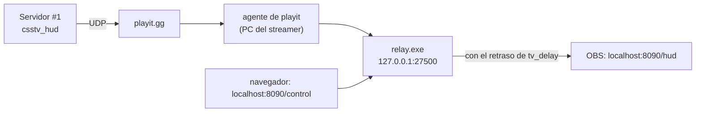

# Relay del HUD de observer

Recibe los paquetes UDP del plugin `csstv_hud`, los retrasa igual que la SourceTV (`tv_delay`) y se los pasa al HUD que se muestra en OBS. Plan y decisiones: [`docs/bitacora/2026-10-22-hud-observer/`](../../docs/bitacora/2026-10-22-hud-observer/PLAN.md).



## Guía para el streamer

### Una sola vez

1. **playit.gg:** crear una cuenta, instalar el agente en *Your computer* y crear un túnel:

   | Campo | Valor |
   |---|---|
   | Tipo | UDP |
   | Port count | 1 |
   | Dirección local | `127.0.0.1:27500` |
   | Proxy protocol | None |

   Pasarle a Daniel, **por privado**, la dirección pública que da playit (dominio y puerto).
2. **Relay:** poner `relay.exe` en una carpeta propia, por ejemplo `Documentos\CMLeague HUD\`, y abrirlo una vez. Crea `relay.json` y se cierra.
   - Windows puede mostrar "Windows protegió tu PC", porque el `.exe` no está firmado: *Más información* → *Ejecutar de todas formas*.
3. Abrir `relay.json` con el Bloc de notas y reemplazar `PEGAR_ACA_LA_CLAVE` por la clave que pasa Daniel. No tocar lo demás.
4. **OBS**, en la escena de la transmisión:
   - Una *Captura de juego* de CS:S, conectado a la SourceTV del servidor #1. Mejor con el juego en 1920×1080.
   - **Encima**, una fuente *Navegador*:
     - URL `http://localhost:8090/hud`
     - Ancho `1920` y alto `1080`
     - El CSS personalizado se deja como viene: hace el fondo transparente.
     - **Desmarcada** la opción "Apagar la fuente cuando no está visible".

### Cada vez que transmite

1. Abrir el agente de playit y `relay.exe`, en cualquier orden.
2. Abrir OBS y conectarse a la SourceTV.
3. Abrir `http://localhost:8090/control` en el navegador normal:
   - Nombres de los equipos. En el **medio tiempo**, tocar *Intercambiar*, porque cambian de lado.
   - Jugador enfocado (la tarjeta grande): con un clic o con las teclas 1 a 5 (CT) y 6 a 0 (T). Esc lo saca.
   - Qué partes del HUD se ven.
4. La consola del relay dice cada 10 s si está recibiendo. El HUD aparece **con el mismo retraso que la SourceTV**: si la partida acaba de empezar, tarda esos segundos.

| La consola del relay dice | Qué hacer |
|---|---|
| "Todavía no llegó ningún paquete" | Revisar que playit esté abierto y avisarle a un admin que cargue el host en el servidor |
| "con clave incorrecta" | La clave de `relay.json` no es la del servidor |
| "Sin paquetes hace X s" | No hay jugadores en el servidor, o se cortó playit |
| "No se pudo abrir el puerto 8090" | Hay otro `relay.exe` abierto: cerrarlo |

**Regla mientras el relay corra en la PC del streamer:** en torneos solo transmite alguien neutral. Los datos le llegan a su PC antes que la imagen.

## Para el servidor (admins)

En la consola del panel, sin recargar nada, y lo mismo en `cfg/sourcemod/csstv_hud.cfg` para que no se pierda en el próximo mapa:

```
csstv_hud_host "<dominio de playit>"
csstv_hud_port "<puerto de playit>"
csstv_hud_status
```

La clave está en el `.env` de la raíz (`HUD_RELAY_KEY`) y en el cfg del servidor. `csstv_hud 0` apaga el envío al instante.

## Desarrollo

Node 24 corre el TypeScript directo. No hay dependencias de producción: el HUD recibe los datos por *Server-Sent Events* (`/events`) y la página de control los cambia con `POST /api/control` (solo JSON).

```bash
pnpm install --frozen-lockfile
pnpm test          # pruebas (node:test)
pnpm typecheck
pnpm start         # usa relay.json de la carpeta actual
pnpm simular 3     # partida simulada con tv_delay 3, contra el relay local
pnpm build:exe     # dist/relay.exe (Node + relay + HUD en un solo archivo)
```

| Qué | Dónde |
|---|---|
| Paquetes del plugin | `src/protocol.ts` (el formato está también al principio de `csstv_hud.sp`) |
| Retraso | `src/delay.ts` |
| Estado que ve el HUD | `src/state.ts` |
| HTTP y SSE (solo en `127.0.0.1`) | `src/server.ts` |
| Nombres, jugador enfocado y lo que se muestra | `src/control.ts` (se guarda en `relay-control.json`) |
| HUD y página de control | `public/` |

`relay.exe` pesa unos 90 MB, porque lleva Node adentro. No se versiona (`dist/`): se arma con `pnpm build:exe` y se le pasa al streamer por Drive o similar.
