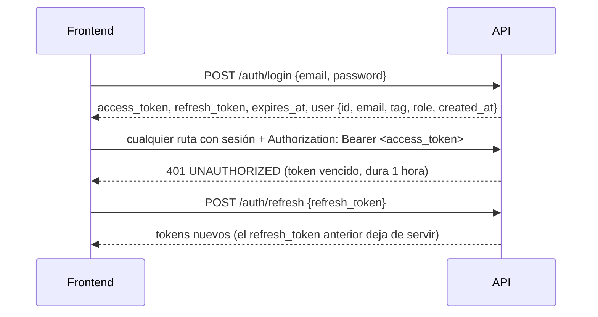
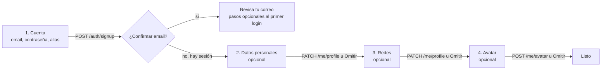
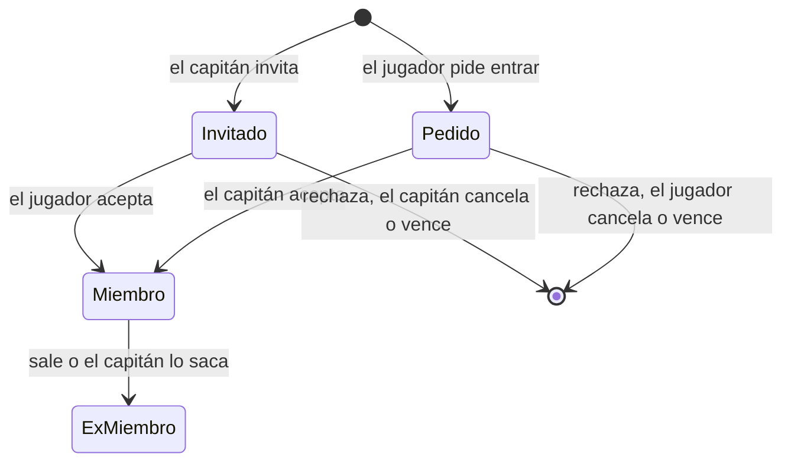
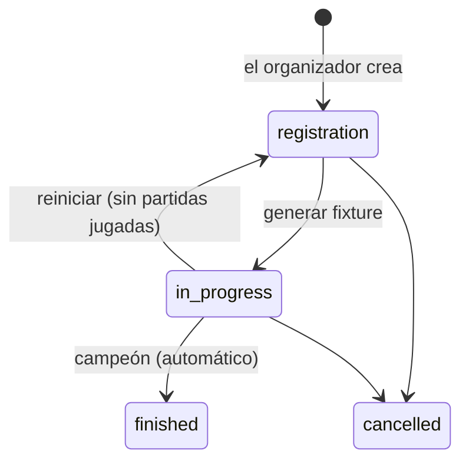

# Contrato para el frontend

> Copia del `contract.md` que entregó el equipo de backend el 2026-10-15. La fuente es el backend: si la OpenAPI (`GET /api/openapi.json`) y este documento no coinciden en un detalle, manda la OpenAPI. Cuando el backend lo suba a `docs/frontend/`, esta copia se reemplaza por un enlace.

Fecha: 2026-10-15. Reúne **todas las decisiones de diseño que afectan al frontend nuevo**, de todas las fases del backend: base y Auth, Mi perfil, replanteo del modelo de datos, `!match`, formatos de PCW, jugadores y equipos, partidas, torneos, PCW y ELO. Al final hay un registro de todas las decisiones con su fecha y su origen. Reemplaza como referencia única a `docs/frontend/2026-10-14-decisiones-para-frontend.md`, que queda como historia.

Los nombres exactos de endpoints, campos y tipos son los de la OpenAPI (`GET /api/openapi.json`). Si este documento y la OpenAPI no coinciden en un detalle, manda la OpenAPI. Las decisiones de diseño (qué se muestra, a quién y con qué reglas) mandan acá.

**Estado de cada parte:**

| Marca | Significa |
|---|---|
| **Disponible** | Implementado y probado en el backend (rama `feat/backend-api-fase-1`), sobre la Supabase local |
| **En implementación** | Aprobado; se está construyendo |
| **Pendiente** | Decidido a grandes rasgos, sin plan de endpoints todavía |

Nada está en producción: el backend y el esquema nuevo se publican juntos en el corte.

## 1. Cómo se consume la API (disponible)

El frontend habla **solo con la API**. No usa `supabase-js` ni la clave pública de Supabase.

| Qué | Dónde |
|---|---|
| Contrato | `GET /api/openapi.json` (OpenAPI 3.1): se pueden generar tipos o un cliente desde ahí |
| Documentación interactiva | `GET /api/docs`: permite probar los endpoints con un token |
| Estado del servicio | `GET /api/health` (`?deep=1` verifica también Supabase) |
| Código y guía | `web/backend/README.md` |
| URL en producción | `api.<dominio>`. El dominio todavía no está comprado: dejar la URL configurable por entorno |

### Sesión



- Guardar los dos tokens. No hay cookies.
- Ante un 401, renovar con `/auth/refresh` una sola vez y reintentar. Si el refresh también da 401, mandar al login.
- El `refresh_token` es de un solo uso: con varias pestañas, que una sola renueve y comparta el resultado.
- Las rutas públicas aceptan el token si viene: con sesión, la respuesta puede traer más datos (por ejemplo, los datos personales de un perfil privado que el usuario puede ver, o si el usuario es capitán de un equipo).
- `user.role` es `user`, `organizer` o `admin`. Las pantallas de admin se muestran solo a `admin`; "Crear torneo" y la gestión de torneos, a `organizer` y `admin` (en un torneo concreto, `viewer.can_manage` dice si puede gestionarlo). La API lo vuelve a verificar.

### Errores

Siempre con este formato:

```json
{ "error": { "code": "VALIDATION_ERROR", "message": "...", "details": [{ "path": "tag", "message": "..." }], "requestId": "..." } }
```

- Decidir qué mostrar según `code`, no según el texto.
- `details` dice qué campo falló: sirve para marcar el input.
- Los mensajes vienen en español.

| `code` | Qué mostrar |
|---|---|
| `VALIDATION_ERROR` | Error en el campo de `details[].path` |
| `BUSINESS_RULE` | El `message` tal cual: está escrito para el usuario (por ejemplo, "El formato BO5 no está habilitado para las PCW") |
| `INVALID_CREDENTIALS` | "Email o contraseña incorrectos" |
| `EMAIL_NOT_CONFIRMED` | "Confirma tu email" |
| `RATE_LIMITED` | Esperar los segundos del header `Retry-After` (login y registro: 10 intentos por minuto) |
| `UNAUTHORIZED` | Renovar la sesión o mandar al login |
| `FORBIDDEN`, `NOT_FOUND` | Mensaje según la pantalla |
| `CONFLICT` | Algo ya existe o está tomado (por ejemplo, un alias). El `message` sirve para mostrar |
| `INVALID_FILE`, `FILE_TOO_LARGE` | Problema con la imagen |
| `INTERNAL` | Error genérico. Mostrar el `requestId` para poder rastrearlo |

### Listados

- Paginados en el servidor: `page` (desde 1) y `per`. La respuesta trae el total para armar el paginador.
- La búsqueda `q` no distingue mayúsculas ni tildes.

## 2. Cuenta y Mi perfil (disponible)

| Endpoint | Notas |
|---|---|
| `POST /auth/signup` | `{ email, password, tag }`. Si hay que confirmar el email, responde `session: null` y `needsConfirmation: true`: mostrar "revisa tu correo". El `tag` es el **alias** (sección 4): `409` si está tomado y `400` con `details[].path = "tag"` si tiene una palabra no permitida. Conviene validarlo antes con `GET /api/v1/aliases/{alias}/available` |
| `POST /auth/login`, `POST /auth/refresh`, `POST /auth/logout`, `GET /auth/me` | |
| `GET /api/v1/me/profile` | Cuenta, detalles, jugador vinculado, equipos actuales y partidas jugadas. `teams` es una lista (un jugador puede estar en varios equipos), con `is_captain` e `is_member`. `matches_played` cuenta las partidas que jugó en el servidor |
| `PATCH /api/v1/me/profile` | Solo se cambian los campos enviados. `null` o `""` borran un campo. Para el alias usar `PUT /me/alias` (sección 4) |
| `POST /api/v1/me/avatar` | `multipart/form-data`, campo `file`. **JPEG, PNG o WebP, máximo 1 MB** (no GIF). Recortar a 256×256 antes de subir |

- **Privacidad del perfil:** público o privado (ya no existe "solo miembros"). Privado oculta los **datos personales** (nombre real, país, redes); la ficha, las stats y las partidas siguen siendo públicas.

### Registro por pasos

Lo único obligatorio es crear la cuenta. Todo lo demás se completa con sesión y se puede omitir.

**Paso obligatorio: `POST /auth/signup`**

| Campo | Reglas |
|---|---|
| `email` | Email válido, hasta 254 caracteres |
| `password` | De 6 a 72 caracteres (Supabase puede exigir más según su configuración) |
| `tag` | El **alias**: de 2 a 24 caracteres, sin `<` ni `>`, único sin distinguir mayúsculas y sin palabras bloqueadas |

- **Alias en vivo:** se valida mientras se escribe con `GET /api/v1/aliases/{alias}/available`. Responde `available` y `reason`: `length`, `chars`, `blocked` o `taken`.
- **Errores del alias:** si está tomado, `409`; si tiene una palabra bloqueada, `400`. En los dos casos `details[0].path = "tag"`.
- **Con confirmación de email** (`needsConfirmation: true`): **no hay sesión hasta que confirme**. Mostrar "revisa tu correo" y ofrecer los pasos opcionales después del primer login.
- **Sin confirmación:** la respuesta ya trae la sesión y se sigue directo.
- **Límite:** 10 intentos por minuto por IP, compartido con el login.

**Pasos opcionales**

- **Datos personales y redes:** `PATCH /api/v1/me/profile`. Exige al menos un campo; si el usuario omite el paso, no se llama. Un paso o dos, da igual: acepta cualquier subconjunto.

  | Campo | Reglas |
  |---|---|
  | `real_name` | Hasta 60 caracteres: letras, espacios, punto, apóstrofe y guion |
  | `country` | Uno de la lista (países de Latinoamérica, España, Estados Unidos, "Otro") |
  | `game_role` | AWPer, Rifler, IGL, Support, Entry fragger, Lurker u Otro |
  | `steam` | SteamID64, `STEAM_X:Y:Z`, link del perfil o nombre de perfil |
  | `faceit` | Nickname o link de faceit.com |
  | `discord` | Nombre de usuario, de 2 a 40 caracteres, sin espacios |

- **Avatar:** `POST /api/v1/me/avatar`, con las reglas de la tabla de arriba.
- **Si el perfil está completo:** se ve en `details` de `GET /api/v1/me/profile`, para ofrecer "completa tu perfil" a quien lo omitió.

**Lo que no se hace en el registro**

- **Vincular el SteamID** (lo que hace falta para entrar a un equipo) **no es** el campo `steam` del perfil, que es solo un dato para mostrar. El vínculo real lo hace un admin al aprobar un reclamo o desde el panel; más adelante será con `!claim` desde el juego. El registro conviene que avise que, para entrar a un equipo, hace falta vincularlo.
- **La privacidad** es del jugador vinculado, no de la cuenta, y hoy la cambia el admin. Una cuenta nueva no tiene jugador.



## 3. Modelo de datos nuevo (lo que cambia respecto de la web vieja)

| Tema | Antes | Después |
|---|---|---|
| **Stats de jugadores** | El admin las cargaba a mano, o salían de los mixes | **Solo salen de partidas jugadas en el servidor**: mixes, y PCW y torneos jugados con `!match`. No hay carga manual. Las stats por mapa también se calculan. Siempre están al día |
| **Mixes** | Cada mix creaba dos equipos `mix` mezclados con los equipos reales | Los bandos van **dentro de la partida**: nombre, jugadores y ganador (bando 1, 2 o empate) de cada lado. Los listados de equipos solo tienen equipos reales (oficiales y PCW) |
| **Jugadores sin cuenta en un mix** | | Quien juega sin estar vinculado aparece en el mix como **invitado** con el nombre que usaba en el juego. Su ELO se calcula igual (por SteamID). Cuando ese SteamID se vincula a un jugador, todos sus mixes pasan a mostrarlo con su alias y la ficha muestra su ELO y stats completos |
| **Miembros de un equipo** | Arreglo de ids | Lista con rol (`player`, `sub`, `coach`) y fechas de alta y baja. El **historial de equipos** sale de ahí |
| **Video y link de demo** | Campos cargados a mano | **Se eliminan.** La demo se descarga desde el botón que usa R2 (estado: `none`, `pending`, `uploaded`, `missing` o `expired`) |
| **IP del servidor de la partida** | Se mostraba para conectarse | Se mantiene |
| **Formato suizo de torneo** | Aparecía como opción sin generar llave | **Vuelve como plantilla nueva**, "suizo + playoffs" al estilo del Major de CS2, con su motor (sección 8b) |
| **Resultados de torneos y PCW** | Cada capitán cargaba mapas, rondas y capturas; un admin aprobaba | **Llegan solos del servidor con `!match`.** A mano los cargan el organizador o el admin. No hay pantalla de reportes ni capturas |
| **Email en el chat de partida** | Se guardaba y se podía leer | La API **no lo devuelve**: el autor se muestra con su alias |
| **Avatar** | Hasta 5 MB y GIF | **1 MB, solo JPEG, PNG o WebP** |
| **Matchmaking** | Cola 1v1 a 5v5 sin terminar | **Se elimina.** No hay pantallas de matchmaking |
| **Reclamar un perfil** | Botón "Reclamar este perfil" → aprobación de un admin | Va a pasar al juego con `!claim <código>` (plan sin aprobar). Mientras tanto `/api/v1/me/profile-requests` y los endpoints de admin de reclamos siguen, **deprecados**. No invertir mucho en esa pantalla |

## 4. Alias (disponible)

Un jugador con cuenta tiene **un solo nombre en la web: el alias**. Une lo que antes eran el tag de la cuenta y el nick del jugador.

- **Dónde se ve:** en todo: menú de la cuenta, Mi perfil, ficha, ranking, listados, planteles, chat.
- **Único:** sin distinguir mayúsculas ni espacios de los bordes. De 2 a 24 caracteres.
- **Quién lo cambia:**
  - **El usuario,** una vez cada **15 días** (`PUT /api/v1/me/alias`). Mostrar cuándo podrá volver a cambiarlo.
  - **El admin,** siempre, para moderar (`PUT /api/v1/admin/users/{id}/alias`).
- **Disponibilidad:** `GET /api/v1/aliases/{alias}/available`, para validar mientras se escribe en el registro y en Mi perfil.
- **Alias tomado:** `409 CONFLICT`. La respuesta de `PUT /me/alias` trae `next_change_at` (desde cuándo puede volver a cambiarlo).
- **Jugadores sin cuenta:** muestran el nombre que les pone el admin. Cuando alguien vincula ese jugador a su cuenta, pasa a mostrar el alias.
- **En el juego** cada uno usa el nombre que quiera: el servidor identifica por SteamID. En cada partida queda registrado el nombre que usó en el juego y la ficha lo puede mostrar como dato de esa partida.
- **Palabras bloqueadas:** un alias, un nombre o sigla de equipo o un nombre de bando de PCW que contenga una palabra de la lista se rechaza con `BUSINESS_RULE`. La comparación ignora mayúsculas, tildes, espacios y los reemplazos típicos (0→o, 1→i, 3→e, 4→a, 5→s, 7→t, @→a, $→s). La lista la gestiona el admin.

## 5. Jugadores (disponible)

- **URLs por id:** `#jugador/<id>` (o la ruta equivalente). El alias cambia, así que no sirve como enlace permanente.
- **Nivel:** lo manda la API ya calculado (1 a 10). Tramos de ELO: 0, 501, 751, 901, 1051, 1201, 1351, 1531, 1751 y 2001. El frontend solo elige el ícono.

| Endpoint | Pantalla |
|---|---|
| `GET /api/v1/players?q=&page=&per=&sort=elo\|alias` | **Jugadores** y **ranking de jugadores** (por defecto, ordenado por ELO): avatar, alias, nivel, ELO, partidas, equipos actuales, rating, K/D |
| `GET /api/v1/players/{id}` | **Ficha:** datos, ELO (actual, pico, partidas), nivel, stats, stats por mapa, medallas, equipos actuales, historial de equipos y datos personales. Si el perfil es privado y el usuario no puede verlos: `details: null` y `private: true` (mostrar "Perfil privado" en esa sección, no en toda la ficha) |
| `GET /api/v1/players/{id}/matches?page=&per=` | **Partidas del jugador:** fecha, mapa, tipo, bandos, resultado, si ganó, sus stats, su cambio de ELO y el nombre que usó en el juego |

## 6. Equipos y plantel (disponible)

### Reglas

| Regla | Detalle |
|---|---|
| Tamaño | Hasta **10** jugadores activos por equipo oficial |
| Cómo se entra | **Estilo FACEIT:** el capitán invita y el jugador acepta, o el jugador pide entrar y el capitán acepta. El admin puede todo, incluso sumar a alguien directamente |
| SteamID obligatorio | Solo puede entrar a un equipo quien tiene **cuenta con SteamID vinculado**. Si no lo tiene, la acción falla: mostrar cómo vincularlo |
| Varios equipos | Un jugador **puede estar en varios equipos** a la vez |
| Torneos | Un jugador no puede estar **inscrito** en un mismo torneo con dos equipos (sección 8b). Entrar a un equipo es libre: lo que se controla es la inscripción |
| PCW | No se puede jugar una PCW si un jugador está en el roster de los dos bandos: aceptarla falla con un mensaje. Al publicar o aceptar, el bando puede jugar **como uno de sus equipos oficiales** (sección 8) |
| Vencimiento | Invitaciones y pedidos vencen a los **7 días** (`expires_at`). Uno abierto por jugador y equipo. Los listados de la API ya excluyen los vencidos |
| Capitán | No puede salir sin ceder antes la capitanía. La cede a un miembro con cuenta |
| Salir o ser sacado | El jugador queda como ex integrante (historial) |
| Equipos PCW | No usan invitaciones: se arman al publicar o aceptar la PCW |



### Endpoints

| Endpoint | Quién | Pantalla |
|---|---|---|
| `GET /api/v1/teams?kind=official\|pcw&q=&page=&per=` | Todos | **Equipos** (por defecto oficiales): nombre, sigla, capitán, jugadores (de 10) |
| `GET /api/v1/teams/{id}` | Todos | **Equipo:** datos, capitán, plantel activo (alias, rol, ELO, nivel), ex integrantes, récord y últimas partidas |
| `GET`/`PUT /api/v1/me/team-request` | Usuario | **Solicitar equipo nuevo** (nombre y sigla), una por usuario. Al aprobarla, el usuario queda como dueño, capitán y primer miembro |
| `GET /api/v1/me/team-invites` | Usuario | **Mis invitaciones** recibidas y pedidos enviados, abiertos |
| `POST /api/v1/teams/{id}/join-requests` | Usuario | Botón "Pedir entrar" en la página del equipo |
| `POST /api/v1/team-invites/{id}/accept` / `…/reject` | Invitado | Aceptar o rechazar |
| `DELETE /api/v1/join-requests/{id}` | Quien pidió | Cancelar su pedido |
| `POST /api/v1/teams/{id}/leave` | Miembro | Salir |
| `GET /api/v1/teams/{id}/pending` | Capitán o admin | **Gestión del equipo:** invitaciones enviadas y pedidos recibidos |
| `POST /api/v1/teams/{id}/invites` | Capitán o admin | Invitar por `alias` o `player_id` (el jugador necesita cuenta y SteamID) |
| `DELETE /api/v1/team-invites/{id}` | Capitán o admin | Cancelar una invitación |
| `POST /api/v1/join-requests/{id}/accept` / `…/reject` | Capitán o admin | Aceptar o rechazar un pedido |
| `DELETE /api/v1/teams/{id}/members/{playerId}` | Capitán o admin | Sacar a un jugador |
| `POST /api/v1/teams/{id}/captain` | Capitán o admin | `{ player_id }`: ceder la capitanía a un jugador con cuenta |

## 7. Ranking de equipos (disponible)

- `GET /api/v1/ranking/teams?pcw=0|1`: posición, equipo, PJ, G, P y puntos.
- **Por defecto cuenta solo torneos.** Un interruptor "Contar también PCW" pasa `pcw=1`: suman las PCW jugadas como el equipo (no las de bandos sueltos).
- **Los puntos son por partida ganada**, no por ganar el torneo entero. Al principio: **30 por partida de torneo** y **5 por PCW**. Los configura el admin y la respuesta trae los valores vigentes, para mostrarlos como leyenda.
- Toda partida de torneo ganada vale lo mismo, sin importar la fase. Los W.O. no suman.

## 8. Partidas, `!match` y PCW (disponible)

### Partidas

| Endpoint | Pantalla |
|---|---|
| `GET /api/v1/matches?kind=&status=&event=&team=&page=&per=` | **Partidas, Resultados y Mixes**: `kind` `official` (torneo), `pcw` o `mix`. Cada una trae `label` con la fase ("Semifinal", "Grupo A · fecha 2", "Suizo · fase 1 · ronda 3"…), los dos bandos con equipo y marcador, y `parent_match_id` si es un mapa vinculado con `!match` |
| `GET /api/v1/matches/{id}` | **Detalle**: serie (`maps_detail`) y mapas jugados (`games`, cada uno es un mix con su propio detalle), roster de cada lado (en torneo, los inscritos; en PCW, el roster con invitados), servidor (para el botón "Conectar"), `demo_url` (mix), stats y MVP (mix), veto, código de `!match` y `viewer` (`can_veto`, `can_chat`, `can_manage`, `is_participant`) |
| `GET /api/v1/matches/{id}/chat?after=<id>` | Chat: los últimos 50, o los nuevos desde un id |
| `POST /api/v1/matches/{id}/chat` · `DELETE /api/v1/chat/{id}` | Escribir (en torneos y PCW: los dos equipos, el organizador y los admins; en mixes, cualquiera con sesión) y borrar el propio |
| `POST /api/v1/matches/{id}/veto` (`{ map, version? }`) | Veto del capitán en su turno |
| `GET /api/v1/maps` | Pool del veto con versiones |

- **Actualización en vivo:**
  - El detalle de partida y de torneo responde con `ETag`. Conviene consultar cada 3 a 5 segundos mandando `If-None-Match` con el último `ETag`.
  - Si no cambió, la API responde `304` sin cuerpo.
  - Para el chat se usa `after` con el id del último mensaje.
- **Veto:**
  - `veto.sequence` es la secuencia de bans y picks según el BO; `veto.next` dice a qué equipo y qué acción le toca (null si terminó).
  - `veto.maps_to_play` trae los mapas en orden con su versión, el decisivo al final.
  - Si el mapa tiene más de una versión (Inferno: `de_inferno` o `de_inferno_classic`), el pick pide elegirla. La versión del decisivo la fija el organizador (en PCW, la normal).
- **Demo:** `demo_url` viene armado cuando la demo está subida; si no, mostrar el estado (`pending`, `missing`, `expired`).

### `!match`

- **Código:**
  - Cada partida de torneo y PCW tiene un **código de 5 caracteres**, que viene en `link_code` del detalle **solo** para los integrantes de los dos equipos, el organizador y los admins.
  - En el servidor, un jugador de un equipo escribe `!match <código>` y alguien del otro lo confirma.
- **Resultado automático:**
  - Cada mapa terminado suma a la serie.
  - Cuando un equipo gana la serie, la partida se cierra sola y el torneo avanza solo: la llave, la ronda siguiente del suizo, los playoffs y el campeón.
  - **No hay pantalla para que los capitanes carguen el resultado.**
- **Si no se pudo jugar en el servidor:** en torneos, el organizador o el admin cargan el resultado (`POST /api/v1/matches/{id}/result`). Una PCW sin `!match` no tiene resultado; solo el admin puede cargarle uno.
- **Overtime:** no hay mapas empatados, el servidor juega overtime.

### Reglas para jugar

| Tipo | Regla |
|---|---|
| Torneo | En el servidor juegan **solo los jugadores inscritos** de cada equipo (sin stand-ins); el mínimo por lado es `players_min` del torneo |
| PCW | Para publicarla o aceptarla hacen falta **4 jugadores con cuenta** (roster de 1 a 7 entre cuentas e invitados). En el servidor cada lado puede sumar hasta **2 stand-ins**; al menos 3 del roster por lado para que cuente |

### PCW

| Endpoint | Pantalla |
|---|---|
| `GET /api/v1/pcw/posts` | Anuncios abiertos: formato, mapas, hora, nota, roster y, si juega como un equipo, cuál |
| `POST /api/v1/pcw/posts` | Publicar: `best_of` (de `GET /api/v1/pcw/formats`), `players`, `guests`, `team_id` opcional, `starts_at`, `maps`, `note`, `name` |
| `POST /api/v1/pcw/posts/{id}/accept` | Aceptar con el roster propio (`team_id` opcional). Devuelve el id de la partida: abrir su detalle |
| `GET /api/v1/me/pcw` | **Mis PCW**: mi anuncio abierto y mis prácticas (pendientes primero) |
| `DELETE /api/v1/pcw/posts/{id}` · `POST /api/v1/pcw/matches/{id}/cancel` | Cancelar mi anuncio o una práctica sin mapas jugados |

- **"Jugar como equipo":** el capitán o dueño de un equipo oficial puede elegirlo al publicar o aceptar. Todo el roster con cuenta tiene que ser de ese plantel y la PCW ganada suma al ranking del equipo (con `pcw=1`). El formulario puede cargar el plantel del equipo elegido.
- **Vencimiento:** una PCW que no se jugó a las 48 h de su hora se cancela sola.

### Formatos de PCW

| Endpoint | Notas |
|---|---|
| `GET /api/v1/pcw/formats` | Sin sesión. `{ formats: [1, 3, 5] }`. El formulario de publicar una PCW ofrece solo esos |
| `PUT /api/v1/admin/pcw/formats` | Solo admin. `{ formats: [1, 3] }`, al menos uno. Pantalla Admin → PCW con tres casillas (BO1, BO3, BO5) que no deja desmarcar la última |

## 8b. Torneos (disponible)

### Quién

- **Organizador:** un usuario con `role = 'organizer'`, que nombra el admin. Crea torneos y en **los suyos** hace todo lo del admin. El admin gestiona todos.
- **En cada torneo,** `viewer.can_manage` del detalle dice si quien consulta puede gestionarlo.

### Plantillas y valores por defecto

El organizador elige una plantilla y ajusta `config`. En cada fase elige **BO1, BO3 o BO5**.

| Plantilla (`template`) | Fases | Por defecto |
|---|---|---|
| `single` (eliminación directa) | Llave | Todas las rondas y la final BO3; 3.er puesto apagado |
| `double` (doble eliminación) | Upper, lower, final del upper, final del lower, gran final | BO3; gran final BO5; **sin reset**; mapa de ventaja apagado |
| `groups` (grupos + playoffs) | Grupos A, B, C… de todos contra todos → playoffs | 2 grupos, clasifican 2; grupos BO1; playoffs y final BO3 |
| `swiss` (suizo + playoffs) | 1 a 3 fases suizas de 16 (u 8) → playoffs | 3 victorias clasifican y 3 derrotas eliminan (2 y 2 con 8); BO1, decisivas BO3; playoffs y final BO3 |

- **Mapa de ventaja** (doble eliminación): el campeón del upper empieza la gran final 1-0, en BO3 o BO5. El marcador ya lo muestra desde el principio.
- **3.er puesto:** opcional. Si se activa, BO3.
- **Grupos:**
  - Victoria 3 puntos, derrota 0.
  - Desempate, en orden:
    1. Puntos.
    2. Diferencia de rondas.
    3. Resultado entre los empatados.
    4. Rondas ganadas.
    5. El organizador.
  - En playoffs, el 1.º de un grupo se cruza con el 2.º de otro.
  - Con 1 grupo y 1 clasificado funciona como una liga.
- **Suizo:**
  - Se cruzan equipos con el mismo récord (0-0, después 1-0 y 0-1…), sin repetir rival.
  - Cada equipo empieza en la fase 1, salvo que el organizador lo ponga en otra (equipos que entran directo, como en el Major).
  - Hacen falta exactamente 16 (u 8) en la fase 1 y la mitad en cada fase siguiente.
- **Empate sin resolver en un grupo:**
  - `tie_pending: { grp }` indica el grupo, y la fila trae `tied: true` en los empatados.
  - El organizador ordena esos equipos con `POST /api/v1/events/{id}/ties` y los playoffs se arman solos.

### Inscripción

- **Quién:** el capitán inscribe a su equipo eligiendo **qué jugadores juegan**, entre `players_min` y `players_max` del torneo (por defecto 5 y 7; máximo 10). Tienen que ser del plantel y tener SteamID.
- **Un jugador, un equipo:** si un jugador ya está inscrito con otro equipo en el mismo torneo, la inscripción falla con un mensaje que nombra al jugador y al equipo.
- **Cambios:** el capitán cambia los inscritos o da de baja al equipo hasta que se genera el fixture. Después, solo el organizador cambia jugadores.
- **Si un inscrito sale del equipo,** deja de estar inscrito. Mostrar un aviso si el equipo queda por debajo del mínimo.

### Flujo



- **Antes de generar:** el formato (plantilla, configuración, inscritos por equipo) y la siembra solo se cambian antes de generar.
- **Después de generar, todo avanza solo** con cada resultado. El organizador puede:
  - Asignar hora y servidor a cada partida (`PATCH /api/v1/matches/{id}`; la lista sale de `GET /api/v1/servers`).
  - Cargar o corregir un resultado (`POST /api/v1/matches/{id}/result` con `maps`, `walkover` o `clear`). Una corrección falla si ya se jugaron partidas que dependían de esa.
  - Marcar **W.O.**: gana el equipo que se presentó. Cuenta para la llave, pero **no suma puntos en el ranking**.
  - Reiniciar el veto de una partida.
- **Borrar un torneo:** solo sin partidas jugadas; si no, se cancela.

### Endpoints

| Endpoint | Quién | Pantalla |
|---|---|---|
| `GET /api/v1/events?status=` | Todos | **Torneos** |
| `GET /api/v1/events/{id}` | Todos | **Torneo**: configuración, inscritos con jugadores y siembra, tablas de grupos y del suizo, partidas (con `stage`, `phase`, `grp`, `round` y `pos` para dibujar la llave), campeón. Con `ETag` |
| `PUT`/`DELETE /api/v1/events/{id}/registrations/{teamId}` | Capitán u organizador | Inscribir, cambiar inscritos (`{ players, start_stage? }`) o dar de baja |
| `POST /api/v1/events`, `PATCH`/`DELETE /api/v1/events/{id}`, `POST …/cancel` | Organizador o admin | Crear, editar, borrar, cancelar |
| `PUT /api/v1/events/{id}/seeds` | Organizador o admin | Orden de siembra (todos los inscritos) |
| `POST /api/v1/events/{id}/generate` · `…/reset` · `…/ties` | Organizador o admin | Fixture y empates |

**Para dibujar las llaves:** las partidas traen `stage` y la posición.
- **`stage`:** `ko`, `third`, `upper`, `lower`, `grand`, `group` o `swiss`.
- **Posición:** `phase` (fase), `round` (columna) y `pos` (fila).
- **Byes:** no vienen en el listado.

## 8c. ELO y stats

| Tema | Decisión |
|---|---|
| A quién se le calcula | A cada **SteamID** que juega un mix en el servidor, tenga o no cuenta o ficha. Al vincular el SteamID a un jugador, su ELO y su historial aparecen completos en la ficha (no se recalcula: ya estaba al día) |
| Valor inicial | 1000 |
| Participación | Quien juega menos del **35 %** de las rondas no recibe ELO; desde el 90 % cuenta completo. Entre medio, proporcional. Valores configurables por el admin |
| Nivel | 1 a 10, calculado por la API con los tramos de la sección 5 |
| Stats | Solo de partidas terminadas en el servidor (mixes, y PCW y torneos con `!match`). Una partida cancelada no cuenta |
| Ranking de jugadores | Es el listado de jugadores ordenado por ELO (`GET /api/v1/players`) |

## 9. Admin

| Pantalla | Endpoints | Estado |
|---|---|---|
| Formatos de PCW | `PUT /api/v1/admin/pcw/formats` | Disponible |
| Organizadores | `PUT /api/v1/admin/users/{id}/role` (`user` u `organizer`); la lista sale de `GET /api/v1/admin/users` | Disponible |
| Pool de mapas | `GET /api/v1/maps` y `PUT /api/v1/admin/maps` (lista completa en orden, con versiones y activos) | Disponible |
| Resultado de una PCW | `POST /api/v1/admin/pcw/matches/{id}/result` (`{ maps }`) | Disponible |
| Partidas huérfanas | `DELETE /api/v1/admin/matches/{id}` (sin stats) | Disponible |
| Torneos | Lo mismo que el organizador, sobre todos los torneos | Disponible |
| Jugadores | Alta, edición y baja (`/api/v1/admin/players`). El nick solo se edita en jugadores sin cuenta (en los vinculados manda el alias). Vincular una cuenta es `PATCH` con `user_id`. La baja falla con mensaje si tiene partidas | Disponible |
| Foto y medallas | `POST /api/v1/admin/players/{id}/photo` (mismas reglas que el avatar), `POST …/{id}/medals`, `DELETE /api/v1/admin/medals/{id}` | Disponible |
| SteamID sin vincular | `GET /api/v1/admin/steam/unlinked`, `POST /api/v1/admin/steam/link` | Disponible |
| Usuarios y alias | `GET /api/v1/admin/users?q=` (alias, rol, jugador). `PUT /api/v1/admin/users/{id}/alias`: si choca con una palabra bloqueada, ofrecer "Guardar igual" (`force: true`) | Disponible |
| Palabras bloqueadas | Lista, alta y baja, y "Nombres actuales que la contienen" (`/api/v1/admin/blocked-words`, `…/hits`) | Disponible |
| Equipos | Alta, edición y baja; sumar a un jugador directamente y cambiar su rol. Nombre o sigla con palabra bloqueada: ofrecer "Guardar igual" (`force: true`). La baja falla si tiene partidas o inscripciones | Disponible |
| Solicitudes de equipo nuevo | Listar (`has_steam` dice si se puede aprobar), aprobar y rechazar | Disponible |
| Puntos del ranking | `GET`/`PUT /api/v1/admin/ranking/config` | Disponible |
| Reclamos de perfil | Listar, aprobar y rechazar | Disponible, **deprecados** |

## 10. Lo que todavía no está definido

- El flujo exacto de `!claim` (dónde se genera y se muestra el código).
- Los endpoints de admin de servidores (tokens, licencias, panel), de la configuración del ELO y de las demos.
- El dominio y las URLs de producción.

## 11. Registro de decisiones

Todas las decisiones de diseño que afectan al frontend, en orden. "Daniel" son las que tomó Daniel; "Propuesta aceptada" son propuestas técnicas que quedaron en un plan aprobado.

| Fecha | Tema | Decisión | Origen |
|---|---|---|---|
| 2026-10-14 | Arquitectura | El frontend habla solo con la API (OpenAPI en `/api/openapi.json`); no usa Supabase directo | Daniel |
| 2026-10-14 | Sesión | Tokens Bearer (sin cookies), renovación con `/auth/refresh` de un solo uso | Propuesta aceptada |
| 2026-10-14 | Hosting | VPS de Hostinger con dominio propio; la URL de la API es configurable | Daniel |
| 2026-10-14 | Avatar | 1 MB, JPEG, PNG o WebP (sin GIF), recortado a 256×256 | Propuesta aceptada |
| 2026-10-14 | Privacidad | Solo público o privado; privado oculta datos personales, no la ficha ni las stats | Daniel |
| 2026-10-14 | Stats | Solo desde partidas jugadas en el servidor; sin carga manual | Daniel |
| 2026-10-14 | Mixes | Sin equipos `mix`: los bandos van dentro de la partida | Daniel |
| 2026-10-14 | Demos | Se quitan los campos manuales de video y demo; la demo sale de R2 | Daniel |
| 2026-10-14 | Matchmaking | Se elimina; no hay pantallas | Daniel |
| 2026-10-14 | Torneo suizo | Se quita de las opciones | Daniel |
| 2026-10-14 | Reclamo de perfil | Va a pasar al juego con `!claim`; los endpoints actuales quedan deprecados | Daniel |
| 2026-10-15 | `!match` | Código de 5 caracteres por partida de torneo y PCW, visible solo para los dos equipos y los admins | Daniel |
| 2026-10-15 | Reglas para jugar | Torneo: 5 en el plantel y sin stand-ins. PCW: 4 con cuenta para publicar o aceptar, hasta 2 stand-ins por lado | Daniel |
| 2026-10-15 | Formatos de PCW | Los decide el admin (BO1, BO3, BO5) | Daniel |
| 2026-10-15 | Plantel | Estilo FACEIT: el capitán invita y el jugador pide entrar | Daniel |
| 2026-10-15 | Tamaño del plantel | Hasta 10 jugadores | Daniel |
| 2026-10-15 | Varios equipos | Un jugador puede estar en varios equipos, pero no en dos del mismo torneo | Daniel |
| 2026-10-15 | PCW con un jugador compartido | No se puede jugar | Daniel |
| 2026-10-15 | SteamID | Obligatorio para entrar a un equipo (y para pedir uno nuevo) | Daniel |
| 2026-10-15 | Alias | Un solo nombre en la web, único; el usuario lo cambia cada 15 días y el admin siempre | Daniel |
| 2026-10-15 | Palabras bloqueadas | Lista del admin; se aplica a alias, equipos y bandos de PCW, con "Guardar igual" para el admin | Daniel (lista); propuesta aceptada (alcance) |
| 2026-10-15 | Jugadores con nick distinto del alias | Pasan a mostrar el alias | Daniel |
| 2026-10-15 | Ranking de equipos | Puntos por partida ganada: 30 de torneo y 5 de PCW, configurables; por defecto solo torneos, con opción de sumar PCW | Daniel |
| 2026-10-15 | PCW en el ranking | Suma solo si el bando juega como uno de sus equipos oficiales | Daniel |
| 2026-10-15 | Torneos | El creador define cuántos inscribe cada equipo (máximo 10) y el formato de las partidas | Daniel |
| 2026-10-15 | URLs | Por id de jugador y de equipo (el alias puede cambiar) | Propuesta aceptada |
| 2026-10-15 | Nivel | Lo calcula la API (1 a 10) con los tramos de la web vieja | Propuesta aceptada |
| 2026-10-15 | Listados | Paginados en el servidor, búsqueda sin tildes ni mayúsculas | Propuesta aceptada |
| 2026-10-15 | Creador de torneos | El admin y los **organizadores** que nombra el admin; el organizador gestiona solo sus torneos | Daniel |
| 2026-10-15 | Resultados | Llegan del servidor con `!match`; a mano solo el organizador o el admin; se quitan los reportes y capturas de los capitanes | Daniel |
| 2026-10-15 | PCW sin `!match` | No tiene resultado (solo el admin puede cargarle uno) | Daniel |
| 2026-10-15 | Plantillas | Eliminación directa, doble eliminación, grupos + playoffs y suizo + playoffs (como el Major de CS2, hasta 3 fases) | Daniel |
| 2026-10-15 | BO | El organizador elige BO1, BO3 o BO5 en cada fase; valores por defecto en la sección 8b | Daniel |
| 2026-10-15 | Gran final | Sin reset; "mapa de ventaja" opcional | Daniel |
| 2026-10-15 | Empates | Overtime obligatorio; en grupos, desempate por diferencia de rondas y después el resto de criterios | Daniel |
| 2026-10-15 | Pool de mapas | dust2_ob, cache, cbble, inferno (normal o classic), mirage_rc1, nuke_old_blue, season, tuscan; el admin lo puede cambiar | Daniel |
| 2026-10-15 | Mapa decisivo con versiones | Lo fija el organizador | Daniel |
| 2026-10-15 | Chat de torneos y PCW | Escriben los dos equipos, el organizador y los admins | Daniel |
| 2026-10-15 | Puntos del ranking | Valor único por partida ganada (no cambia según la fase) | Daniel |
| 2026-10-15 | Motor de torneos | En la base: el torneo avanza solo con cada resultado | Propuesta aceptada |
| 2026-10-15 | W.O. | Avanza el que se presentó; no suma puntos en el ranking | Propuesta aceptada |
| 2026-10-15 | Código de `!match` | Oculto en la base; solo los dos equipos, el organizador y los admins | Propuesta aceptada |
| 2026-10-15 | Partidas sueltas | Se quita "crear partida suelta" | Propuesta aceptada |
| 2026-10-15 | Borrar un torneo | Solo sin partidas jugadas; si no, se cancela | Propuesta aceptada |
| 2026-10-15 | PCW vencidas | Se cancelan solas a las 48 h de su hora | Propuesta aceptada |
| 2026-10-15 | En vivo | `ETag` y `304` en los detalles | Propuesta aceptada |
| 2026-10-15 | Demo | La API arma `demo_url` | Propuesta aceptada |
